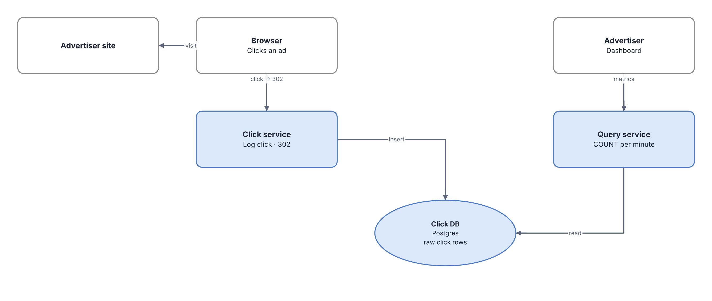
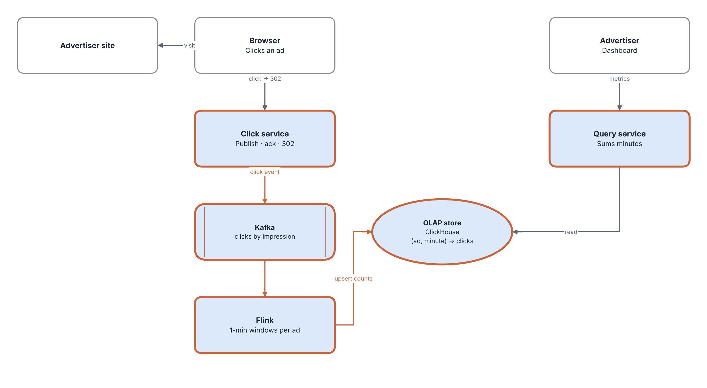
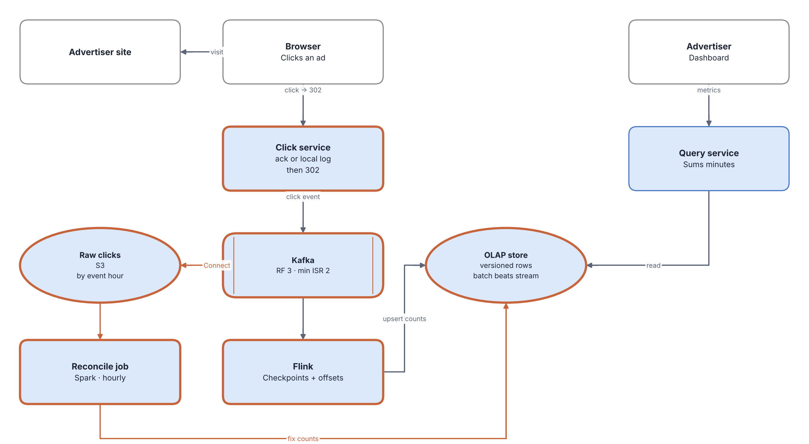
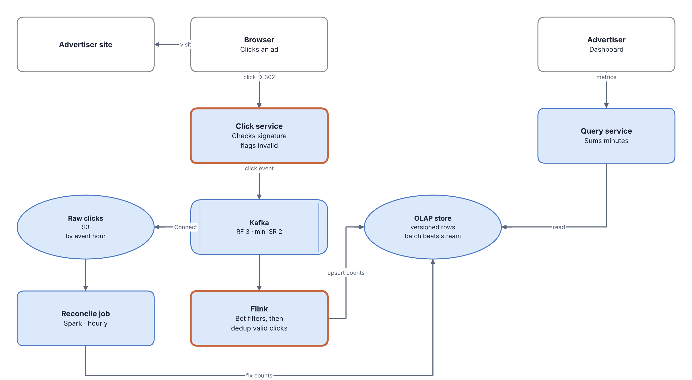
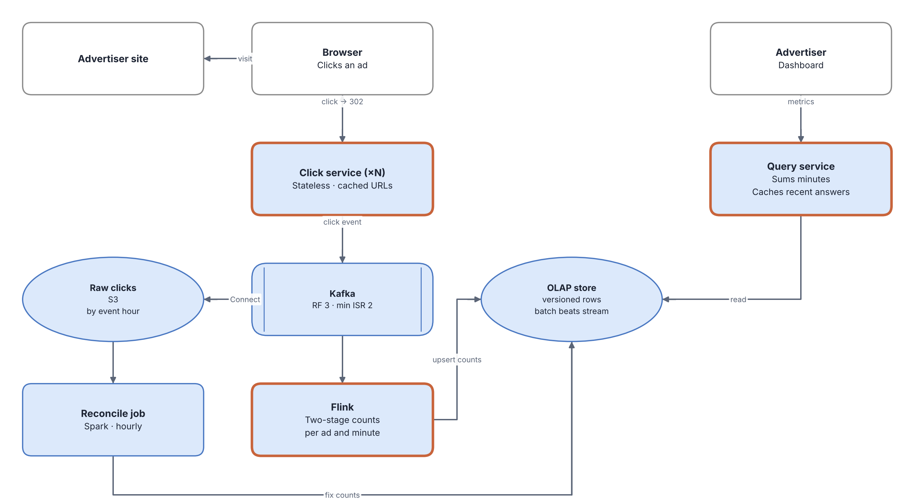

# Ad Click Aggregator · system design, step by step

Whiteboard (Claude artifact): https://claude.ai/artifact/MJPy22FsDLp9PQJWNr2oo5 · PDF: [ad-click-aggregator.pdf](ad-click-aggregator.pdf)

> Part 2 · Design: clicks stream through Kafka into per-minute counts; an hourly batch keeps them exact

## Part 1 · Requirements, API and data model

### Functional requirements

Core requirements:

1. Users can click on an ad and be redirected to the advertiser's website
2. Advertisers can query ad click metrics over time with a minimum granularity of 1 minute

Out of scope: ad targeting, ad serving, cross-device tracking, integration with offline marketing channels

### Non-functional requirements

- **Scale:** 10M active ads; \~10k clicks/s at peak
- **Fast queries:** an advertiser's metrics query answers in < 1 s
- **Fresh:** a click shows up in metrics within \~1 minute
- **Accurate and fault tolerant:** no click is lost and none is counted twice (advertisers are billed on these counts)
- **Fast redirect:** logging adds only a few milliseconds before the user reaches the advertiser's site

### API

**Core**

- GET /click/{ad_id}?impression_id=…&exp=…&sig=… → 302 Found, Location: the advertiser's URL (logs the click on the way)
- GET /ads/{ad_id}/metrics?from=&to=&granularity=1m|1h|1d → [{time, clicks}] (valid clicks, the advertiser's own ads only)

**Below the line**

- Breakdowns by country, device, campaign

Auth: the click URL carries a signed impression; metrics need an advertiser session

### Entities

**Core**

- **ad**: ad_id PK, advertiser_id, target_url
- **click**: impression_id (unique per ad shown), ad_id, cookie_id, timestamp, IP, user agent, valid, invalid_reason
- **click counts**: (ad_id, minute) PK, clicks, invalid_clicks, version (1 h and 1 d are summed from minutes at query time)

**Used by the deep dives**

- **raw clicks** (S3, by event hour): every click, kept for reconciliation

## Part 2 · Design, step by step

Each step redraws the whole diagram. Blue = our services, white = external, circle = storage, orange outline or orange arrow = new or changed in that step.

### Step 0 · Baseline (high-level design)

#### Step 0: works, but has problems

**Core 1 · click:** the ad links to our Click service with its ad_id; the service inserts a click row in Click DB and answers 302 with the advertiser's URL

**Core 2 · metrics:** Query service runs COUNT(*) … GROUP BY minute over the click rows for that ad and time range

**Why start here:** the shortest path that covers both core requirements; make it clear first, then fix problems one at a time

**Problems:**

1. 10k inserts/s into one database, and every dashboard view counts raw rows: billions of rows a month
2. A database outage or a crash loses clicks, and nothing lets us check the counts later
3. Double clicks, retries and bots inflate the counts advertisers pay for
4. One viral ad concentrates its load on a single key

**Next:** each deep dive fixes one problem; new or changed components get an orange outline

### Step 1 · DD1 Fresh, fast metrics: stream and pre-aggregate

#### DD1 · Real-time aggregation

**Problem:** dashboards need per-minute counts in < 1 s, fresh within a minute; counting raw rows per query can't do that

**Added:** Kafka, Flink, an OLAP store of pre-aggregated counts

- Click service publishes each click to Kafka (keyed by impression_id; Flink re-keys by ad_id to count), waits for the broker's ack (a few ms), then returns the 302
- Flink reads the stream and counts clicks per ad in 1-minute tumbling windows by event time. It writes early partial counts every \~10 s and the final count when the window closes (a watermark waits a few seconds for late clicks), so a click shows up within \~10–20 s
- Writes go to the OLAP store as (ad_id, minute) → clicks with a version (Flink: the window's cumulative count of all events, valid and invalid, so it rises with any change and a replay writes the same value; Spark: a higher tier plus its run sequence, so a later recount wins even if lower): ClickHouse ReplacingMergeTree keeps the highest version per key, and queries read it with FINAL (or argMax)
- 1-hour and 1-day points are summed from minutes at query time: 30 days at 1 day is at most \~43k minute rows for one ad, still milliseconds

**Why Flink:** stateful event-time windows with exactly-once checkpoints; Spark Structured Streaming also works, with more latency

**Why an OLAP store:** columnar, partitioned by time and ad (ClickHouse or Pinot, whose upsert tables also fit); Cassandra keyed by (ad_id, day) suits these fixed queries too

**When things fail:** Flink falls behind → metrics lag, but Kafka keeps every click and Flink catches up from its offset

### Step 2 · DD2 No lost clicks: durable log and reconciliation

#### DD2 · Accuracy and fault tolerance

**Problem:** no click may be lost and counts must be exactly right, because advertisers are billed on them

**Added:** raw clicks archived to S3; an hourly Spark reconciliation job

- Kafka holds recent clicks durably: replication factor 3, min.insync.replicas = 2, acks=all, unclean leader election off, 7 days of retention. The 302 goes out only after that ack
- Ack timeout (\~50 ms) → the click goes to a local log on a durable attached volume (fsynced) and is shipped later; the redirect never waits more than that. The volume is drained before an instance is removed
- Flink checkpoints its window state together with its Kafka offsets; after a crash it replays from the checkpoint
- Kafka Connect copies every click to S3, partitioned by event hour. Spark recounts hour H after a \~2 h grace, re-runs any hour that later receives late files, and does a final daily recount before billing
- Spark writes with a higher version than Flink, so a corrected minute is never overwritten by a stream replay; differences are logged and alerted on

**Why stream and batch:** the stream gives freshness; the batch gives a complete, auditable answer

**When things fail:** Kafka unavailable → Click services keep redirecting and keep clicks in their local logs until it's back

### Step 3 · DD3 No double counting: signed impressions, dedup

#### DD3 · Idempotent click counting

**Problem:** the same click can arrive twice (double click, browser retry, our own retry), and bots fake clicks

**Changed:** the ad server signs each impression; clicks are deduplicated on it; validity is a flag, not a drop

- When an ad is shown, the ad server (out of scope) creates a unique impression_id and signs (impression_id, ad_id, expires_at) with HMAC; the click URL carries them
- Click service checks the signature and expiry. Every click is still redirected and published, with valid = false and a reason when the signature is bad, the impression expired, or the ad doesn't match
- Bot filters run first, before dedup: known bot user agents and data-center IPs inline, then bursts per IP in a stage keyed by IP (a burst is only recognised once it crosses the threshold in its window, so its first clicks can still pass; Spark's recount applies burst rules over the whole hour and re-picks the first valid click, and its answer wins)
- Dedup is its own Flink stage keyed by impression_id, after the bot filters: the first *valid* click of an impression counts, in its own minute; later valid repeats are marked invalid. A click already flagged (bot, bad signature) never claims the impression, so a bot click arriving first can't push out the real one. Seen ids stay in state for 24 h (\~1B ids, in RocksDB), and signatures expire within that time
- Spark applies the same rules and loads the previous 24 h of impression ids when it recounts an hour. Where arrival order and event time pick a different "first" click, the difference is alerted and Spark's answer wins
- Counts and charts use valid clicks; invalid ones are counted separately for review

**Why dedup in Flink:** its state is checkpointed with the stream, so dedup survives crashes; a separate cache would be one more system to keep consistent

**When things fail:** dedup state lost → the hourly reconciliation corrects any double counts

### Step 4 · DD4 Scale and hot ads: two-stage counts

#### DD4 · Scale and hot ads

**Problem:** a viral ad can take a large share of the traffic, and counting per ad funnels all its clicks into one Flink task

**Changed:** two-stage counting in Flink; caches on both ends

- Sizing: one Kafka partition takes \~10 MB/s (\~20k small messages/s) and one Flink task tens of thousands of events/s, so even all 10k clicks/s on one ad fits today. Two-stage counting is the plan for 10× growth
- Kafka is keyed by impression_id (DD1), so a hot ad is already spread across all partitions; dedup gets an impression's repeats together by re-keying on impression_id after the bot stage
- This replaces DD1's single count keyed by ad_id (after DD3's dedup). Stage 1, keyed by (ad_id, minute, hash(impression_id) mod P) with a fixed P, emits cumulative counts; stage 2, keyed by ad_id, keeps the latest per sub-key and sums them, so rescaling Flink changes nothing and replays are harmless. Stage 2 sees at most P small records per window, not every click, so a viral ad never overloads one task
- There's still one row per ad and minute in the OLAP store
- Click service is stateless behind a load balancer and autoscales; the redirect target comes from a cached ad_id → URL map, loaded from the ad server's catalog (out of scope, not drawn); Query service checks ad ownership against the same catalog
- Query service caches recent answers for a few seconds; the OLAP store has replicas

**Why two stages:** the merge cost is one partial count per task per minute, regardless of how hot the ad is; no hot-ad list has to be detected and shared

**When things fail:** a Flink task fails → the job restarts from its last checkpoint; Kafka holds the clicks meanwhile
