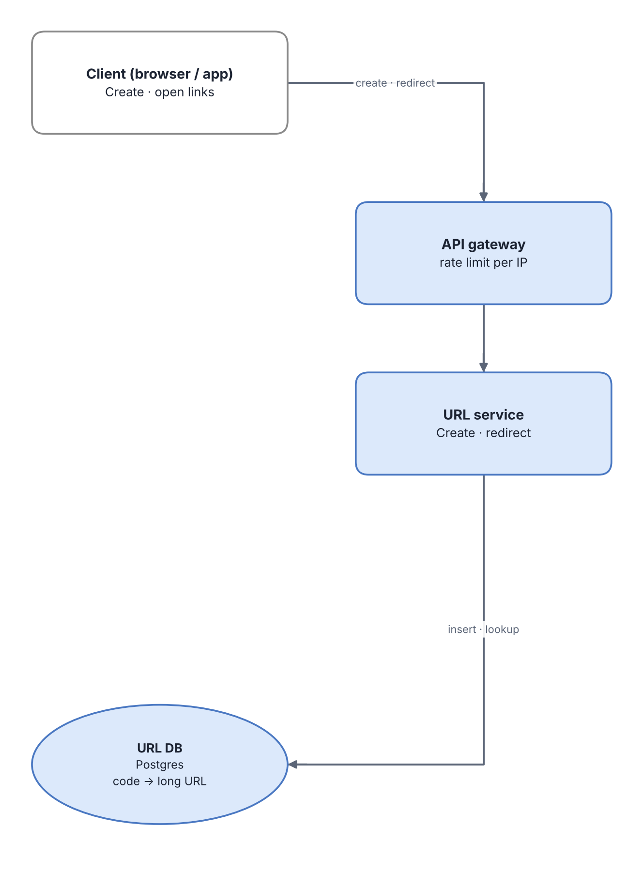
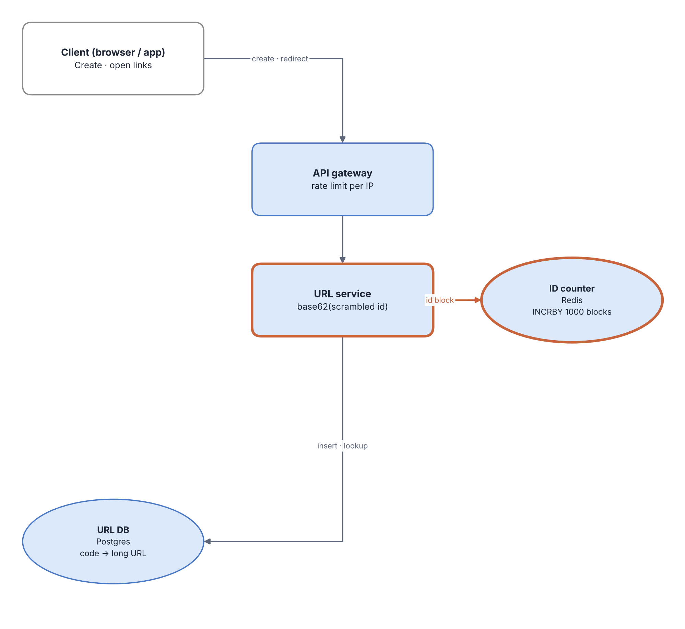
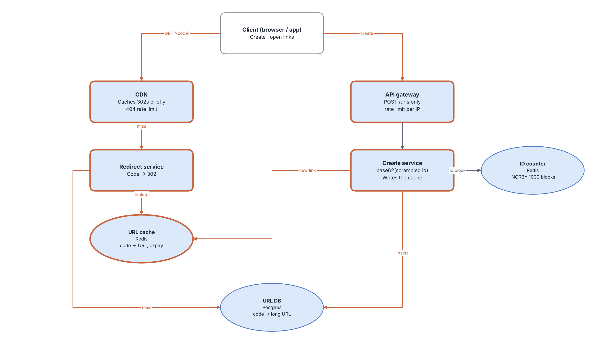
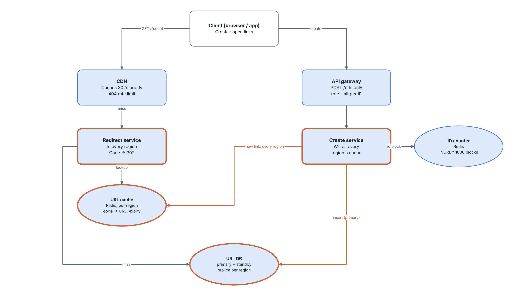
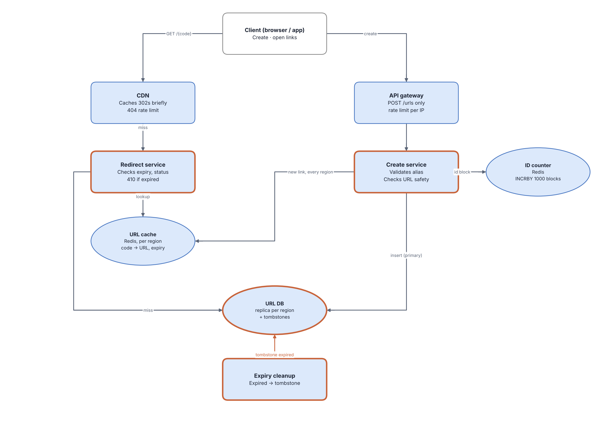

# Bitly · system design, step by step

Whiteboard (Claude artifact): https://claude.ai/artifact/FBE1wf3292vaAq12v5iMCY · PDF: [bitly.pdf](bitly.pdf)

> Part 2 · Design: unique codes from a counter; redirects served from cache and CDN

## Part 1 · Requirements, API and data model

### Functional requirements

Core requirements:

1. Users should be able to submit a long URL and receive a shortened version
- Optionally, a custom alias (e.g. short.ly/my-custom-alias)
- Optionally, an expiration date
2. Users should be able to access the original URL by using the shortened URL

Out of scope: user authentication and account management, analytics on link clicks

### Non-functional requirements

- **Low latency:** a redirect answers in < 100 ms (p95); creating a link < 500 ms
- **High availability:** redirects 99.99%, creates 99.9%; for redirects, availability wins over consistency (a new link may take a moment to reach every region)
- **Uniqueness:** each short code maps to exactly one long URL, forever; custom aliases never collide
- **Scale:** 1B links stored; 100M daily users; \~1B redirects/day (\~12k/s average, \~100k/s peak); \~1M creates/day (\~1,000× fewer than redirects)

### API

**Core**

- POST /urls {long_url, custom_alias?, expires_at?} → short_url (create)
- GET /{short_code} → 302 Found, Location: long URL (redirect); 404 if unknown, 410 if expired or taken down

**Below the line**

- DELETE /urls/{short_code} (needs accounts)

Auth: none (accounts are out of scope); creates are rate-limited per IP

### Entities

**Core**

- **url**: short_code PK, long_url, id (unique; empty for custom aliases), created_at, expires_at, status (active / expired / disabled)

**Used by the deep dives**

- **id counter** (Redis): next id; each server reserves blocks of 1,000
- **cache entry** (Redis, every region): short_code → long_url, expires_at, status

## Part 2 · Design, step by step

Each step redraws the whole diagram. Blue = our services, white = external, circle = storage, orange outline or orange arrow = new or changed in that step.

### Step 0 · Baseline (high-level design)

#### Step 0: works, but has problems

**Core 1 · create:** client → API gateway → URL service, which makes a short code, stores (code → long URL, expires_at) in URL DB and returns https://short.ly/{code}

**Core 2 · redirect:** GET /{code} → URL service looks the code up in URL DB and answers 302 with the long URL

**Why start here:** the shortest path that covers both core requirements; make it clear first, then fix problems one at a time

**Problems:**

1. How do many servers make codes that are short and never collide?
2. Redirects are \~1,000× more frequent than creates and must be fast, yet every one hits the database
3. 1B links and \~100k redirects/s at peak; one database in one region is a single point of failure
4. Expired links must stop working, custom aliases need rules, and short links are used to hide phishing

**Next:** each deep dive fixes one problem; new or changed components get an orange outline

### Step 1 · DD1 Unique short codes: add an ID counter

#### DD1 · Unique short codes

**Problem:** codes must be short (7 characters), unique, and made by many servers at once without a round trip per create

**Options:**

- Hash the long URL (MD5, keep 7 base62 chars): collisions need a check-and-retry, and the same URL always gets the same code
- Random 7 chars: simple, but collision checks get more frequent as the table fills
- Counter + base62 (chosen): every id is unique by construction; 62^7 ≈ 3.5 trillion codes, plenty for 1B links

**Added:** ID counter in Redis

- Each URL service instance reserves a block with INCRBY 1000 and hands ids out from memory, so Redis sees one call per 1,000 creates
- Sequential codes are guessable and reveal volume, so the id first goes through a reversible scramble: a Feistel cipher over 42 bits (2^42 ≈ 4.4T), re-applied until the result is < 62^7 (cycle-walking). Still exactly one code per id
- code = base62 of that value, left-padded to exactly 7 characters
- The insert is conditional on the code not existing (primary key), the final guard against any repeat. If a custom alias already took that code, the server just uses the next id
- Custom alias: insert with the alias as the code; if it exists → 409 "alias taken"

**Why Redis:** atomic INCRBY and tiny load thanks to blocks, and it keeps id handout off the database; a Postgres sequence would also work at this write rate

**When things fail:**

- An instance crashes holding unused ids → those ids are never used; gaps are fine
- Redis keeps the counter durable (AOF, fsync on every write: cheap at one INCRBY per 1,000 creates). A promoted Redis replica is bumped by a margin (e.g. +1M) before it serves; if the counter is lost, rebuild it from MAX(id) in URL DB plus a margin

### Step 2 · DD2 Fast redirects: cache, CDN, separate services

#### DD2 · Fast redirects

**Problem:** \~100k redirects/s at peak with p95 < 100 ms; popularity is very skewed (a few links get most clicks)

**Added:** separate Redirect service, Redis cache, CDN

- Reads and writes are split: the Redirect service is stateless and scales on its own; the Create service stays small
- Cache-aside: look the code up in Redis (code → long URL, expires_at, status); on a miss, read the database (one read per code at a time) and fill the cache with SET NX, so a fill never overwrites what Create service wrote (TTL 24 h, or until the link expires if sooner)
- Create service writes each new link into the cache right away, replacing any cached "not found"
- Hot set: 1B links × \~500 bytes ≈ 500 GB in total; the \~20% that get almost all clicks (\~100 GB) fit a Redis cluster
- CDN in front: 302s for popular codes are cached at the edge with Cache-Control s-maxage ≤ 5 min (never past expires_at) and max-age=0, so the CDN keeps them but browsers don't
- 302, not 301: browsers keep a 301 forever, so we could never expire or change the link; 302 keeps control (and would allow click counting later)
- Unknown codes are cached as "not found" for \~10 s, and the CDN rate-limits 404s per IP, so guessing codes can't hammer the database

**Why Redis:** sub-millisecond lookups and LRU eviction; Memcached would also work

**When things fail:**

- A Redis node is lost → its keys miss and fall back to URL DB, one read per code
- The CDN has an outage → traffic goes straight to the Redirect service, which is sized for full load

### Step 3 · DD3 Scale and availability: replicas, regions

#### DD3 · Scale and availability

**Problem:** 1B links, 99.99% redirect availability, users worldwide

**Changed:** URL DB gets a standby and read replicas; Redirect service and cache run in every region

- Size: 1B links × \~500 bytes ≈ 500 GB, which fits one Postgres primary; writes are only \~12/s (peaks of a few hundred)
- Each region has Redirect service instances, a Redis cache and a read replica; redirects never leave the region
- Create service writes each new link into every region's cache (asynchronously, retried), so it works everywhere before the replicas catch up; a cache miss is answered by the local replica alone
- The primary (one region) takes the rare creates, with a synchronous standby beside it: if the primary fails, the standby is promoted (creates pause \~1 min, no confirmed link is lost); cross-region replicas stay asynchronous
- If writes or size grow 10×, shard by hash of short_code; a key-value store (DynamoDB, Cassandra) fits this access pattern equally well

**Why Postgres:** small, simple data with a unique key; replicas are easy

**When things fail:**

- Primary down → creates fail briefly; redirects continue from replicas and caches
- A region's cache write fails → retried; at worst a new link answers 404 there for \~10 s
- A whole region down → DNS sends redirects to the next region. If it's the primary's region, a replica elsewhere is promoted: creates pause for minutes, the last seconds of async writes may be lost, and the counter is rebuilt from MAX(id) + margin, so no code is reused

### Step 4 · DD4 Expiration, custom aliases, abuse

#### DD4 · Expiration, custom aliases, abuse

**Problem:** expired links must stop working promptly, aliases need rules, and short links are used to hide phishing

**Added:** Expiry cleanup job; checks when creating

- Every redirect checks expires_at and status (cache entries carry both): expired → 410 Gone, even if the row still exists
- Cached 302s never outlive expires_at, so no cache serves an expired link; the 410 itself is cached for long in Redis and at the CDN, since a code is never reissued
- The cleanup job turns expired rows into tombstones in small batches (index on expires_at): long URL cleared, code kept, so it keeps answering 410 and is never handed out again, as an alias or otherwise
- Custom aliases: 3–30 characters of [A-Za-z0-9_-], reserved words blocked (api, admin, …)
- Abuse: on create, the long URL is checked against a malicious-URL list (e.g. Google Safe Browsing, an external API, not drawn); the gateway rate-limits creates per IP
- Takedown: status = disabled (410); a disabled entry is written into every region's cache (not deleted, so a lagging replica can't refill the live URL), then the CDN is purged: it stops within seconds

**When things fail:** cleanup job behind → expired rows stay a little longer, but redirects already refuse them, because expiry is checked on every read
