# ChatGPT · system design, step by step

Whiteboard (Claude artifact): https://claude.ai/artifact/8ptdpGaCZLAaqZXrkmoVXW · PDF: [chatgpt.pdf](chatgpt.pdf)

> Part 2 · Design: decouple generation from the connection; queue GPUs by priority

## Part 1 · Requirements, API and data model

### Functional requirements

Core requirements:

1. Users should be able to send a prompt in a chat and receive an AI-generated response
2. Users should be able to view past chats and resume a conversation, with the chat's prior context carried into the prompt

Below the line (covered in the deep dives): stop a reply, regenerate, delete a chat

Out of scope: files, tools, memory, voice

### Non-functional requirements

- **Low latency:** the first words of a reply show up in < 1 s, then the rest streams in smoothly
- **Reliable streaming:** if the network drops or the page reloads, the reply picks up where it left off, with no lost text
- **High availability:** 99.9% (≈ 44 min down per month). When GPUs are overloaded, free users get a smaller model or "try again later" (429) instead of everyone failing
- **Durability:** a message the user sent, and a reply once it's finished, are never lost
- **Scale:** 1B messages/day ≈ 12k/s on average (\~30k/s at peak); about 300k replies streaming at the same time at peak

### API

**Core**

- POST /conversations → conversation_id (start a new chat)
- POST /conversations/{id}/messages {client_message_id, content, parent_id} → message_id, stream_token (send a prompt)
- GET /streams/{message_id} → the reply, streamed over SSE (Last-Event-ID resumes after a disconnect)
- GET /conversations?cursor= → my chats, newest first
- GET /conversations/{id}/messages → a chat's history, to resume it

**Below the line**

- POST /messages/{id}/cancel (stop) · regenerate = send with parent_id of an earlier message · DELETE /conversations/{id}
- GET /messages/{id}/stream_token → a fresh stream token if the old one expired

Auth: user JWT on every call; the stream uses its short-lived stream token

### Entities

**Core**

- **conversation**: conversation_id PK, user_id FK, title, created_at, last_activity_at, deleted_at
- **message**: partition (conversation_id, bucket), message_id (ULID); parent_id, role (user / assistant), content, state, tokens
- **conversations_by_user**: partition user_id, clustered by created_at; last_activity_at (the chat list)

**Used by the deep dives**

- **message_dedupe**: (conversation_id, client_message_id) PK → message_id, generation_id, state
- **reply_chunk**: (message_id, epoch, offset) → text (checkpoints + final reply)
- **generation** (DynamoDB): generation_id PK, message_id, conversation_id, user_id, epoch, winning_epoch, lease_until, state
- **conversation_lock** (DynamoDB): conversation_id PK → generation_id, lease_until
- **usage**: (user_id, date#model) PK, tokens

## Part 2 · Design, step by step

Each step redraws the whole diagram. Blue = our services, white = external, circle = storage, orange outline or orange arrow = new or changed in that step.

### Step 0 · Baseline (high-level design)

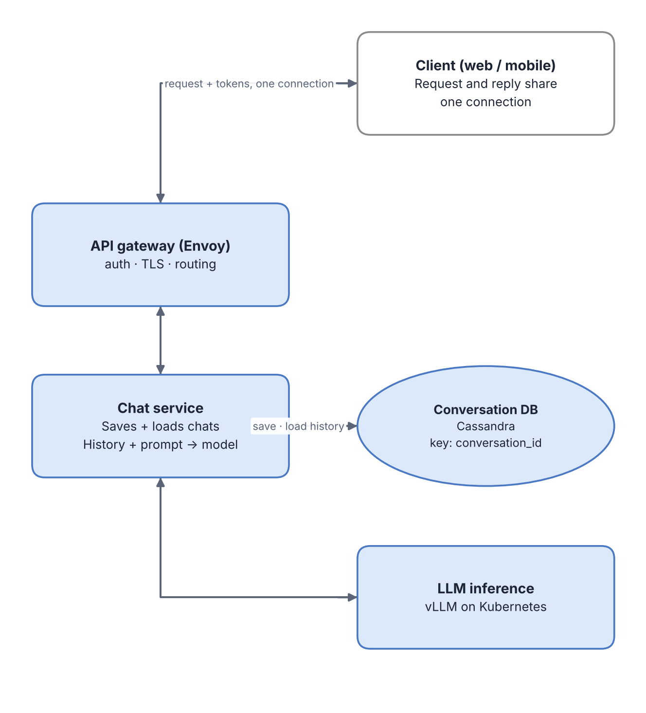

#### Step 0: works, but has problems

**Core 1 · send a prompt:** client → gateway → Chat service saves the message, loads the chat's earlier messages and sends them with the new prompt to the LLM → tokens stream back the same way → the finished reply is saved

**Core 2 · past chats:** the chat list and a chat's history are read from Conversation DB. Resuming a chat needs nothing special: the next prompt is built from that history

**Why start here:** the shortest path that meets both core requirements; make it clear first, then fix problems one at a time

**Problems:**

1. Generation is tied to the connection: if the network drops, the reply is lost
2. GPUs are scarce and expensive; with no queue or priority, everything times out under load
3. No rate limits or metering, so no per-tier pricing
4. Long chats overflow the model's context window; the DB keeps growing; no moderation, and deletes aren't complete

**Next:** each deep dive fixes one problem; new or changed components get an orange outline

### Step 1 · DD1 Streaming & resume: add Streaming gateway, Stream buffer

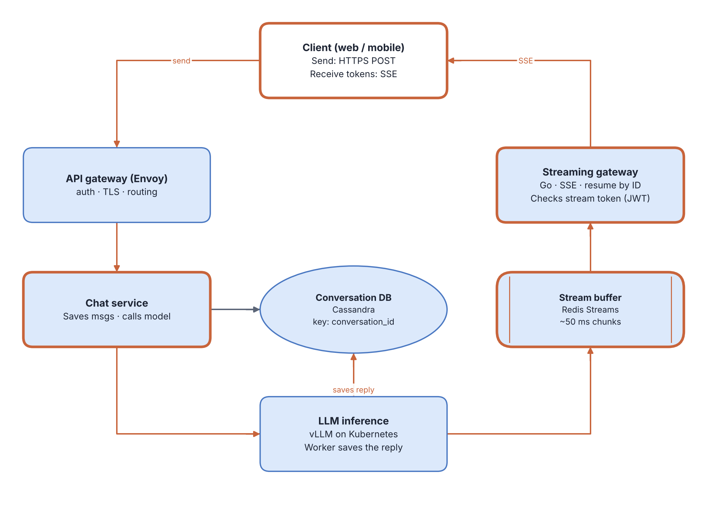

#### DD1 · Streaming and resume

**Problem:** tokens must reach the user while they're generated; a dropped network, a backgrounded app or a page refresh must not lose them

**Added:** Streaming gateway, Stream buffer

- Sending is a normal POST that returns the reply's message_id and a stream token; tokens come back over SSE — two separate paths
- Stream token: signed (JWT), valid 5 min, bound to user_id + message_id, checked when a connection opens. A client coming back later gets a fresh one with its user JWT, so guessing a message_id gets nothing
- The GPU worker writes to the Stream buffer in \~50 ms chunks (one XADD per chunk, not per token), never straight to the client
- Each entry's ID is its text offset. After a disconnect the client reconnects with Last-Event-ID and gets only what it hasn't shown
- A disconnect doesn't stop generation. The GPU worker owns the reply: it appends a checkpoint to Conversation DB every \~2 s and saves the final reply when done. The buffer is only a short-lived cache (TTL 10 min)

**Why SSE:** one-way push is all we need; it's plain HTTP, so proxies and load balancers handle it. Browser EventSource reconnects by itself but can't set headers, so the web client passes the token in the URL or uses fetch; mobile apps implement the reconnect themselves

**Why Redis Streams:** XREAD resumes from any entry ID; MAXLEN + TTL cap memory. Sharded by message_id across a Redis Cluster (\~40 shards at peak)

**Why Go:** goroutines are cheap, so one machine holds hundreds of thousands of idle connections

**When things fail:**

- Streaming node dies → the client reconnects to another node and replays from the buffer
- Redis loses a shard → the worker continues from its last checkpoint and sends reset(offset), so clients cut their text back to the same point
- Deploys → drain long-lived connections before taking a node down

### Step 2 · DD2 GPU scheduling: add GPU scheduler

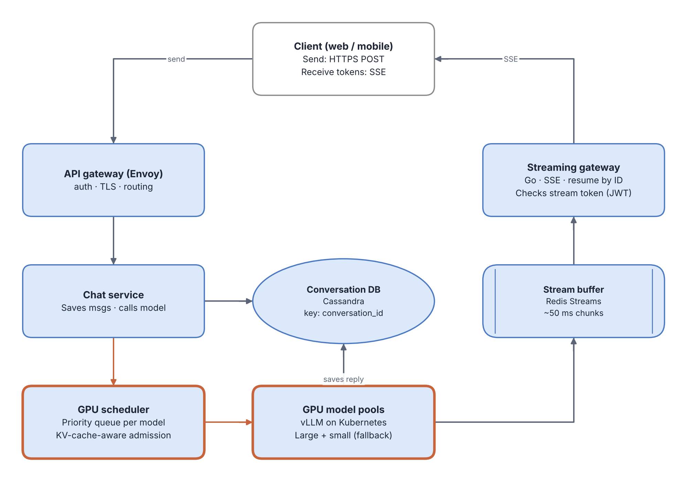

#### DD2 · GPU scheduling and capacity

**Problem:** GPUs are expensive and take minutes to scale; during a traffic spike everything times out

**Added:** GPU scheduler; GPUs split into a large-model pool and a small-model pool

- Queue by model + priority (paid > free)
- Admit by cost, not request count: cost = prompt tokens + max_tokens, and a request goes only to a replica with enough free KV-cache memory (the real limit)
- When the queue is full, return 429 + Retry-After instead of queueing forever
- Prefix affinity: the same conversation goes to the same replica to reuse its prompt cache; if that replica is busy or gone, take the least-loaded one
- Long free-tier generations can be preempted (paused, KV cache dropped) when paid requests wait
- At large scale, prefill and decode run on separate GPU pools (better time to first token and throughput)
- Under overload, fall back to the small model; scale out early on queue depth and keep headroom
- Stop: POST /messages/{id}/cancel → the scheduler tells the worker to stop; a generation nobody has read for 5 min is stopped too

**Why vLLM:** continuous batching and paged KV cache keep GPU utilization high; Kubernetes manages the GPU nodes

**Why this scheduler:** start from an open-source router (llm-d, KServe, Ray Serve) for KV-cache and prefix-aware routing, and add our product rules on top: tiers, quotas, cancellation, fallback models. Its queues are in Redis (leases in DynamoDB, DD6), and it only places requests, so it isn't on the per-token path

**When things fail:**

- GPU worker dies → missed lease renewals; the generation moves to another worker and continues from the text already sent (DD6)
- A whole pool is down → switch to the other pool and run degraded

### Step 3 · DD3 Rate limits & metering: add Rate limiter, Kafka, Usage

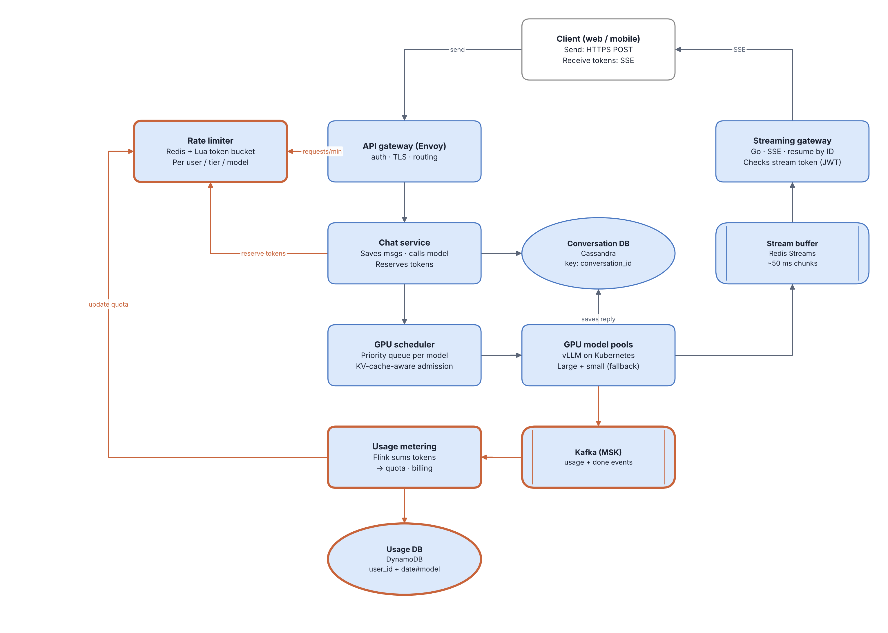

#### DD3 · Rate limits, quotas and metering

**Problem:** usage must be limited per tier and billed per token; when GPUs are tight, paid users come first

**Added:** Rate limiter, Kafka, Usage metering, Usage DB

- Two checks: the gateway limits requests per minute; Chat service reserves tokens, because only Chat knows the real prompt size (after it builds the context)
- Token buckets per user, tier and model, in Redis
- Reserve prompt tokens + max_tokens before generating; settle with the real count when the reply finishes. A reservation has a TTL (10 min), so a crash gives the tokens back instead of leaking them
- Each finished generation emits one usage event keyed by generation_id → Kafka → Flink → Usage DB (billing, monthly quotas, analytics)
- The token count is also saved on the message in Conversation DB, and a daily job compares it with Usage DB, so a lost event is found and re-sent

**Why Redis + Lua:** one script checks and deducts atomically, so no overspending, in under 1 ms

**Why Kafka + Flink:** billing needs exact totals: Flink checkpoints + dedupe by generation_id; several consumers (billing, analytics) read the same events and can replay

**Why DynamoDB:** pk = user_id, sk = date#model; simple queries, auto-scaling

**When things fail:**

- Rate limiter down → fail open for a few minutes with Envoy's local per-instance limit; usage is still billed later from Usage DB
- Kafka down → generation continues; the daily job publishes the missing usage from Conversation DB
- Flink down → restore from the checkpoint, dedupe by generation_id

### Step 4 · DD4 Storage & cold data: add cache, context builder, S3

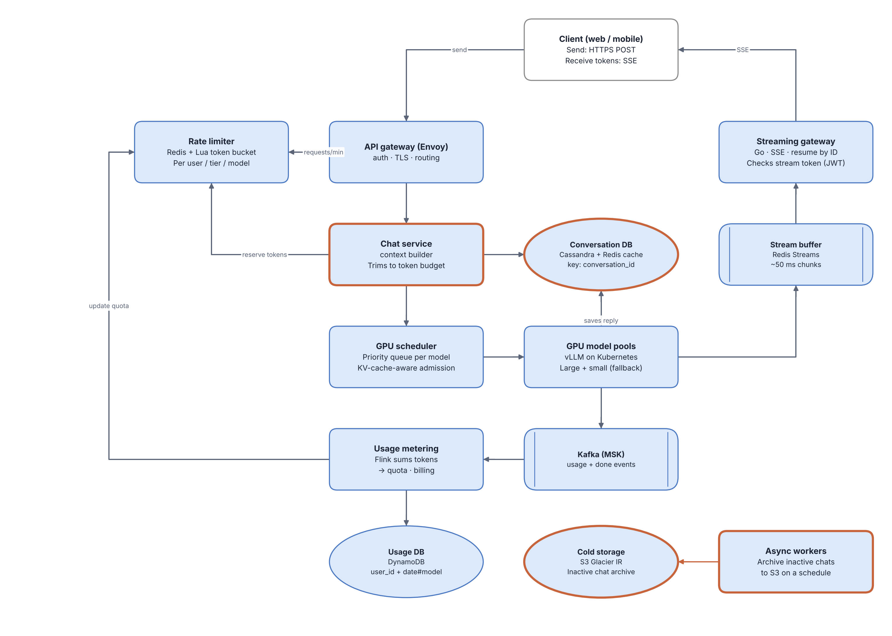

#### DD4 · Storage, context and cold data

**Problem:** 2–3 TB of new messages per day; building context must be fast; old conversations sit on expensive storage

**Added:** context builder in Chat service; Redis cache for Conversation DB; Async workers + Cold storage

- messages: partition (conversation_id, bucket), clustered by message_id (ULID, time-ordered). A new bucket every 1,000 messages keeps very long chats from making huge partitions
- Sidebar: conversations_by_user is clustered by created_at and keeps last_activity_at as a normal column (overwriting it leaves no tombstone; changing a clustering key would). The "most recent first" order is a per-user Redis sorted set, rebuilt from that column if lost
- Messages form a tree (parent_id): regenerate creates a new branch
- The context builder walks up the current branch and trims to the token budget; older turns are compressed into a summary
- Very long messages go to S3; the row keeps a pointer. Recent turns of active conversations are cached in Redis
- Conversations untouched for 6 months are moved to S3 by Async workers; opening one copies it back first. They're removed from Cassandra by deleting whole partitions, which leaves one tombstone instead of one per row

**Why Cassandra:** write-heavy, one partition per conversation read in order, multi-region replication. Check-and-set is needed only for dedupe (LWT); leases, epochs and the final commit live in DynamoDB (DD6)

**Why S3 Glacier Instant Retrieval:** reads in milliseconds, so reopening an old chat feels instant. Glacier Flexible / Deep Archive take minutes to hours, so they only hold backups

**When things fail:**

- Cassandra node down → quorum reads and writes keep working
- Redis down → read Cassandra directly, just slower; the sidebar order is rebuilt
- Archive fails halfway → write to S3, verify, then delete; safe to rerun

### Step 5 · DD5 Safety & privacy: add Moderation, Output guard, deletion

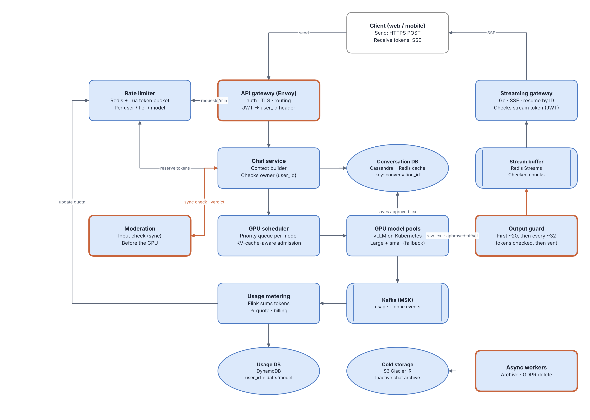

#### DD5 · Safety and privacy

**Problem:** users must never see each other's chats; harmful content must be stopped, also mid-stream; users must be able to truly delete their data

**Added:** Moderation (input), Output guard (output), deletion in Async workers

- Ownership: the API gateway turns the JWT into a user_id; Chat service checks conversation.user_id on every read and write (the gateway can't know who owns what); streams are protected by the stream token (DD1)
- Input: Moderation checks the message synchronously before it goes to the GPU; a flagged message gets a policy refusal, releases the reservation and marks the dedupe row `rejected`
- Output: the GPU worker streams raw text to Output guard instead of the buffer. The guard releases text in small steps — the first \~20 tokens with a fast classifier, then every \~32 tokens (each step 20–50 tokens) — and each check sees the previous \~200 tokens, so content split across steps is still caught. With the input check (\~50 ms) this puts the first text at \~0.5 s, within the < 1 s goal. The buffer's chunks are now these release steps, not 50 ms chunks
- The guard returns the approved offset; the worker saves checkpoints and the final reply only up to it, so the DB never holds unchecked text. Guard writes carry the worker's epoch and pass the same epoch check (DD6)
- On a violation the guard stops the generation and writes a `stopped` event; the reply is cut at the approved offset
- Output options: check each chunk before sending it (ours: small delay, nothing unchecked shown) or stream first and pull the message back later (no delay, but it may already be read; low-risk only)
- Sizing: \~1.5 checks per stream per second → \~450k checks/s at peak, batched on GPU classifiers
- Delete: set a deleted flag so it disappears at once; Async workers then purge Cassandra, Redis, S3 and analytics data. Usage events (no content) stay

**Why separate services:** moderation changes often and scales on its own GPUs, apart from chat logic. Encryption at rest; no chat content in logs

**When things fail:**

- Input moderation down → a smaller on-host classifier before the GPU; if that fails, refuse "try again": reservation released, dedupe row left retryable
- A guard node dies → the worker resends from the last approved offset to another guard node; the guard keeps no other state
- Guard overloaded → hold the stream rather than release unchecked text; after a few seconds end the reply with an error
- Delete task fails → it retries until it succeeds (SQS in DD6)

### Step 6 · DD6 Reliability: add SQS, fenced leases, idempotency, multi-region

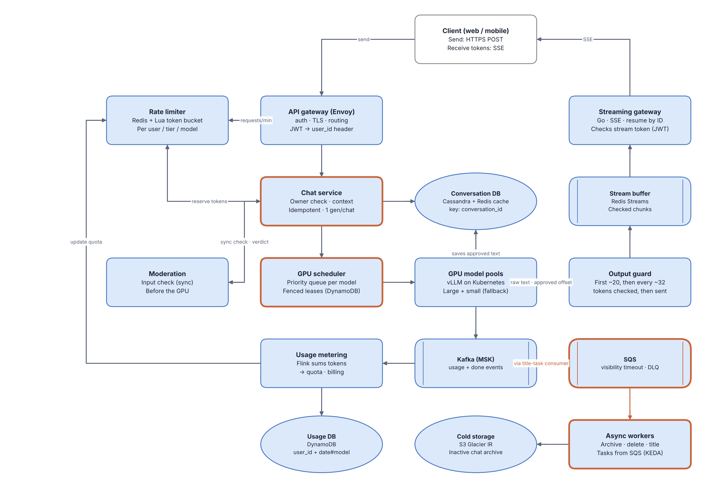

#### DD6 · Reliability and multi-region

**Problem:** async tasks (delete, archive, title generation) can fail; GPU workers can die mid-generation; clients submit twice; a whole region can go down

**Added:** SQS (+ DLQ); fenced leases in GPU scheduler (DynamoDB lease table, lines not drawn); idempotency in Chat service

- Send flow: (1) dedupe row (conversation_id, client_message_id) IF NOT EXISTS, state `pending`, holding the message_id and generation_id chosen now; (2) reserve tokens; (3) input moderation; (4) conversation lock — held by another reply → 409; (5) save the user message and an empty reply `queued`; (6) hand it to the scheduler; then mark the dedupe row `committed`
- A retry that finds `committed` returns the stored ids. One that finds a stale `pending` or a `rejected` row re-runs the steps with the same ids; every step is an idempotent upsert, so nothing is written twice
- A 429 marks the reply and the dedupe row `rejected` and releases this request's lock and reservation; a 409 only releases this request's reservation and leaves the other reply's lock alone. A sweeper re-queues replies stuck in `queued` with no lease
- Reply states: queued → running → done / stopped / failed / rejected
- Leases and epochs live in DynamoDB with conditional writes (linearizable), not Redis. A worker renews its lease every \~5 s (\~60k writes/s at peak); each handover bumps the epoch. The conversation lock is a DynamoDB item renewed with the lease and released on done, cancel or error
- Fencing the stream: every buffer write goes through a Lua script that checks a per-stream epoch key in the same hash slot ({message_id}), so a paused worker's writes are rejected once it has lost its lease
- Takeover: the new worker first sets that key to epoch + 1, then continues from the stream's tail (text users may already see), not from the older checkpoint. If the tail was lost, it continues from the checkpoint and sends reset(offset)
- Fencing the DB: checkpoints and the final reply are rows keyed (message_id, epoch, offset), safe to repeat. One DynamoDB conditional write (epoch = mine → done, winning_epoch = mine) commits, and readers use the winning epoch's rows; the commit is retried until it succeeds
- Usage is counted once per generation_id, however many workers touched it
- Async tasks go through SQS: a small consumer (the Kafka → SQS line) turns completion events into title tasks. Lines not drawn: Chat → SQS (deletes, archives); title tasks → scheduler (small model, lowest priority)

**Why SQS:** visibility timeout — a taken message is invisible; if it isn't deleted in time it becomes visible again for another worker. Slow tasks extend it (ChangeMessageVisibility); after maxReceiveCount it moves to the DLQ. Fully managed

**Why both Kafka and SQS:** Kafka is an event stream — many consumers each read every event and can replay; SQS is a task queue — each task goes to one worker and failed tasks retry automatically

**Multi-region:**

- Each user has a home region (EU users stay in the EU for GDPR); their data lives there and replicates to a second region in the same jurisdiction
- GPUs are pooled per region; when one runs short, the scheduler can send prompts to another allowed region's GPUs, which store nothing
- Region down → DNS moves users to the backup region. Streams in flight are lost, but checkpoints are already replicated, so users see the reply up to the last checkpoint and can regenerate

**When things fail:**

- A task keeps failing → DLQ + alert; delete tasks must eventually succeed
- Delivery is at-least-once → tasks must be idempotent (deletes can safely run twice)

## Part 3 · More deep dives: inside the GPU server, cost, and extensions

### DD7 · Why one model spans a whole server of GPUs

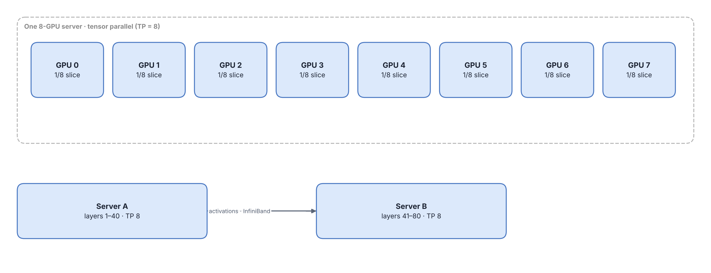

*Every GPU holds 1/8 of every layer. All 8 work on each token, then combine their partial results after each layer over NVLink (\~900 GB/s inside the server)*
*Pipeline parallel (PP = 2): each server holds a block of layers and passes activations to the next one — only once per block, so the slower network link is enough*

#### DD7 · Splitting one model across GPUs

**Problem:** a frontier model's weights (hundreds of GB) plus its KV cache don't fit in one GPU's memory (80–192 GB)

**Added:** each model replica spans a whole 8-GPU server, or several servers

- Tensor parallelism (TP): every layer's weight matrices are cut into 8 slices, one per GPU. All 8 GPUs work on every token together, then combine partial results (an all-reduce) after each layer
- That all-reduce happens twice per layer for every token, so TP only works over NVLink inside a server, not over the network
- Pipeline parallelism (PP): each server holds a block of whole layers and hands its activations to the next server over InfiniBand. Traffic happens once per block, so the slower link is fine
- Usual mix: TP inside a server, PP across servers only when one server isn't enough. Mixture-of-experts models add expert parallelism: different GPUs hold different experts
- PP leaves stages idle while they wait ("bubbles"), so keep many requests in flight (micro-batches) to give every stage work

**Effect on the rest of the design:** the scheduler (DD2) places requests on whole replicas, not single GPUs; replicas = GPUs ÷ GPUs per replica

**When things fail:**

- One GPU dies → the whole replica stops (every GPU holds part of every layer); the scheduler drains it and moves its generations (DD6)
- Interconnect saturated → tokens/s drop for the whole replica; watch NVLink / InfiniBand use, not just GPU use

### DD8 · Speculative decoding

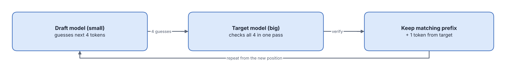

*Example: draft guesses "the cat sat on" → the big model agrees with "the cat sat", rejects "on" and produces "down" → 4 tokens for one big-model pass*

#### DD8 · Speculative decoding

**Problem:** decode makes one token per forward pass, and each pass is limited by reading the weights from memory, not by compute, so the GPU sits partly idle

**Added:** a small draft model next to the big (target) model in each replica

- The draft model cheaply guesses the next k tokens (e.g. 4)
- The target model checks all k in a single forward pass, keeps the longest prefix it agrees with, and adds one token of its own
- The output is exactly what the big model would have written alone; only speed changes
- Good guesses (code, boilerplate, common phrases) give \~2–3× tokens per step; bad guesses only waste the draft's small cost
- It speeds up decode — the time between tokens and the total reply time. Time to first token is mostly prefill, which it doesn't change
- Variants without a separate model: n-gram / prompt lookup, or extra prediction heads trained on the big model (Medusa, EAGLE)

**Effect on the rest of the design:** fewer GPU-seconds per reply → more streams per replica; tokens arrive in small bursts, which the chunked stream (DD1) already handles

**Trade-offs:** the draft model takes GPU memory from the KV cache, and at very large batch sizes the GPU is already busy, so the gain shrinks — turn it on per pool depending on load

**When things fail:** the acceptance rate drops (new model, unusual prompts) → switch speculation off automatically when it stops paying off

### DD9 · Cheaper requests: routing and caching

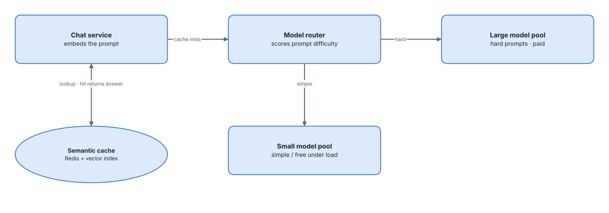

#### DD9 · Routing and semantic caching

**Problem:** sending every prompt to the biggest model wastes GPUs; many prompts are simple, and many repeat what someone else already asked

**Added:** Model router, Semantic cache

- Model router: a small classifier scores how hard a prompt is and picks the small or large model. Users who chose a model explicitly keep it
- Ties into tiers (DD3): under load, free traffic is routed down first; paid traffic keeps the large model
- Semantic cache: embed the prompt and look for near-duplicates in a vector index; above a high similarity threshold (e.g. cosine > 0.95), return the stored answer without touching a GPU
- Only cache prompts with no personal context (first turn, no memory, no files). The key also includes the model and system-prompt version, so a model change invalidates it
- This is different from vLLM's prefix caching (DD2), which skips recomputing a shared prompt prefix but still generates the answer

**Why Redis + a vector index:** sub-millisecond lookups and TTLs for freshness; the embedding model is tiny next to the LLM

**Trade-offs:** a wrong cache hit returns a plausible but wrong answer — keep the threshold high, check hit quality offline, and never cache answers that depend on time or on the user

**When things fail:** router or cache down → skip it and send the prompt to the large model; it costs more but never breaks

### DD10 · Multimodal input and cross-chat memory

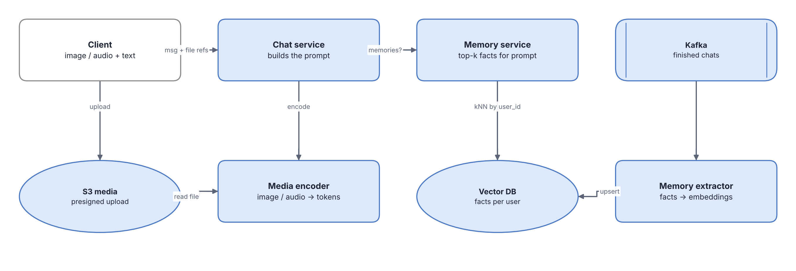

#### DD10 · Multimodal input and memory

**Problem:** users send images and audio, not just text, and expect the assistant to remember facts about them across separate chats

**Added:** media upload to S3, Media encoder, Memory service + Vector DB, Memory extractor

- Uploads: the client gets a presigned URL and uploads straight to S3; the message only carries file references, so big files never pass through Chat service
- An encoder (vision / audio) on GPUs turns media into tokens before the LLM. One image can be 1k+ tokens, so prompts get much bigger: more prefill time and KV-cache memory, which the scheduler's cost estimate (DD2) has to count
- Cross-chat memory is a retrieval problem: an async Memory extractor reads finished chats from Kafka, pulls out lasting facts ("prefers Python"), embeds them and stores them per user in a Vector DB
- For each new prompt, Chat asks Memory service for the top-k facts relevant to it and adds them to the context within the token budget (DD4)
- This differs from DD4's summary, which only compresses one conversation

**Why a vector DB:** nearest-neighbour search on embeddings, filtered by user_id; pgvector or OpenSearch is enough at per-user scale

**Privacy:** users can see and delete their memories; deleting a chat and the GDPR flow (DD5) also purge the Vector DB; temporary chats are never mined for memories

**When things fail:** Memory service slow → answer without memories after a short timeout; encoder overloaded → queue media requests separately so text chats stay fast
