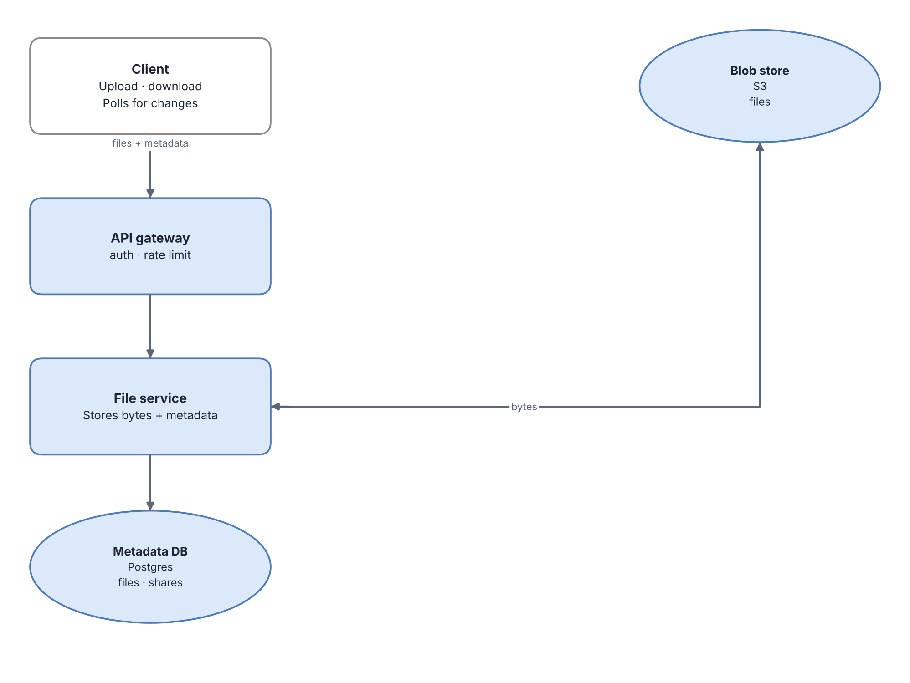
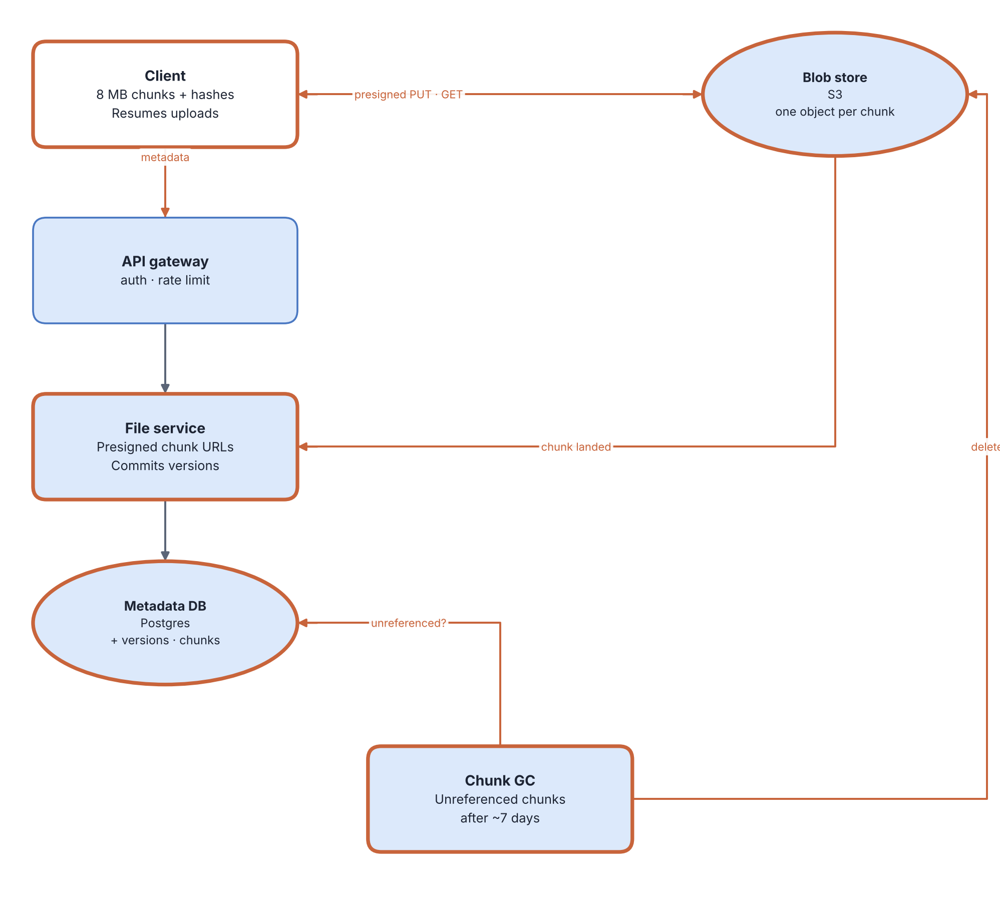
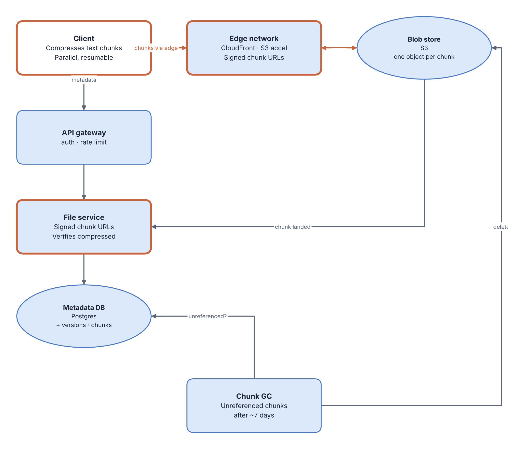
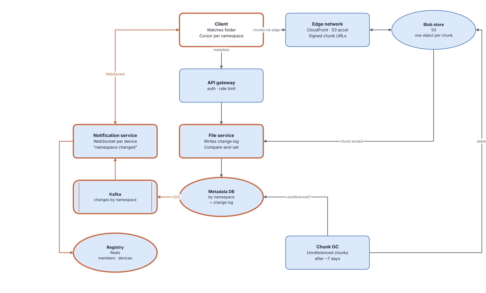
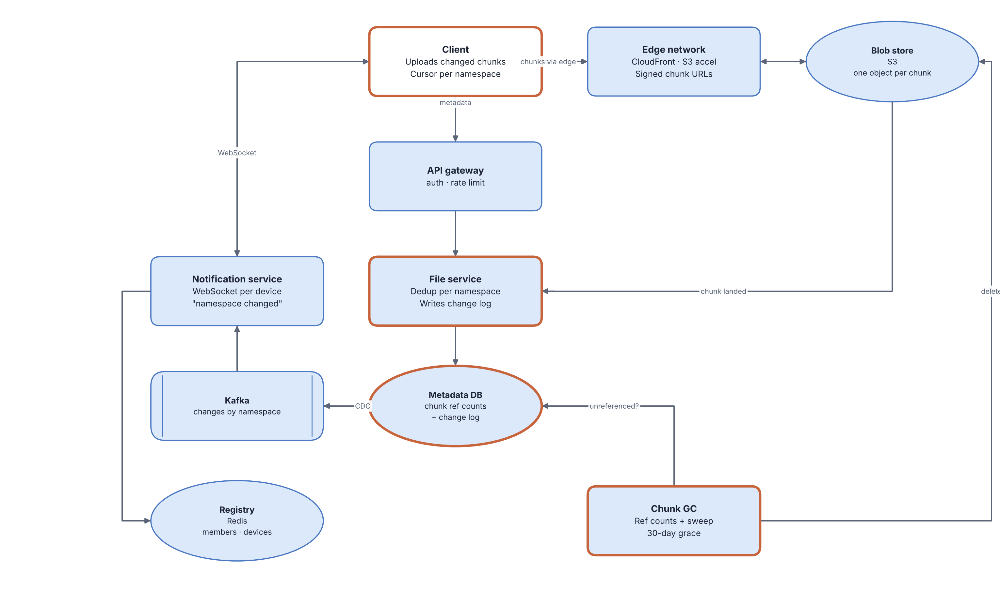
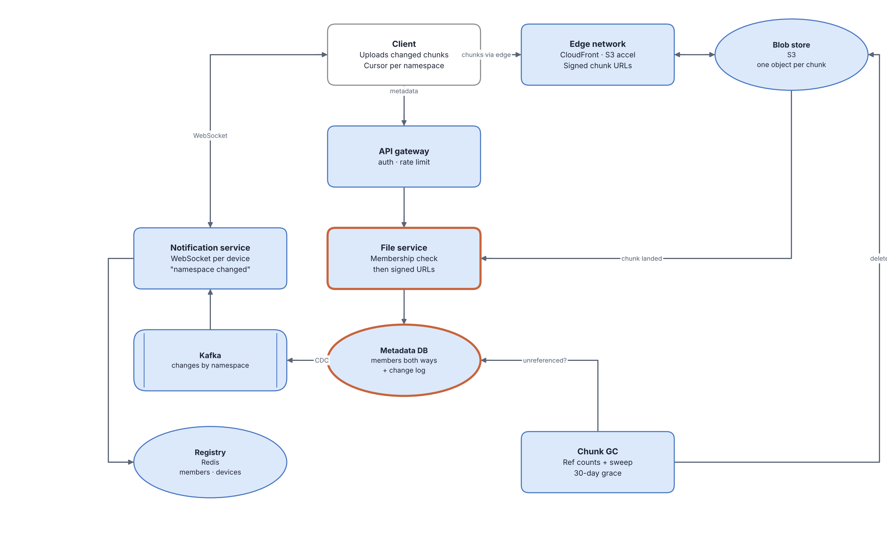

# Dropbox · system design, step by step

Whiteboard (Claude artifact): https://claude.ai/artifact/Q9Q4VTx6fycgrd4Skdz9GE · PDF: [dropbox.pdf](dropbox.pdf)

> Part 2 · Design: bytes go straight to S3 in chunks; a change log per namespace keeps devices in sync

## Part 1 · Requirements, API and data model

### Functional requirements

Core requirements:

1. Users should be able to upload a file from any device
2. Users should be able to download a file from any device
3. Users should be able to share a file with other users and view the files shared with them
4. Users can automatically sync files across devices

Out of scope: editing files, viewing files without downloading them

### Non-functional requirements

- **Availability over consistency:** a change may take a few seconds to show on other devices, but every device ends up with the same files
- **Fast sync:** a change reaches the other online devices (the owner's and those it's shared with) within seconds
- **Large files:** up to 50 GB; an interrupted upload or download resumes where it stopped
- **Durability:** once an upload is confirmed, the file is never lost
- **Scale:** 500M users, 100M daily users; \~200M uploads/day (\~2.5k/s), most small; exabytes stored

### API

**Core**

- POST /files {name, parent_id, size, chunk_hashes} · POST /files/{id}/versions {chunk_hashes, based_on_version} → version (new file or new version)
- POST /files/{id}/versions/{v}/upload-urls {chunks: [hash, sent_sha256]} → presigned PUTs for the next \~100 missing chunks · POST …/complete
- GET /files/{id} → metadata · GET /files/{id}/versions/{v} → ordered chunk hashes and sizes
- GET /files/{id}/versions/{v}/download-urls?chunks= → signed URLs, \~100 at a time
- POST /files/{id}/shares {user_ids, role} · GET /shared-with-me?cursor=
- GET /changes?cursors= → changes, new cursors (sync) · WebSocket /notifications

**Below the line**

- PATCH /files/{id} {name?, parent_id?} · DELETE /files/{id} (rename, move, delete; each appends a change-log entry)

Auth: user session on every call; upload and download URLs are short-lived and signed

### Entities

**Core**

- **file**: file_id PK, namespace_id (containing namespace), parent_id, name, latest_version, updated_at, deleted_at, status (pending / live); UNIQUE (namespace_id, parent_id, name) for live files
- **file_version**: (file_id, version) PK → ordered chunk hashes, based_on_version, status (uploading / committed)
- **namespace**: namespace_id PK, owner_id (every user has a root namespace), next_seq (DD3)
- **share**: (file_id, user_id) PK, role (Step 0; namespace members in DD5)

**Used by the deep dives**

- **chunk**: (namespace_id, hash) PK → S3 key (indexed), size, codec (none / zstd), stored size, ref_count, state (pending / stored), created_at, unreferenced_since (indexed); **chunk ref**: (namespace_id, hash, file_id, version), written at /complete and removed with the version, for GC's point checks
- **change log**: (namespace_id, seq) PK → file_id, op, version, target namespace_id (for added / removed / moved); **file location** (key-value, sharded by file_id): file_id → namespace_id
- **member**: (namespace_id, user_id) PK, role, mount path; a copy keyed (user_id, namespace_id). A root namespace's only member is its owner; DD5 adds shared ones
- **device cursor** (on the device): last seq per namespace, local chunk hashes per file

## Part 2 · Design, step by step

Each step redraws the whole diagram. Blue = our services, white = external, circle = storage, orange outline or orange arrow = new or changed in that step.

### Step 0 · Baseline (high-level design)

#### Step 0: works, but has problems

**Core 1 · upload:** client → API gateway → File service, which receives the bytes, stores them in S3 and the metadata (name, size, owner, S3 key) in Metadata DB

**Core 2 · download:** File service checks access, reads the metadata and streams the bytes back from S3

**Core 3 · share:** File service adds a share row (file, user, role); "shared with me" lists the rows for a user

**Core 4 · sync:** each device polls every minute for files changed since its last check and downloads them

**Why start here:** the shortest path that covers all four core requirements; make it clear first, then fix problems one at a time

**Problems:**

1. A 50 GB file streamed through our servers ties them up for hours, and a dropped connection starts over from zero
2. Downloads are slow far from our region, and every byte passes through File service
3. Polling every minute notices changes late and wastes requests across \~250M devices
4. Changing a few bytes of a 1 GB file re-uploads the whole file
5. Shared files must stay in sync for everyone, and access checks and "shared with me" must stay correct and fast

**Next:** each deep dive fixes one problem; new or changed components get an orange outline

### Step 1 · DD1 Large files: chunked uploads straight to S3

#### DD1 · Large files: chunked, resumable, straight to S3

**Problem:** files up to 50 GB; our servers shouldn't carry the bytes, and an interrupted upload must resume

**Added:** chunked uploads straight to S3 with presigned URLs; Chunk GC job

- The client splits the file into \~8 MB chunks (fixed size here; content-defined from DD4) and hashes each (SHA-256). POST /files (or /versions) sends the hash list; the new version stays `uploading`
- upload-urls returns presigned PUTs for the next \~100 chunks the server doesn't have. A 50 GB file (\~6,400 chunks) asks again as it goes; after a crash the same call returns only what's still missing
- Each URL allows PUTs to one key for \~15 min and carries the SHA-256 of the bytes being sent (x-amz-checksum-sha256), so S3 itself rejects corrupted bytes
- Chunks go straight to S3 in parallel (4–8 at a time); our servers never proxy the bytes. upload-urls first writes each chunk's row as pending with its unique S3 key (the first request fixes the codec and sent checksum; a repeat request for a pending row gets the same key and form, and refreshes created_at; pending GC re-checks it under the row lock); S3 notifies File service as each lands and the row becomes stored (upload-urls and /complete check S3 themselves in case the event is late). Only stored rows count as "server has it" and can be referenced
- POST /complete: in one transaction, lock the version's chunk rows, add a reference to each, mark the version committed. A chunk that vanished meanwhile is returned as missing and uploaded again
- A new file stays pending until its first /complete: invisible to other devices and not holding its name. That same transaction makes it live (or a conflicted copy) and logs it

**Why presigned URLs:** bandwidth goes to S3, not us; S3 scales by itself and is designed for 11 nines of durability

**When things fail:**

- Network drops → retry that one chunk
- Upload abandoned → its chunks are never referenced by a committed version; Chunk GC deletes them, rows and objects, after \~7 days. Every object has a row from before it exists (pending), so nothing in S3 is ever unknown

### Step 2 · DD2 Fast transfers anywhere: add edge network

#### DD2 · Fast transfers anywhere

**Problem:** users all over the world move large files; one region is far away for most of them

**Added:** edge network: CloudFront for downloads, S3 Transfer Acceleration for uploads

- download-urls names a version and the chunks wanted, and returns signed CDN URLs (short expiry, one chunk each, \~100 per call), so a resume never mixes versions; the client downloads in parallel, resumes with HTTP range requests and reassembles the file
- Uploads enter the nearest edge, then cross the provider's backbone to the bucket
- Chunks of popular shared files stay cached at the edge
- Compression: chunk and hash the raw bytes first, then compress each text-like chunk on its own (jpg, mp4, zip are skipped), so an edit still changes only a few chunks. The client gives upload-urls each sent body's checksum for S3 to verify. Uncompressed chunks need nothing more (that checksum is the raw hash, the dedup key); a compressed chunk's row becomes stored only after a small in-region verifier pool decompresses it (size capped) and checks the raw hash, deleting mismatches, so bad bytes can never be deduped against

**Why signed URLs:** the CDN serves private content without calling our servers, and a leaked URL dies within minutes

**When things fail:**

- An edge is down → the client retries through another edge, or straight from S3
- A corrupted chunk fails its hash check and is downloaded again

### Step 3 · DD3 Sync: change log, Kafka, notifications

#### DD3 · Sync across devices

**Problem:** a change on one device should show on the user's other devices within seconds, without \~250M devices polling

**Added:** change log per namespace, Kafka (CDC), Notification service (WebSocket), registry (Redis)

- A namespace is a root of files (a user's own files; later each shared item, DD5). Metadata DB is sharded by namespace_id; a cached key-value table maps file_id → namespace_id, so calls find their shard
- Every metadata change appends (namespace_id, seq) → file, op, version in the same transaction as the file row; seq comes from incrementing the namespace's next_seq row there, so entries commit in seq order and a cursor never skips one
- The client watches the folder (FSEvents / inotify) and uploads local edits (DD1, DD4). It keeps a cursor per namespace it can see; sync = GET /changes?cursors=…, then fetch each changed file's chunk list (GET …/versions/{v}) and download only the chunks it lacks
- No polling: devices keep a WebSocket to the Notification service (\~250M at peak; \~1M per node → \~300 nodes). Registry (Redis): namespace → members, user → devices, device → node; devices register on connect, member changes arrive via CDC. CDC → Kafka (keyed by namespace) → the node reading that partition finds the members' devices and forwards "namespace changed" to their nodes; offline devices catch up from cursors
- Conflicts: /complete does a compare-and-set (UPDATE file SET latest_version = new WHERE latest_version = based_on_version), and UNIQUE (namespace_id, parent_id, name) catches two new files or renames with one name. The loser is kept as "name (conflicted copy, Laptop)", so no edit is lost
- The log keeps \~30 days; an older cursor gets "reset", and the device re-lists the namespace and compares hashes

**Why a cursor plus a push hint:** a push can be lost or arrive twice safely; the cursor is the source of truth, and devices also call /changes on every (re)connect and every \~10 min

**When things fail:**

- Notification service down → devices fall back to polling /changes every \~60 s; nothing is missed
- A shard's primary fails → its synchronous standby takes over (no committed version lost); that shard's writes pause briefly while downloads continue

### Step 4 · DD4 Upload only what changed

#### DD4 · Upload only what changed

**Problem:** editing a small part of a large file shouldn't re-upload all of it, and the same content is often uploaded again

**Changed:** File service dedups chunks per namespace; Chunk GC uses reference counts

- A file version is an ordered list of chunk hashes. After a change the client re-hashes and uploads only chunks the server doesn't have; the new version reuses the rest
- Content-defined chunking (boundaries set by a rolling hash, \~8 MB on average) keeps most chunks unchanged even when bytes are inserted near the start of a file
- Dedup is per namespace: chunks are stored under (namespace, hash). Dedup across users would let someone test whether another user has a given file
- Old versions keep their chunk lists, so version history and undelete are cheap; after 30 days a cleanup drops old versions and deleted files and lowers their chunks' ref counts in the same transaction
- A new chunk row starts with unreferenced_since = created_at; the first reference clears it, and when ref_count drops back to 0 the same transaction sets it again. An index on it lists only zero-ref chunks, so Chunk GC reads that index, never the whole table, and deletes after a 30-day grace (never-referenced chunks: \~7 days, DD1)
- No global mark-and-sweep: \~1 EB in 8 MB chunks is \~125B rows, too many to scan. Before deleting, GC checks only its candidates, by point lookups in the chunk ref index (namespace, hash, file_id, version): rows are inserted in /complete's transaction, deleted in the same transaction that drops old versions, and moved with the chunks (DD5). A slow audit recounts a sample against version lists and alerts on mismatches
- The GC re-checks ref_count = 0 under the chunk's row lock, the same lock /complete takes to add a reference, so a chunk can't vanish under a new version. Each upload gets a unique S3 key, recorded in the chunk row, so GC only deletes the object its row names, never a fresh re-upload

**Why:** most edits touch a few chunks, so uploads shrink from gigabytes to megabytes

**When things fail:** a ref-count bug could free a live chunk, so deletes wait out the 30-day grace, the pre-delete ref-index check catches it, and S3 versioning keeps deleted objects a few more days for recovery

### Step 5 · DD5 Sharing and access control

#### DD5 · Sharing and access control

**Problem:** shared files must reach exactly the right people and stay in sync for all of them; "shared with me" must be fast, and access must be revocable

**Changed:** a shared file or folder becomes its own namespace; members are stored both ways

- Sharing creates a new namespace (own change log) with member rows (namespace_id, user_id, role, mount path) on its shard; everyone, owner included, sees it at their mount path; a shared folder's namespace holds its whole subtree
- A background job moves the item one file at a time: mark it moving (commits get a retryable error), copy its rows, flip its file location entry and drop the cache, and log "moved to namespace X" so devices keep their local copies; members see the folder fill in. Chunks change owner without copying: the new namespace's row takes the same S3 key and the old row is dropped. Only chunks still used by files left behind are server-side copied, so each namespace's GC deletes only its own objects; file_ids never change
- The member row is written with an outbox row; File service's relay applies it on the recipient's shard: the reverse row (user_id, namespace_id) for "shared with me", and "namespace added" in the recipient's own change log, so their devices add a cursor and get its pushes (DD3). Unsharing does the same with "removed". Replays are harmless; lag is seconds
- Big shared folders (a whole company): push hints carry the namespace's latest seq and are coalesced per device and namespace (at most one every few seconds, with jitter); /changes reads the log's recent tail from a replica that has reached that seq (else the primary), so one edit doesn't send \~60k reads to the primary at once
- File service checks membership for reads (/changes, version chunk lists, download URLs) and the editor role for writes (new versions, upload URLs, rename, delete); URLs live minutes, so revoking takes effect quickly

**Why short-lived URLs instead of proxying:** S3 and the CDN move the bytes, while we keep the access decision (TLS in transit, KMS-encrypted at rest)

**When things fail:** access revoked mid-download → the current URL works until it expires (minutes); new chunk URLs are refused
