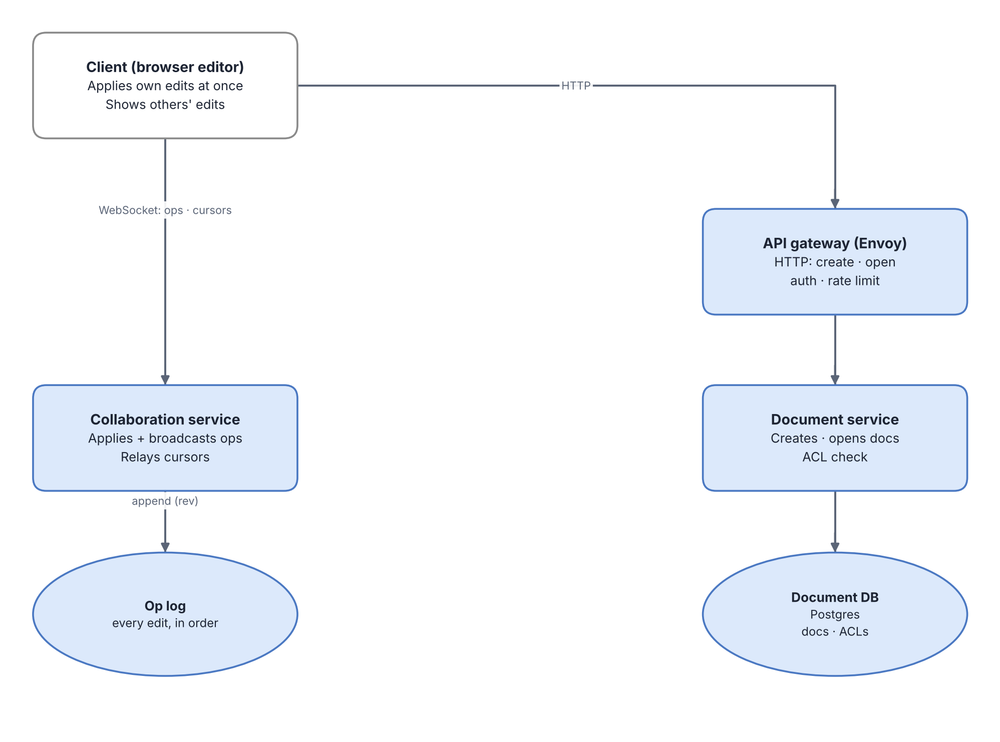
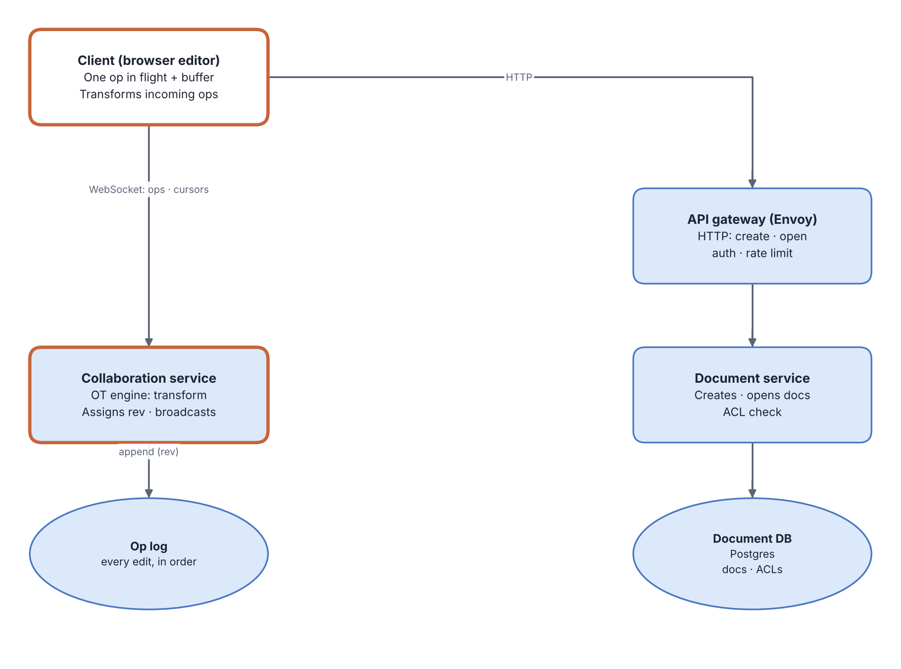
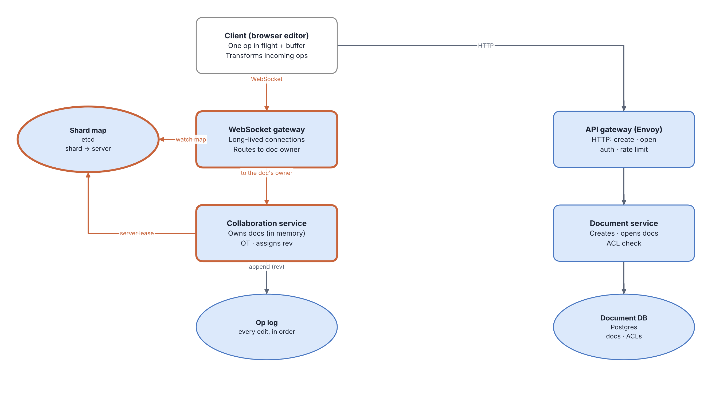
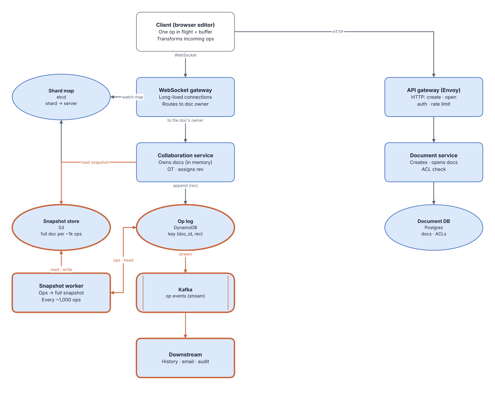
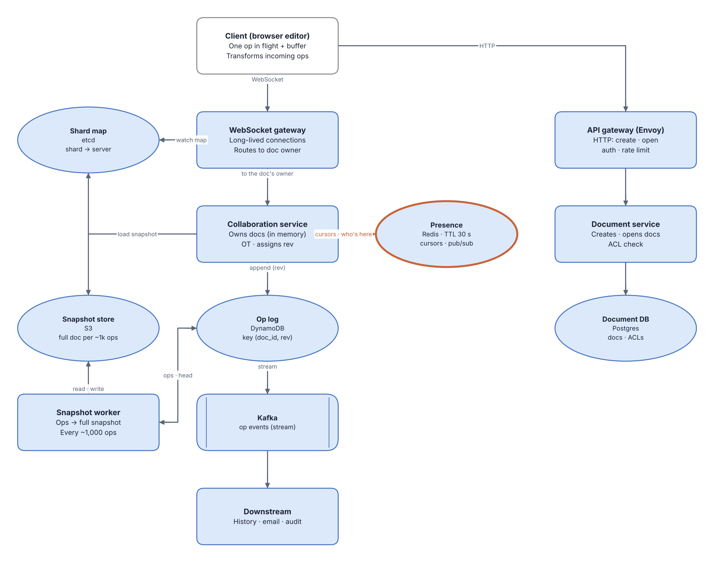
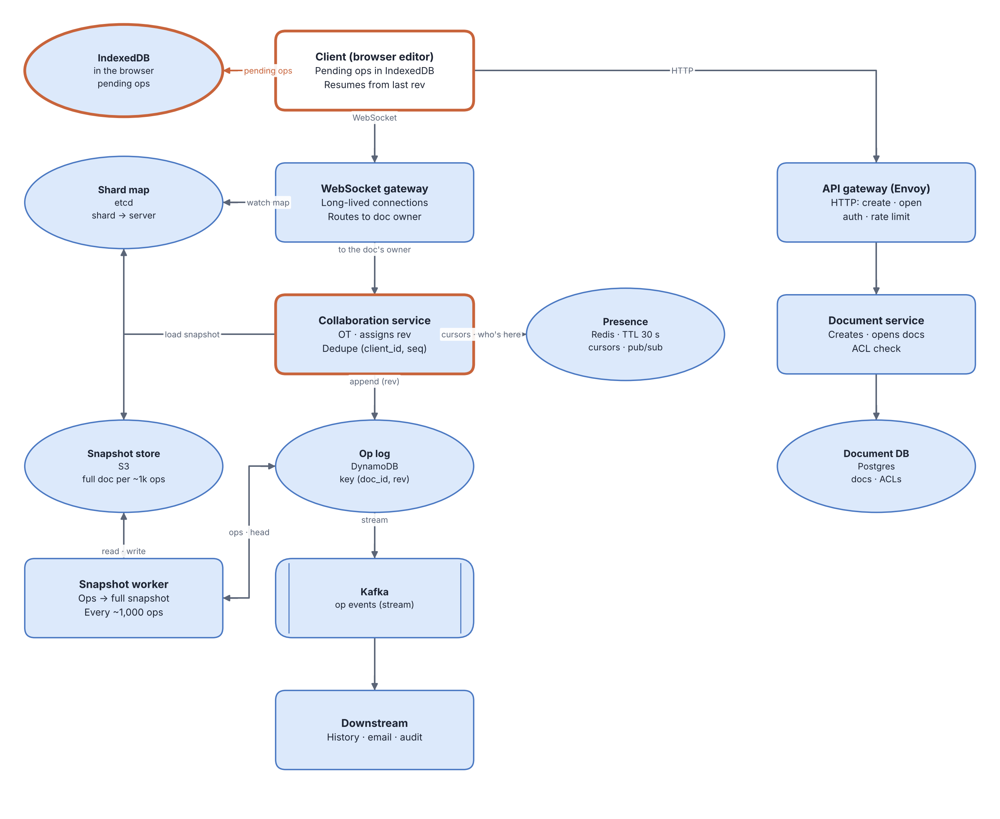
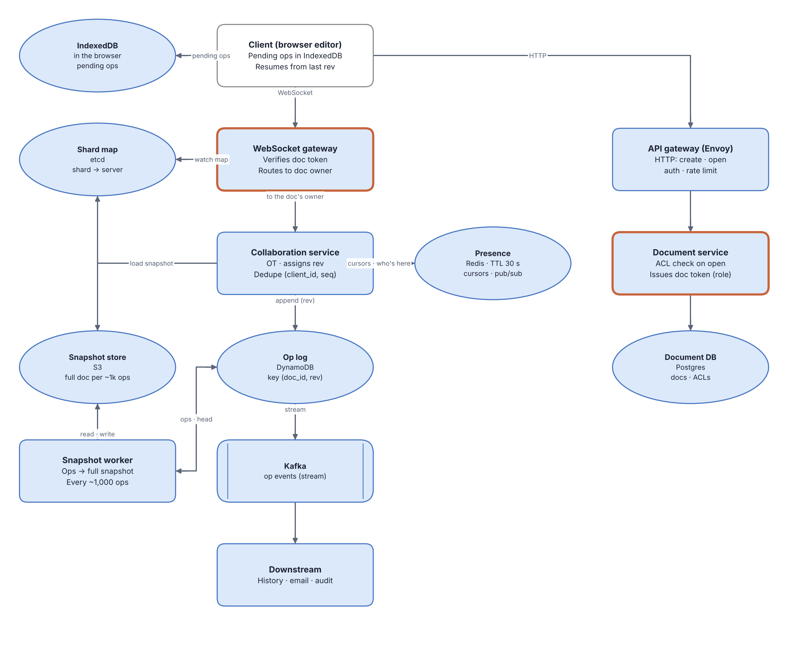

# Google Docs · system design, step by step

Whiteboard (Claude artifact): https://claude.ai/artifact/AuAX59w3oKBiZGb5Gni12j · PDF: [google-docs.pdf](google-docs.pdf)

> Part 2 · Design: one sequencer per doc orders every edit; clients apply their own edits instantly

## Part 1 · Requirements, API and data model

### Functional requirements

Core requirements:

1. Users should be able to create new documents
2. Multiple users should be able to edit the same document concurrently
3. Users should be able to view each other's changes in real time
4. Users should be able to see the cursor position and presence of other users

Below the line (covered in the deep dives): offline editing, sharing and permissions, version history

Out of scope: comments and suggestions, images and tables, export, search inside docs

### Non-functional requirements

- **Low latency:** your own typing shows instantly (applied locally); other people's edits appear in < 200 ms (p95, same region)
- **Convergence:** everyone ends up with exactly the same document, whatever order edits arrive in; no edit is lost
- **Durability:** an edit the server has acknowledged is never lost; if a whole region fails, clients resend the last \~1 s of edits that weren't replicated yet
- **High availability:** editing 99.99%; cursors and presence may degrade first
- **Scale:** 100M daily users; \~5M docs open at peak, most with 1–3 editors, up to \~100 editors on one doc; \~5M edit ops/s at peak

### API

**Core**

- POST /docs {title} → doc_id (create a doc)
- GET /docs/{id} → title, your role, doc_token (open a doc)
- WebSocket /docs/{id}/live, doc_token in the first message (edit together in real time):
  - client → server: op {client_id, seq, base_rev, ops: insert / delete at a position}
  - server → client: ack {seq, rev, replicated_rev} · remote op {rev, author, client_id, seq, ops} · on join: snapshot + rev
  - both ways: cursor {user_id, position, selection} · join / leave
- GET /docs/{id}/ops?since=rev → ops missed while disconnected

**Below the line**

- POST /docs/{id}/share {user, role} · GET /docs/{id}/revisions

Auth: user session for HTTP; the WebSocket uses the short-lived doc_token (never in the URL, so it stays out of logs)

### Entities

**Core**

- **document**: doc_id PK, owner_id FK, title, created_at, home_region
- **doc_acl**: (doc_id, user_id) PK, role (owner / editor / viewer)
- **operation** (op log): (doc_id, rev) PK; author_id, client_id, client_seq, ops, created_at
- **snapshot**: (doc_id, rev) PK → S3 key of the full document at that rev

**Used by the deep dives**

- **doc_head** (DynamoDB, beside the op log): doc_id → latest_rev, snapshot_rev, epoch
- **shard map** (etcd): \~16k shards; shard → collab server, epoch; one lease per server, not per doc
- **presence** (Redis, TTL 30 s): doc_id → {user_id, color, cursor, last_seen}
- **client_seq**: (doc_id, client_id) → last applied seq, for dedupe

## Part 2 · Design, step by step

Each step redraws the whole diagram. Blue = our services, white = external, circle = storage, orange outline or orange arrow = new or changed in that step.

### Step 0 · Baseline (high-level design)

#### Step 0: works, but has problems

**Core 1 · create:** client → API gateway → Document service creates the doc in Document DB

**Core 2–4 · edit together:** each client opens a WebSocket to the Collaboration service. Every keystroke is sent as an operation (insert / delete at a position); the server applies it to its copy, appends it to the Op log and sends it to everyone else in the doc. Cursor moves are sent the same way

**Why start here:** the shortest path that covers all four core requirements; make it clear first, then fix problems one at a time

**Problems:**

1. Two people editing at once send positions that no longer match after the other's edit: text lands in the wrong place and copies diverge
2. With many Collaboration servers, editors of one doc can land on different servers, so nothing decides the order of its edits
3. The op log grows forever and opening a doc means replaying all of it
4. Cursor updates are chatty and point at the wrong place once text shifts
5. A dropped connection loses edits; anyone with the doc id can join; users are worldwide

**Next:** each deep dive fixes one problem; new or changed components get an orange outline

### Step 1 · DD1 Concurrent edits: add OT

#### DD1 · Concurrent edits with OT

**Problem:** Alice inserts "X" at position 5 while Bob deletes position 2. Applied as sent, Alice's insert lands one character off on Bob's screen and the copies diverge

**Added:** an OT engine in the Collaboration service; the client keeps its unacknowledged edits

- The server is the single sequencer for a doc: every accepted op gets the next revision number (rev)
- The client sends each op with base_rev, the last rev it had seen. The server transforms it against every op applied since then (Bob's delete before position 5 moves Alice's insert to 4), applies it and broadcasts it with its new rev
- The client keeps one op in flight and buffers the rest. Incoming ops are transformed against its pending ones, so its own typing never waits for the server (the Jupiter model Google Docs uses)
- Cursors are positions too, so they're transformed with every op and stay on the right character

**Why OT, not CRDT:** there's a central server per doc anyway, so OT's single ordering fits; documents stay compact (a CRDT keeps an id and a tombstone per character). CRDTs (Yjs, Automerge) win for peer-to-peer or long offline editing

**Cost:** a transform costs O(ops since base_rev); a client that falls far behind re-syncs from a snapshot (DD3)

**When things fail:** a transform bug makes copies diverge silently → acks carry a checksum of the doc; on mismatch the client reloads the server's copy

### Step 2 · DD2 One sequencer per doc: add WebSocket gateway, etcd

#### DD2 · One sequencer per document

**Problem:** OT needs one place that orders a doc's edits, but there are thousands of Collaboration servers and connections land anywhere

**Added:** WebSocket gateway, a shard map in etcd

- Each open doc is owned by exactly one Collaboration server, which keeps it in memory and orders all its edits
- Ownership is by shard: hash(doc_id) picks one of \~16k shards, and etcd holds only shard → server (with an epoch per shard) plus one lease per server. Per-doc keys would mean \~5M leases and a Raft write per open and close
- The WebSocket gateway watches the shard map, caches it, and routes every connection for a doc to its shard's server
- One server easily handles a doc with 100 editors and owns many shards (tens of thousands of open docs); rebalancing moves whole shards: the shard is first marked as moving with a new epoch; the old owner sees it (or fails to renew its lease), closes that shard's connections and stops serving it; only then does the map name the new owner, and it loads each doc when clients reconnect. Servers refuse docs from shards they don't hold
- Fencing: every op-log write is conditional on rev = last + 1 and on the shard epoch stored in doc_head being ≤ the writer's, so a server that lost its shard (GC pause, network split) can't append once the new owner has written; until then the rev condition keeps each doc's order. The controller sets a shard's epoch once, at assignment, as (failover generation, counter), so epochs only rise, also after a region failover; servers never derive it on load

**Why etcd:** small, strongly consistent, with leases and watches; the map is tiny and changes only when servers join, leave or rebalance. ZooKeeper would also work

**Why a separate WebSocket gateway:** long-lived connections need sticky routing by doc, and survive Collaboration server restarts by reconnecting to the new owner

**When things fail:**

- Collaboration server dies → its one lease expires (\~5 s) and a controller (leader-elected through etcd, not drawn) reassigns its shards with new epochs; the new owner loads snapshot + recent ops when clients reconnect. Clients resend unacknowledged ops (DD5)
- etcd unavailable → gateways keep routing with their cached map and owners keep serving; only reassigning shards waits

### Step 3 · DD3 Storage: add snapshots, Snapshot worker, Kafka

#### DD3 · Durable op log and snapshots

**Problem:** \~5M ops/s must be stored in order without loss, and replaying a doc's whole history on open is too slow

**Added:** Op log in DynamoDB, Snapshot worker + Snapshot store (S3), Kafka for other consumers

- Order for every op: transform and apply it in memory, write it to the op log, and only then ack the sender and broadcast it to everyone else. Nobody sees an op that isn't stored
- The write is one DynamoDB transaction: put the op at key (doc_id, rev) only if that rev doesn't exist yet, and update doc_head (latest_rev, epoch) only if latest_rev = rev − 1 and epoch ≤ the writer's (a group commit puts several ops in the same transaction), so ordering and fencing come from the DB
- Group commit: ops for one doc within \~10 ms go in one write, cutting writes several-fold at the same latency
- Every \~1,000 ops, or when a doc goes idle, the Snapshot worker reads the previous snapshot + the ops since, writes the new full document to S3 and records snapshot_rev in the doc's head item. Opening a doc = latest snapshot + ops after it
- Ops stay in the op log for \~30 days (long-offline clients need them, DD5), then move to S3 Standard-IA, still readable; snapshots kept over time give version history
- DynamoDB Streams → Kafka feeds version history, email notifications and audit without touching the editing path

**Why DynamoDB:** partitioned by doc_id, conditional writes for strict per-doc order, millions of writes/s; Bigtable or Spanner would also work

**Why S3 for snapshots:** cheap and durable for large blobs; DynamoDB items are capped at 400 KB

**When things fail:**

- Op-log write fails → nothing was acked or broadcast; the owner reloads that doc's state from the log, and the client resends the same op (same client_id, seq), so it can't be applied twice
- Snapshot worker behind → opening reads more ops: slower, still correct

### Step 4 · DD4 Cursors and presence: add Redis presence

#### DD4 · Cursors and presence

**Problem:** cursor moves happen far more often than edits; sending each one to everyone wastes bandwidth, and storing them is pointless

**Added:** Presence store (Redis)

- Cursors and selections are ephemeral: never written to the op log
- The client sends at most \~10 cursor updates per second (only the latest); the owner coalesces them and broadcasts every \~50–100 ms
- A cursor is a position at a rev and is transformed by later ops (DD1), so it doesn't drift when others type above it
- Who is in the doc lives in Redis with a 30 s TTL refreshed by heartbeats: a crashed client disappears on its own, and a new owner after failover shows presence at once
- A doc with thousands of viewers: view-only connections subscribe through Redis pub/sub on fan-out nodes, so the owner sends each update once (line not drawn)

**Why Redis:** in-memory, with TTLs and pub/sub built in; losing presence data is harmless

**When things fail:** Redis down → cursors and presence pause; editing is unaffected. Under load, cursor rate is the first thing cut

### Step 5 · DD5 Reconnects and offline: add IndexedDB, dedupe

#### DD5 · Reconnects and offline edits

**Problem:** networks drop and laptops close; edits typed in the meantime must not be lost or applied twice

**Added:** a local store in the client (IndexedDB); dedupe in the Collaboration service

- The client saves unacknowledged ops in IndexedDB, each with (client_id, seq)
- On reconnect it sends its last rev; the server returns the ops it missed; the client transforms its pending ops against them and resends
- Lost ack: if a missed op carries this client's own (client_id, seq), the server had already applied it. The client treats it as the ack and drops it from pending, so the text isn't inserted twice
- The server keeps the last applied seq per client_id; an op it already applied is acked again, not applied twice
- Long offline (thousands of ops behind): the server composes all ops since the client's rev into one op (read from the op log, or S3 after 30 days); the client transforms its pending ops against it once and resends. Offline longer than we keep ops: the client's version is saved as a copy instead
- Long offline edits can still clash in meaning (both rewrote one paragraph); OT keeps the text consistent and version history lets users restore either version

**Why IndexedDB:** the browser's durable local store; survives a closed tab

**When things fail:** browser data cleared before reconnecting → those edits are lost; the UI warns when edits haven't synced for a while

### Step 6 · DD6 Access control and multi-region

#### DD6 · Access control and multi-region

**Problem:** only allowed users may open or edit a doc, also when access changes mid-session; editors of one doc can be anywhere in the world

**Added:** doc tokens; a home region per doc

- Opening a doc (GET /docs/{id}) checks the ACL in Document service and returns a short-lived doc token with the user's role and the doc's home region; the WebSocket gateway verifies it without calling anything
- The owner rejects ops from viewers. When access is removed, Document service finds the owner the same way the gateway does and tells it to close that connection (line not drawn: it goes through the gateway's routing)
- Each doc has a home region where its owner runs; etcd runs per region. Users far away connect to their nearest gateway, which reads the home region from the token and forwards there; their own typing still shows instantly, others' edits arrive \~100–200 ms later
- When most editors are elsewhere, the doc's home moves there while it's idle
- The op log and snapshots replicate to a second region; every ack carries replicated_rev, and clients keep acked ops (in IndexedDB) until they are replicated

**Why one home region, not multi-writer:** OT needs a single sequencer; one home keeps ordering simple, and local apply hides the extra latency

**When things fail:** region loss → the doc resumes in the second region from its last replicated rev; clients resend their acked-but-unreplicated ops, and clients that had seen newer revs reload and reapply their pending ops
