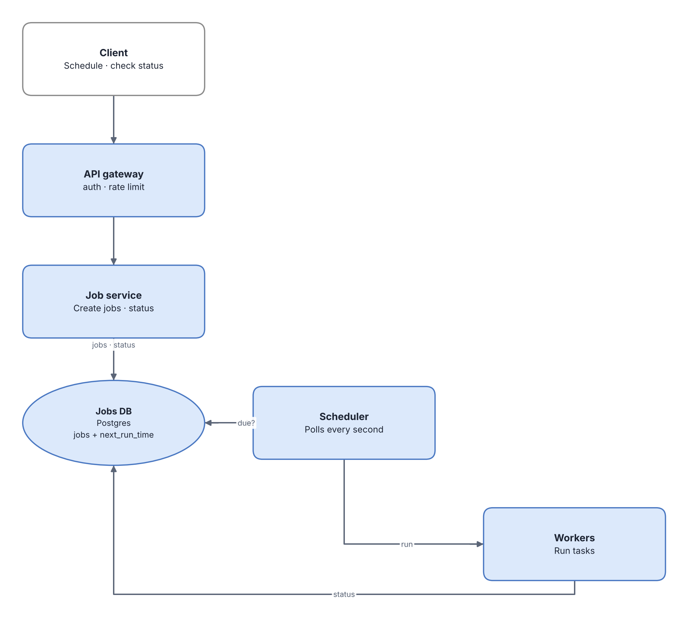
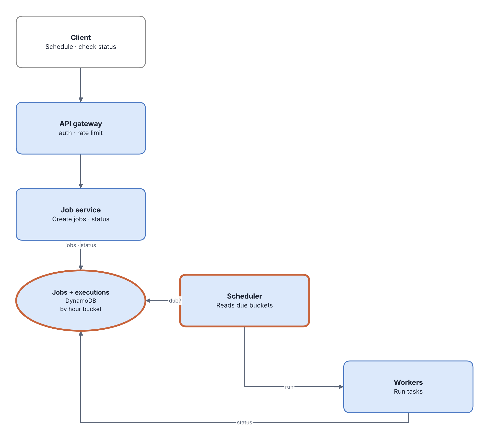
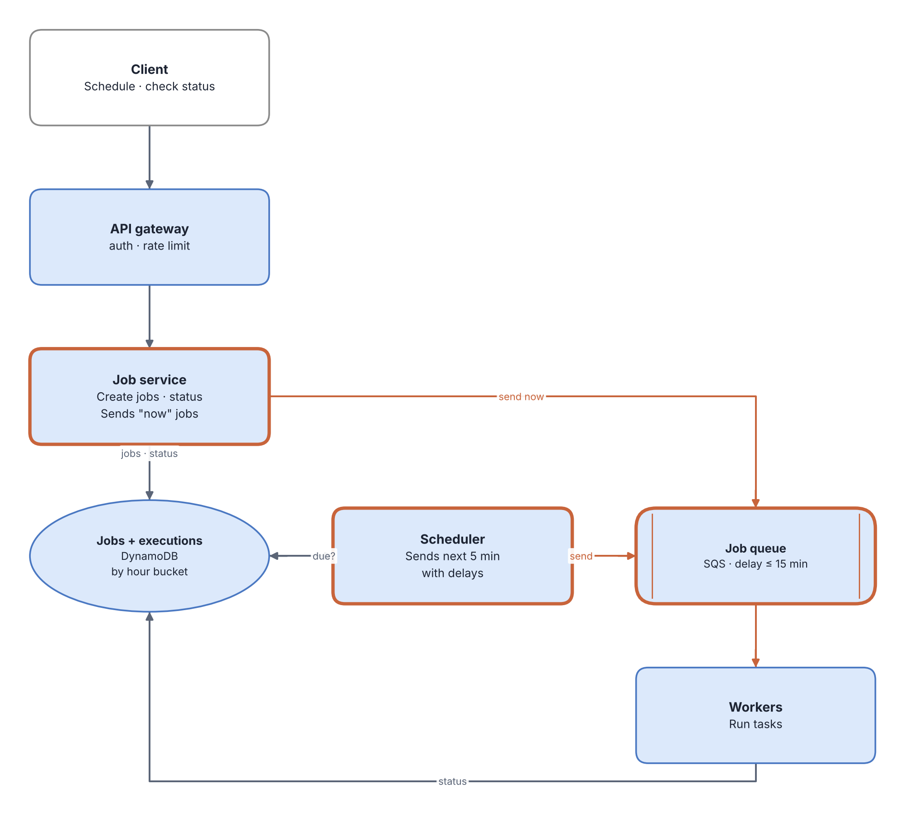
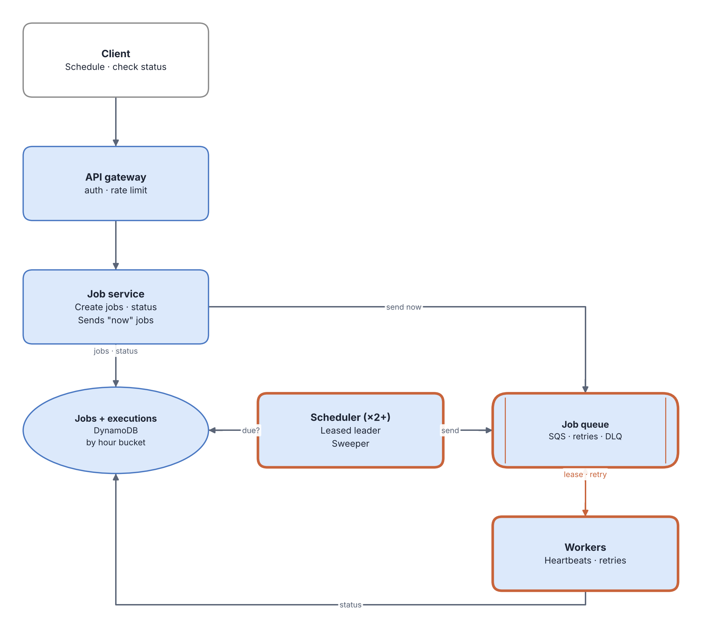
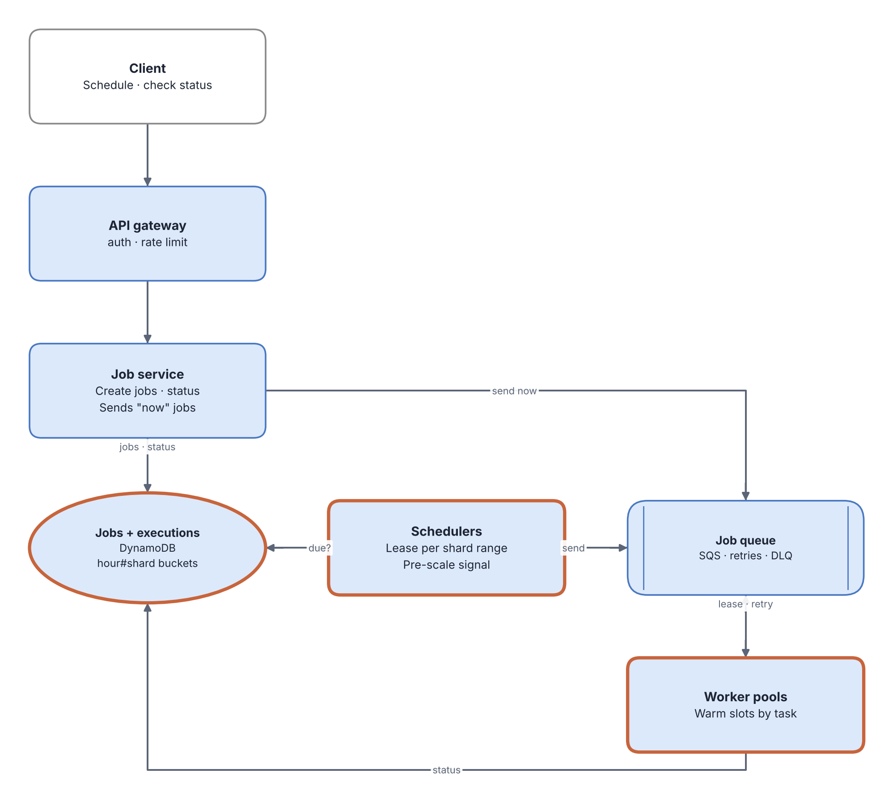

# Job Scheduler · system design, step by step

Whiteboard (Claude artifact): https://claude.ai/artifact/3gz85PKJ61WifpCm3JxCYT · PDF: [job-scheduler.pdf](job-scheduler.pdf)

> Part 2 · Design: executions in a time-bucketed table, handed to a delayed queue, run at least once

## Part 1 · Requirements, API and data model

### Functional requirements

Core requirements:

1. Users should be able to schedule jobs to be executed immediately, at a future date, or on a recurring schedule (i.e. "every day at 10:00 AM")
2. Users should be able to monitor the status of their jobs

Terms: a task is reusable work ("send an email"); a job is one scheduled instance of a task, with its parameters

Out of scope: cancelling or rescheduling jobs

### Non-functional requirements

- **On time:** a job starts within \~2 s of its scheduled time
- **At least once:** every job runs even if a worker or the scheduler dies; tasks are written to be idempotent
- **Highly available:** scheduling and execution keep working through node and zone failures
- **Scale:** up to 10k job executions/s at peak; most run for seconds, some for minutes

### API

**Core**

- POST /jobs {task_id, schedule: {type: now | at | cron, value, timezone}, params} + Idempotency-Key → job_id
- GET /jobs/{id} → the job, its next run and recent executions (status, attempts, last error)
- GET /jobs?status=&from=&to=&cursor= → the user's executions

**Below the line**

- DELETE / PATCH /jobs/{id} (cancel, reschedule)

Auth: user session; tasks are registered ahead of time by developers

### Entities

**Core**

- **task**: task_id PK, name, handler (code loaded by a worker pool), timeout, max_attempts
- **job**: job_id PK, user_id, task_id, schedule (a time or a cron expression + time zone), params, idempotency_key, created_at
- **execution** (one run of a job): execution_id = hash(job_id, scheduled_time), job_id, user_id, scheduled_time, status (pending / queued / running / succeeded / failed), attempt, next_attempt_at, lease_expires_at, last_error, started_at, finished_at

**Used by the deep dives**

- **execution key** (DD1): PK = hour bucket (DD4: hour#shard), SK = scheduled_time#execution_id; GSIs (user_id#n, scheduled_time) and (job_id, scheduled_time) with status; sparse GSI of unfinished runs

## Part 2 · Design, step by step

Each step redraws the whole diagram. Blue = our services, white = external, circle = storage, orange outline or orange arrow = new or changed in that step.

### Step 0 · Baseline (high-level design)

#### Step 0: works, but has problems

**Core 1 · schedule:** client → API gateway → Job service, which stores the job with its next_run_time in Jobs DB

**Core 2 · run:** a Scheduler polls every second for jobs whose next_run_time has passed, hands each to a worker, and sets the next run time for recurring jobs

**Core 3 · status:** Job service reads the job's status from Jobs DB

**Why start here:** the shortest path that covers both core requirements; make it clear first, then fix problems one at a time

**Problems:**

1. Polling "next_run_time <= now" over millions of jobs every second is slow, and one row per job keeps no history of its runs
2. A 1-second poll plus dispatch time can't promise a start within 2 s at 10k jobs/s
3. A worker that dies mid-job loses it, nothing retries a failure, and the single Scheduler is a single point of failure
4. 10k executions/s needs many workers ready at the right moment, and writes the database must absorb

**Next:** each deep dive fixes one problem; new or changed components get an orange outline

### Step 1 · DD1 Find due jobs fast: executions by time bucket

#### DD1 · Data model: jobs and executions

**Problem:** find what's due in the next few minutes without scanning every job, and keep a record of every run for monitoring

**Changed:** jobs and executions are separate; executions are stored by time bucket (DynamoDB)

- A job is the definition; an execution is one run, with id = hash(job_id, scheduled_time), so the same run can never be inserted twice (attribute_not_exists)
- Creating a job writes the job and its first execution (plus, for a recurring job, the second) in one TransactWriteItems. For a recurring job, the next execution (cron evaluated in the job's time zone, DST included) is inserted with its own idempotent put (attribute_not_exists) before the current one is sent, separate from the status mark, so a worker that already claimed the run can't block it
- Executions are keyed by time: PK = hour bucket, SK = scheduled_time#execution_id, so "due in the next 5 minutes" is a range read on one or two partitions
- GSIs: (user_id#n, scheduled_time) for "my jobs" (write-sharded n = 0–9 so a big tenant's burst at :00 spreads out; queried in parallel) and (job_id, scheduled_time) for one job's runs; both project status, so status filters work on the index (each status change also writes the GSIs, costed in DD4). A sparse GSI keyed by the DD4 shard (0–99) holds only unfinished executions (pending / queued / running), for overdue and stuck-run checks without scanning old buckets
- An execution's key never changes; every SQS message carries the full key (bucket, scheduled_time, execution_id) and the attempt, so workers update it directly. Status changes are conditional writes (only from the expected status). An execution's TTL (\~30 days) is set when it finishes, so future runs never expire

**Why DynamoDB:** key-value access by bucket, user and job, high write throughput, TTL built in; Postgres with an index on scheduled_time works at smaller scale

**When things fail:** a crash at any point leaves the next run already inserted, so the chain never breaks; a run not yet sent stays pending for the next pass

### Step 2 · DD2 Start on time: a delayed queue

#### DD2 · Start within 2 seconds

**Problem:** jobs must start within \~2 s of their time; polling the table every second doesn't scale to 10k jobs/s

**Added:** a job queue (SQS) with per-message delay; the Scheduler loads work a few minutes ahead

- Each minute, the Scheduler reads only the new slice [last horizon, now + 5 min) plus any overdue pending executions (from the sparse unfinished index), and sends each to SQS with DelaySeconds = scheduled_time − now (up to 15 min). The message becomes visible at the right second
- Order: send first, then mark queued (pending → queued, conditional). A crash in between leaves it pending, so it's sent again; a duplicate is harmless because a worker only runs an execution it can move from pending or queued to running (a delay-0 message can arrive before the mark)
- Whoever inserts an execution due before the horizon + a margin (now + \~6 min) sends it right away with the right delay (a duplicate is harmless): Job service for new jobs, and the Scheduler pass that inserts a recurring job's next run inside the window. The horizon is stored with the Scheduler's shard lease, so a failover resumes from it
- Workers long-poll the queue and start a job the moment it appears: typically < 1 s late
- Alternative: a Redis sorted set scored by run time, claimed with ZRANGEBYSCORE + ZREM in one Lua script; precise, but its durability and failover are ours to run

**Why two tiers:** the database holds the long-term schedule; the queue handles the last few minutes with second precision

**When things fail:** a Scheduler pass missed → the next pass picks up everything still pending, overdue runs with no delay

### Step 3 · DD3 Run at least once: leases, retries, failover

#### DD3 · At-least-once execution

**Problem:** workers crash, tasks fail and the Scheduler itself can die; every execution must still run at least once

**Changed:** visibility-timeout leases with heartbeats, retries the worker controls, a leased Scheduler leader, a sweeper

- A worker takes a message and moves the execution from pending or queued → running, setting lease_expires_at, conditional on attempt. Heartbeats extend both the lease and the message's visibility. A second copy of the message finds it running with a live lease and is dropped
- Worker dies → heartbeats stop → the message reappears; a worker may take over a running row only once its lease has expired, conditional on attempt, and bumps attempt
- Task fails → the worker records last_error, re-sends with attempt + 1 and a backoff delay (10 s, 1 min, 5 min; all within SQS's 15-min limit, so a retry never moves the row), then marks it running → queued, setting attempt = a + 1 and next_attempt_at, conditional on attempt = a (the same send-then-mark order as DD2; a first run's next_attempt_at is its scheduled_time). After max_attempts the worker marks it failed and sends it to a dead-letter queue
- A job can run twice (a slow worker whose lease ran out), so tasks get the execution_id and attempt and are expected to be idempotent
- Scheduler: two or more instances; a lease (in DynamoDB) makes one the leader, and another takes over within seconds if it dies
- A sweeper reads the sparse unfinished index and re-sends executions running with an expired lease, pending ones past their time, and queued ones far past their next_attempt_at (when the message becomes visible), since a queued row always already has a message

**Why at least once:** exactly once isn't possible across crashes without the task's help; at least once plus idempotent tasks is the standard deal

**When things fail:** SQS unavailable → executions stay pending in the table and are sent (overdue) when it's back

### Step 4 · DD4 Scale to 10k executions/s

#### DD4 · Scale to 10k executions/s

**Problem:** 10k executions/s at peak: \~40k writes/s, \~3M executions per 5-minute window, and enough warm workers at the top of each minute and hour

**Changed:** buckets split into shards, one Scheduler lease per shard range; worker pools pre-scaled from the schedule

- One hour bucket would be a hot partition, so the key becomes hour#shard (0–99): each execution's shard = hash(execution_id) mod 100, so a retried insert hits the same key, and each Scheduler instance holds the lease for a range of shards. A pass reads its shards in parallel
- Writes: \~4 per execution (insert, queued, running, done) ≈ 40k/s across \~100 hot partitions (\~400/s each); each also hits up to three GSIs (\~160k), plus heartbeats: provision \~200k+ write units/s
- Workers are long-lived processes with many slots and the task code already loaded, grouped in pools per task family: 10k/s × \~5 s average ≈ 50k busy slots across a few hundred hosts
- Pre-scaling: the Scheduler knows how many executions are due in the next 5 minutes (cron spikes at :00), so pools scale up before the spike and keep warm headroom; the age of the oldest message is only a backstop alarm
- Long jobs (minutes) get their own queue and pool, so they don't hold slots short jobs need

**Why shard the time bucket:** time-ordered keys put all current writes on one partition; shards spread the load while keeping each read a cheap range

**When things fail:** a pool runs short anyway → messages wait in the queue; the backstop alarm adds capacity and the delay shows in each execution's start time
