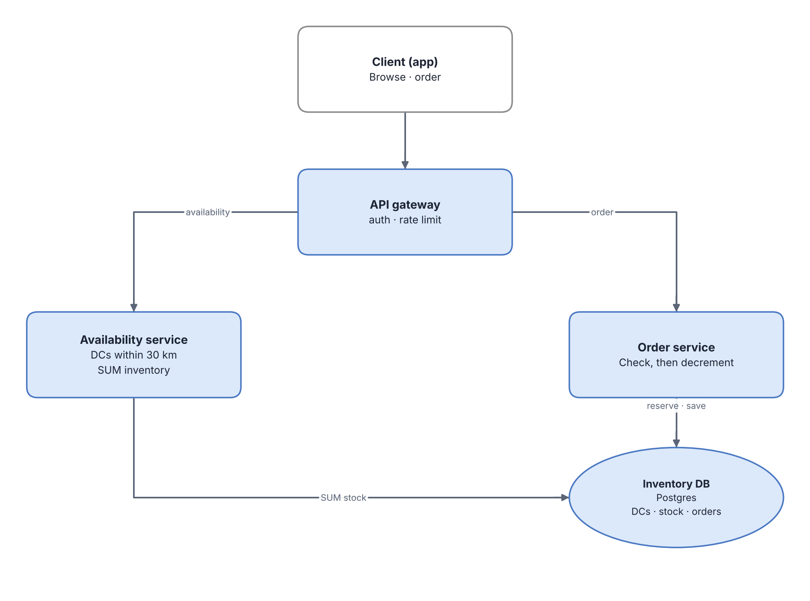
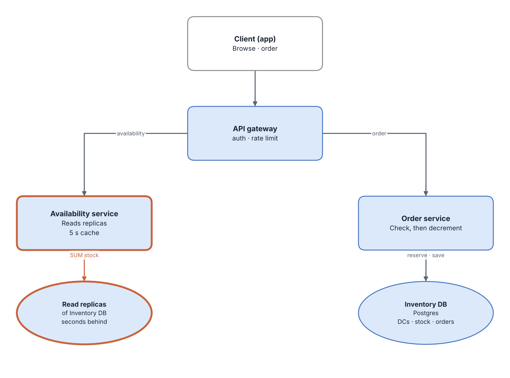
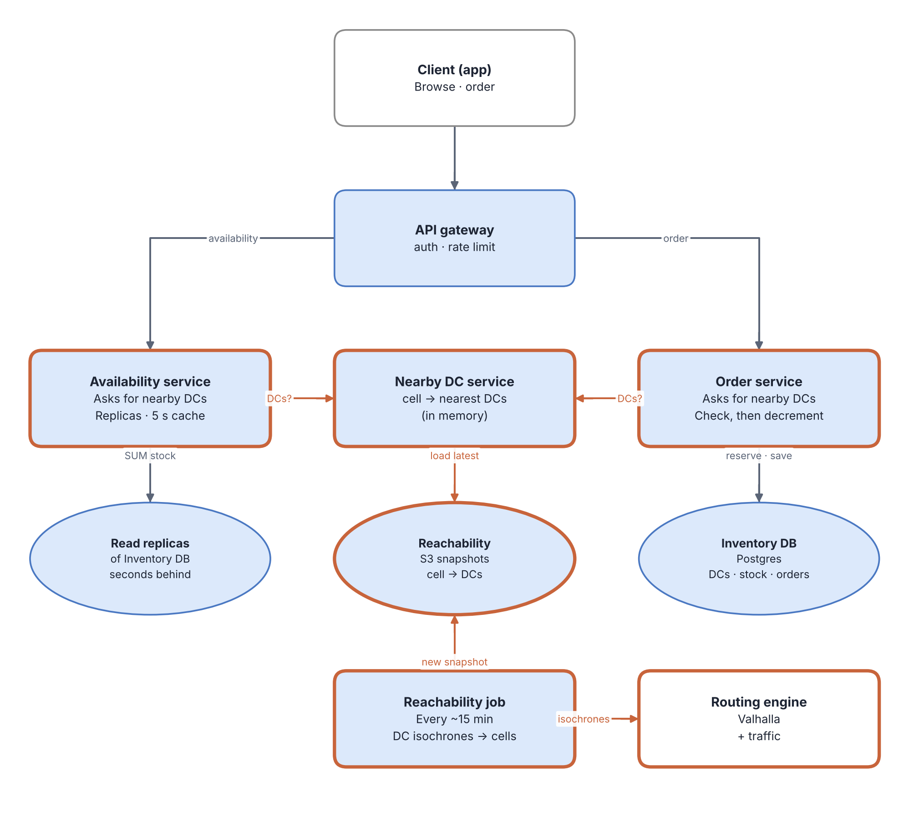
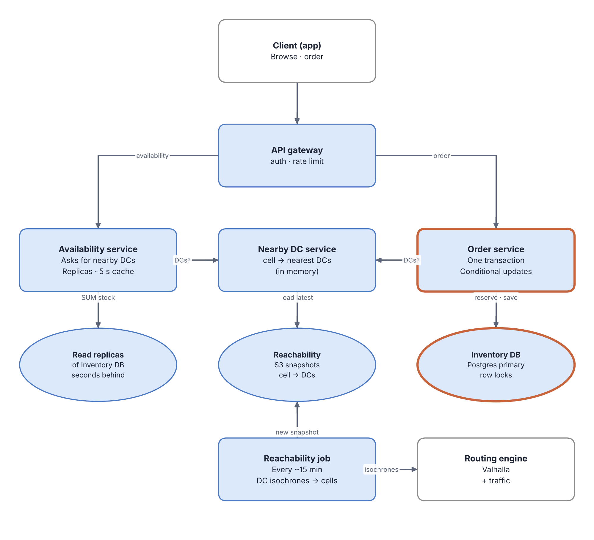
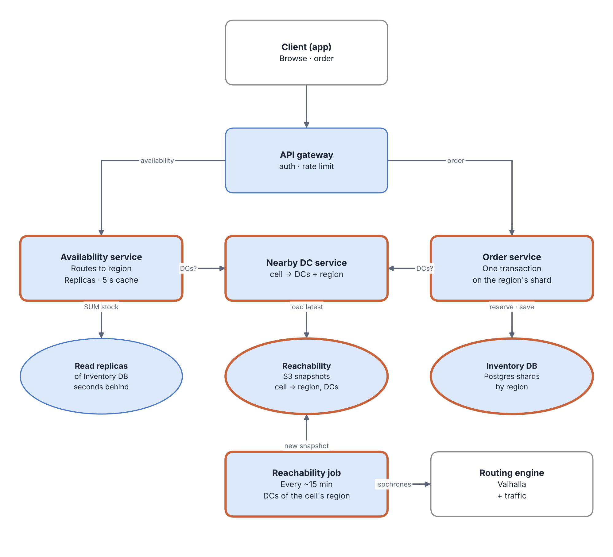

# Local Delivery Service · system design, step by step

Whiteboard (Claude artifact): https://claude.ai/artifact/BP1ppCHabdJpkw1UZdU59K · PDF: [local-delivery.pdf](local-delivery.pdf)

> Part 2 · Design: precomputed reachability for fast reads; one transaction per order

## Part 1 · Requirements, API and data model

### Functional requirements

Core requirements:

1. Customers should be able to query availability of items, deliverable in 1 hour, by location (the effective availability is the union of all inventory in nearby distribution centers, DCs)
2. Customers should be able to order multiple items at the same time

Out of scope: payments, driver routing and deliveries, search and catalog APIs, cancellations and returns

### Non-functional requirements

- **Fast availability:** an availability query answers in < 100 ms (p95)
- **No overselling:** two orders can never take the same unit; an order with several items succeeds or fails as a whole (strong consistency for ordering)
- **Availability vs consistency:** availability shown while browsing may be up to \~10 s stale; the order step is the source of truth
- **Scale:** 10k DCs, \~100k items in the catalog; 10M orders/day (\~120/s average, \~1k/s peak); \~20 availability queries per order (\~2.5k/s average, \~20k/s peak)

### API

**Core**

- GET /availability?lat=&long=&item_ids= → [{item_id, quantity}], summed over the DCs that can deliver within 1 hour; region (DD4)
- POST /orders {lat, long, items: [{item_id, qty}]} + Idempotency-Key (region:uuid, region from the availability response) → order_id, status, dc_ids; 409 with the items that ran out; 422 if the address moved out of that region

**Below the line**

- GET /orders/{id} → status

Auth: customer session

### Entities

**Core**

- **dc**: dc_id PK, location (lat, long), region
- **item**: item_id PK, name
- **inventory**: (dc_id, item_id) PK, quantity (CHECK ≥ 0)
- **order**: order_id PK, customer_id, delivery location (lat, long), status, idempotency_key, created_at; UNIQUE (customer_id, idempotency_key)
- **order_line**: (order_id, item_id, dc_id) PK, qty

**Used by the deep dives**

- **reachability** (S3 snapshot, not in the order DB): cell_id → up to \~10 (dc_id, drive-time band), nearest first; + region (DD4) (cell = \~1 km² geohash cell)

## Part 2 · Design, step by step

Each step redraws the whole diagram. Blue = our services, white = external, circle = storage, orange outline or orange arrow = new or changed in that step.

### Step 0 · Baseline (high-level design)

#### Step 0: works, but has problems

**Core 1 · availability:** client → API gateway → Availability service, which computes the straight-line distance to every DC, keeps those within \~30 km, and SUMs inventory for the requested items across them in Inventory DB

**Core 2 · order:** Order service checks each item's stock in a nearby DC, then decrements it and saves the order

**Why start here:** the shortest path that covers both core requirements; make it clear first, then fix problems one at a time

**Problems:**

1. \~20k availability queries/s at peak would hammer the same database that orders need
2. Straight-line distance isn't delivery time, and scanning all 10k DCs on every query is wasteful
3. Check-then-decrement lets two customers buy the last unit, and a multi-item order can fail half-way
4. One database holds every DC and every order: one failure or overload stops the whole country

**Next:** each deep dive fixes one problem; new or changed components get an orange outline

### Step 1 · DD1 Fast availability: replicas and a cache

#### DD1 · Fast availability queries

**Problem:** \~20k availability queries/s at peak, each summing 20–50 items over the nearby DCs (the nearest \~10 once DD2 is in), must answer in < 100 ms without slowing orders down

**Added:** read replicas; a short-lived cache

- Availability service reads from Postgres read replicas: SELECT item_id, SUM(quantity) FROM inventory WHERE dc_id IN (…) AND item_id IN (…) GROUP BY item_id, served by the (dc_id, item_id) primary key
- That's \~10 DCs × 50 items = 500 key lookups per query, so each instance also caches (dc_id, item_id) → quantity for \~5 s and sums the per-DC values itself. Every customer a DC serves shares those entries, and the gateway routes by coarse location so each instance covers a few metros: popular items come from memory, and replicas see only the misses
- Numbers shown may be up to \~10 s stale; that's fine because the order step re-checks on the primary (DD3)
- Orders use only the primary, so browsing load stays off its CPU and I/O

**Why replicas instead of a separate inventory store:** these are primary-key lookups Postgres handles well; reads scale by adding replicas

**When things fail:**

- Replica lag spikes → slightly staler numbers; the order step still decides
- A replica down → the others take its share

### Step 2 · DD2 Which DCs deliver in 1 hour: reachability

#### DD2 · Which DCs can deliver within 1 hour

**Problem:** "deliverable in 1 hour" depends on drive time (roads, traffic) plus picking time, not straight-line distance; calling a routing API on every query is slow and costly

**Added:** Reachability job, routing engine, snapshots in S3, Nearby DC service

- The map is divided into \~1 km² cells (geohash). Drive budget = 60 min − \~15 min picking = 45 min
- Every \~15 min, the job asks a routing engine (e.g. Valhalla, with traffic) for each DC's isochrones at 15 / 30 / 45 min: one routing call per DC per refresh (\~10k), not one per query
- For each cell it keeps the nearest \~10 DCs that reach it, with their drive-time band, and writes the table as a new versioned snapshot to S3, never to the order database
- Nearby DC service loads the newest snapshot into memory (\~30M (cell, DC) pairs, \~0.5 GB): location → cell → DCs, nearest first, in microseconds
- Busy metros are refreshed more often, because traffic changes through the day

**Why precompute:** travel times change slowly compared with query volume; one batch job replaces millions of routing calls

**When things fail:**

- Job or routing engine down → keep serving the last snapshot (minutes old is fine)
- A cell with no DC in the table → nothing is deliverable there; never guess from straight-line distance
- A new DC → included from the next refresh

### Step 3 · DD3 No overselling: one transaction per order

#### DD3 · No overselling, all-or-nothing orders

**Problem:** two customers can both see 1 unit left and both buy it; an order of 5 items must not take 3 and fail on the 4th

**Changed:** Order service places the whole order in one transaction on the primary

- First, look up (customer_id, Idempotency-Key): if that order exists, return it; nothing else runs
- Candidate DCs = the reachable DCs for the delivery cell, nearest first. If the cell's region isn't the key's region (a drifted retry), skip planning and go straight to the transaction, which returns the existing order or the 422 (DD4)
- Plan: read their current stock from the primary, without locks. Prefer one DC that has every item; otherwise split across the fewest DCs (each part is its own delivery)
- Commit in one transaction: insert the order row first (UNIQUE (customer_id, key), so a concurrent duplicate waits here and then returns the stored order without touching stock); then, in (dc_id, item_id) order to avoid deadlocks, UPDATE inventory SET quantity = quantity − q WHERE dc_id = ? AND item_id = ? AND quantity >= q for each planned row; then insert the lines
- An update that matches 0 rows (someone just took that stock) → roll back, re-plan with fresh numbers (up to \~3 tries). 409 only when the candidate DCs together are short, listing those items

**Why one relational transaction:** atomic across items and DCs (all in one region, DD4), simple and correct; even the hottest rows (a popular item in one DC) see only a few orders per second

**When things fail:** database failover mid-transaction → nothing was committed; the client retries with the same key

### Step 4 · DD4 Scale by region: shard the inventory

#### DD4 · Scale by region

**Problem:** one database serves every DC and every order. Throughput isn't the issue (\~1k orders/s fits one Postgres primary); a failure, a bad migration or a hot spot anywhere stops the whole country, and data keeps growing

**Changed:** Inventory DB sharded by region (metro), each shard with its own standby and replicas

- Regions are a fixed split by metro. Each cell belongs to exactly one region, and only that region's DCs serve it, for both availability and ordering, so what customers see matches what they can order
- Trade-off: a border cell ignores a reachable DC across the border; borders run through sparse areas, so this is rare
- The Reachability job keeps only the cell's own region's DCs before taking the nearest \~10; Nearby DC service returns the region with the DC list; Availability and Order services route to that shard, so an order's transaction stays on one shard
- Retries route by key, not by location: GPS drift could carry a retry across a border. The availability response names the region; the client makes its Idempotency-Key region:uuid and reuses it on every retry, so all retries reach the same shard, which returns the existing order if the key is there. The region check runs inside the transaction, after the order-row insert (DD3), so a retry racing an in-flight attempt waits on the UNIQUE key and gets that order. Only a genuinely new order is checked: if the delivery cell no longer belongs to the region, it's refused with 422 "region changed" and the client re-checks availability, so an order is never placed twice. No availability call yet → the client asks for one before ordering
- order_id starts with the region, so GET /orders/{id} finds the shard
- Each shard: a primary, two standbys with quorum commit (an order is confirmed only once a standby has it, and losing one standby blocks nothing), and read replicas
- The item catalog is small and global, so it's replicated to every region

**Why shard by region:** orders and availability are local by nature; a problem in one metro doesn't affect the others, and each shard stays small enough to fail over and back up quickly

**When things fail:**

- A region's primary fails → that region's orders pause \~30 s until a standby takes over; browsing continues on replicas; other regions are unaffected
- One standby fails → commits continue on the other
