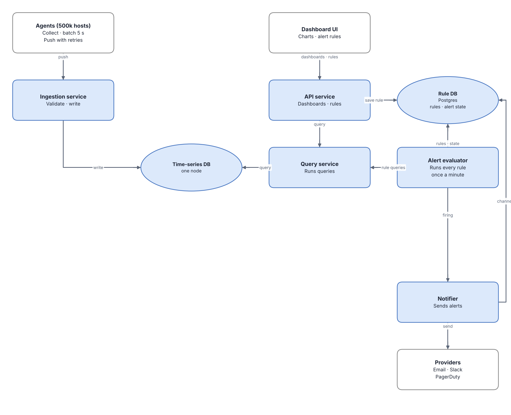
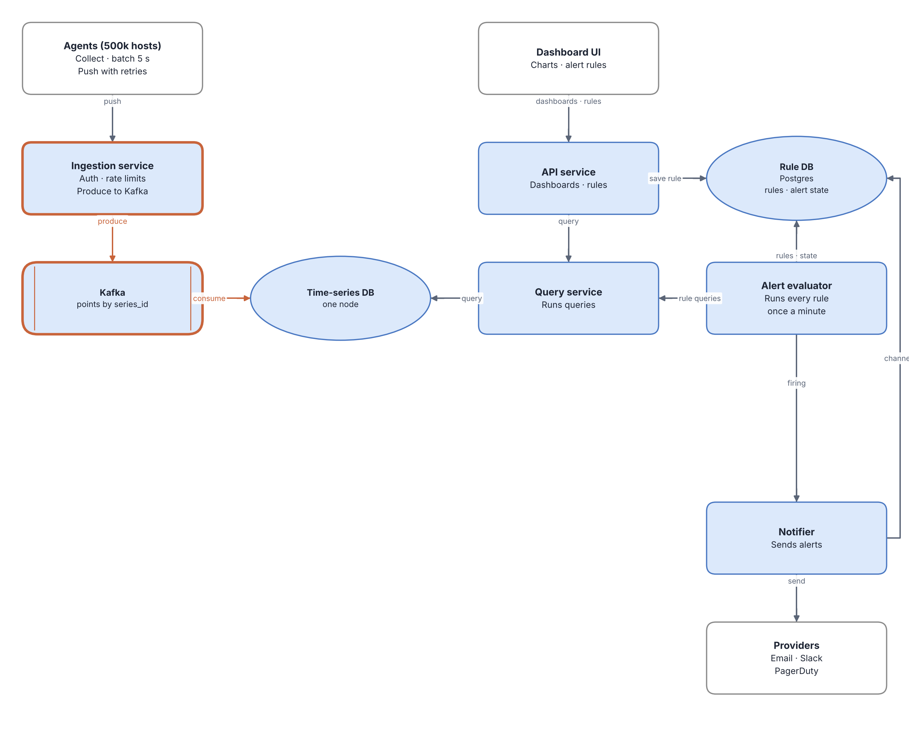
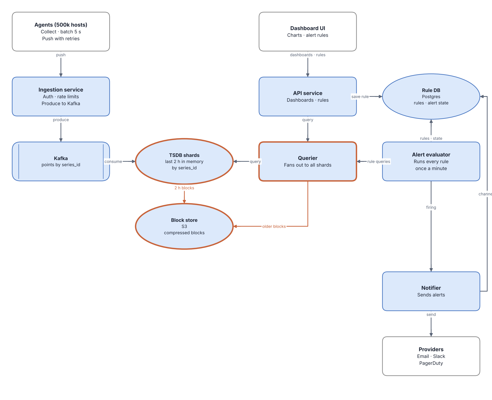
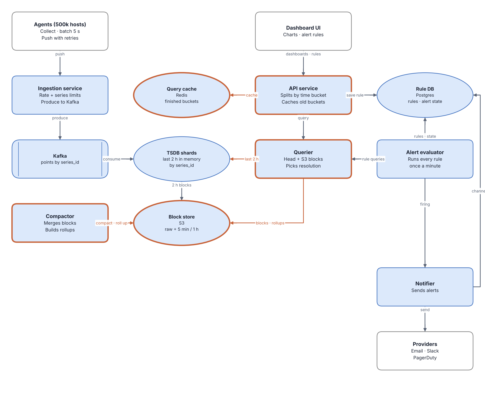
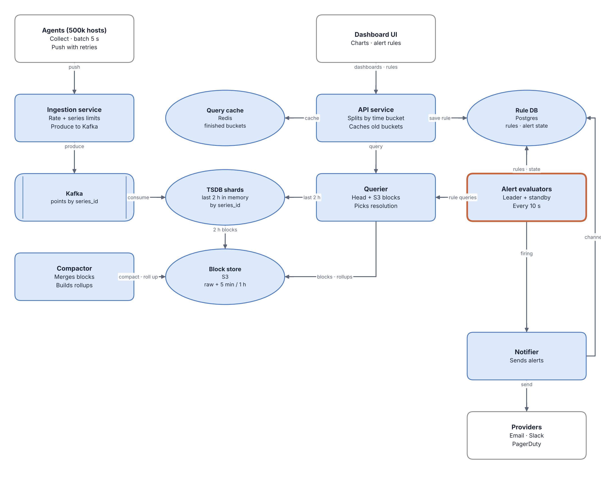
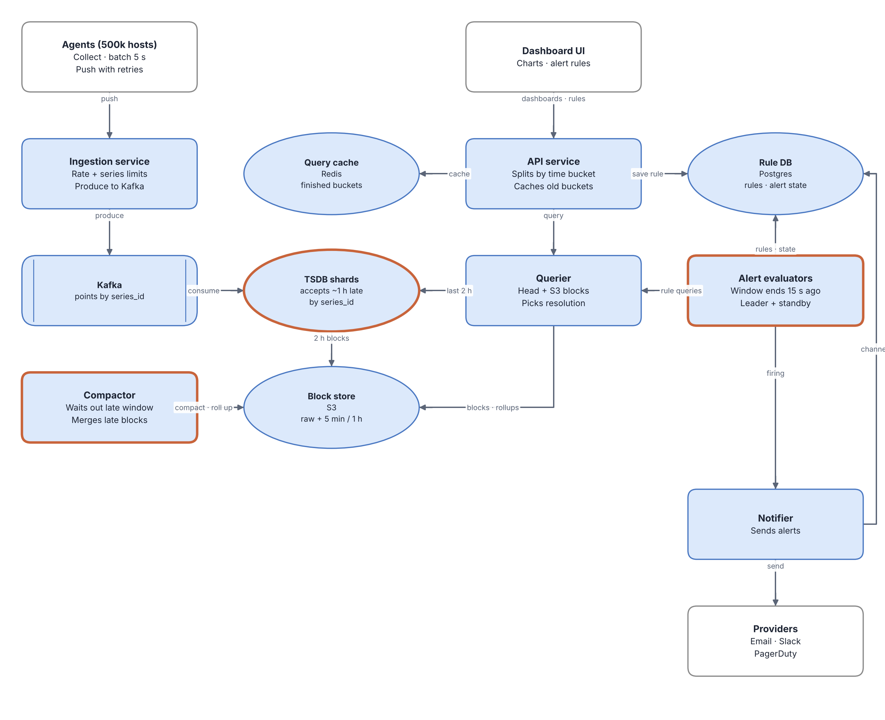
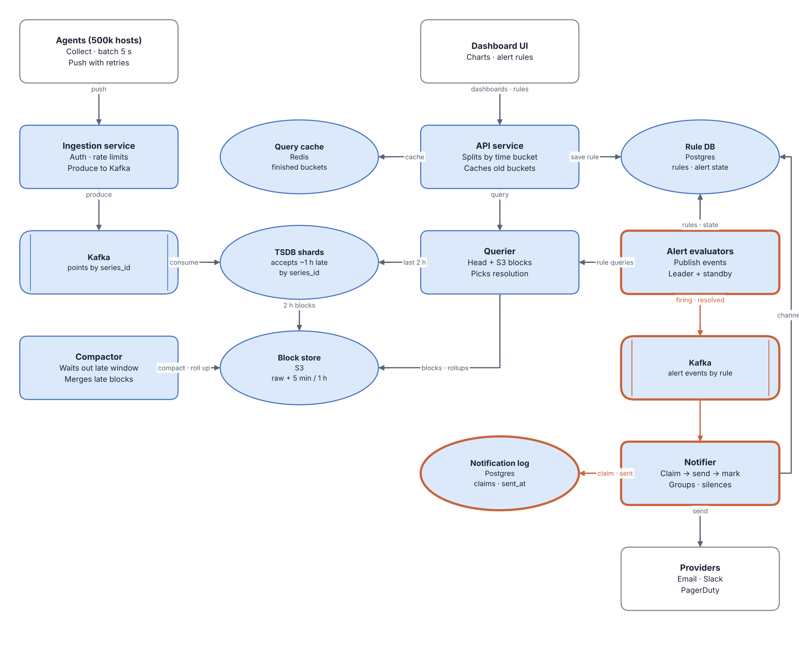

# Metrics Monitoring · system design, step by step

Whiteboard (Claude artifact): https://claude.ai/artifact/3U95BdrEaZKc1cm77NhsJH · PDF: [metrics-monitoring.pdf](metrics-monitoring.pdf)

> Part 2 · Design: Kafka buffers ingest; recent data from the TSDB, long ranges from S3 rollups

## Part 1 · Requirements, API and data model

### Functional requirements

Core requirements:

1. The platform should be able to ingest metrics (CPU, memory, latency, custom counters) from services
2. Users should be able to query and visualize metrics on dashboards with filters, aggregations and time ranges
3. Users should be able to define alert rules with thresholds over time windows (e.g. "alert if p99 latency > 500 ms for 5 minutes")
4. Users should receive notifications when alerts fire (email, Slack, PagerDuty)

Below the line (covered in the deep dives): retention and downsampling, late data, alert grouping and silences

Out of scope: logs and traces, anomaly detection, deploying agents, billing

### Non-functional requirements

- **Ingest scale:** 5M points/s from 500k servers (\~10 points/s each), \~430B points/day, \~50M active series (500k hosts × \~100)
- **Fast queries:** dashboards return within seconds, even over days or weeks
- **Fast alerts:** \~100k alert rules; an alert notifies < 1 minute after its condition (including its "for" duration) is met
- **Availability:** highly available; dashboards may be eventually consistent, but alert evaluation must be reliable (no missed alerts on accepted points that arrive within the \~15 s evaluation lag; late backfill fills dashboards and rollups but doesn't page after the fact)
- **Late data:** late or out-of-order points (network delays) are handled gracefully

### API

**Core**

- POST /v1/metrics (batched, compressed) [{name, type, labels {service, host, …}, timestamp, value}] → 202 once Kafka has stored the accepted points; series over the tenant's quota or new-series cap, and points with bad timestamps, are listed as refused in the response (the whole batch gets 429 only when the tenant is over its rate), and agents retry refused series only after the next filter publish (agents push)
- GET /v1/query?q=&start=&end=&step= → series [{labels, points}], e.g. p99 latency by region: histogram_quantile(0.99, sum by (region, le) (rate(latency_bucket[5m])))
- POST /v1/alerts {name, query, condition "> 500", for "5m", severity, channel_ids} → alert_id
- POST /v1/channels {type: email | slack | pagerduty, target} → channel_id

**Below the line**

- PUT /v1/dashboards/{id} (saved queries + layout) · POST /v1/silences {matchers, until}

Auth: API keys for agents; user session for the UI

### Entities

**Core**

- **series**: series_id PK (hash of metric name + sorted labels), name, type (counter / gauge / histogram), labels
- **point**: (series_id, timestamp) → value, stored compressed in TSDB chunks
- **alert_rule**: rule_id PK, owner_id FK, query, condition, for_duration, severity, channel_ids
- **alert_state**: (rule_id, label set) PK, state (ok / pending / firing / resolved / no_data), pending_since, last_change; **evaluator shard**: lease epoch, evaluated-through window end
- **channel**: channel_id PK, type, target

**Used by the deep dives**

- **label index** (in the TSDB): label=value → series_ids
- **rollup**: (series_id, resolution 5 min / 1 h, bucket_start) → min, max, sum, count, last, increase (counters and histogram buckets)
- **notification_log**: (rule_id, label set, episode = pending_since, event) PK, claimed_at, sent_at
- **silence**: silence_id PK, matchers, until, created_by

## Part 2 · Design, step by step

Each step redraws the whole diagram. Blue = our services, white = external, circle = storage, orange outline or orange arrow = new or changed in that step.

### Step 0 · Baseline (high-level design)

#### Step 0: works, but has problems

**Core 1 · ingest:** an agent on each server pushes metrics to the Ingestion service, which writes the points into one time-series DB

**Core 2 · dashboards:** the UI sends queries (filters, aggregations, time range) through the API service to the Query service, which runs them on the DB

**Core 3 · alert rules:** users save rules through the API service into Rule DB

**Core 4 · notify:** the Alert evaluator runs every rule's query once a minute through the Query service; when one fires, the Notifier sends email / Slack / PagerDuty to the rule's channels (from Rule DB)

**Why start here:** the shortest path that covers all four core requirements; make it clear first, then fix problems one at a time

**Problems:**

1. 5M points/s is far beyond one DB; a slow DB or a burst means dropped points
2. \~430B points/day: a general-purpose DB stores each point in 50+ bytes
3. A 4-week dashboard scans billions of points; many people open the same dashboards
4. \~100k rules once a minute on one evaluator: slow, and a single point of failure
5. Points arrive late or out of order; failing hosts flood people with pages, and a crash can lose one

**Next:** each deep dive fixes one problem; new or changed components get an orange outline

### Step 1 · DD1 Ingest 5M points/s: add Kafka

#### DD1 · Ingesting 5M points per second

**Problem:** 500k servers × \~10 points/s, with bursts after deploys or network recovery; the database must never be the reason points are dropped

**Added:** Kafka between ingestion and storage

- Agents (OpenTelemetry Collector or Prometheus agent) batch \~5 s of points, compress them and retry; a local disk buffer covers short outages
- Ingestion is stateless behind a load balancer: checks the API key, validates, applies per-tenant limits and produces to Kafka. It answers 202 only once all in-sync replicas have the batch (acks=all, RF 3 across zones, min.insync.replicas 2, no unclean leader election), so every point in a 202 is stored
- The topic is partitioned by series_id (hash of name + sorted labels), keeping each series in order. \~250 MB/s (5M × \~50 bytes) → a few hundred partitions; TSDB shards consume them, and Kafka absorbs bursts and replays after a crash (\~24 h)
- Cardinality guard, before the 202 (a label like user_id would create millions of series): shards publish per tenant a Bloom filter of active series; a Redis set of series admitted since (keyed by filter generation, cleared once every shard's publish covers it) fills the gap (neither line drawn). A new series is admitted with SADD (counted once) from the instance's share of the tenant's headroom, under a per-tenant cap on new series per second
- Refused new series are named; the rest of the batch is stored and acked. Over the cap, the agent retries them at each publish (\~1 min); over the quota, they wait for room. With Redis up, a series that stays active (Bloom false positives included) is never refused later: shards charge it to the quota; one returning after going quiet is checked as new
- Redis down, or its set lost in a failover → each instance uses its local copy of the admitted set (written back on recovery) and admits unchecked series under a small per-instance cap. The one exception: a series admitted elsewhere can be refused until the first shard publish that covers it (normally ≤ \~2 min)
- TSDB shards never refuse an acked point: their ceiling is soft; series that slipped past are written, counted and alerted

**Why Kafka:** a durable buffer that decouples ingest from storage

**When things fail:**

- TSDB slow or down → points wait in Kafka; dashboards lag, alert rules wait for the shard watermark (DD5), nothing is lost
- Kafka unavailable → agents buffer on disk and retry

### Step 2 · DD2 Storage: sharded TSDB, blocks in S3

#### DD2 · Time-series storage

**Problem:** \~430B points/day and \~50M active series; a general-purpose database can't store them cheaply or scan them fast

**Added:** a sharded time-series DB (the Prometheus TSDB design, as in Mimir or VictoriaMetrics) with blocks in S3; the Query service becomes a Querier that fans out

- Sharded by series_id; each shard keeps the last \~2 h in memory (the head block) with a write-ahead log. Replicated 3×: three shards consume the same partition; only one replica uploads each block, and queries merge replicas by timestamp
- Memory: \~50M series × \~3 KB ≈ 150 GB per replica → \~20 shards × 3 replicas
- Compression (Gorilla): timestamps stored as delta-of-delta, values XOR'd with the previous one → \~1.5 bytes per point instead of 16 → \~650 GB/day
- Every 2 h the head becomes an immutable block (per-series chunks + label index) uploaded to S3
- Inverted label index: label=value → series_ids, so {service="api", region="us"} finds its series without a scan
- Series are hashed, so a query can't know which shards hold its series: the Querier asks all shards and merges; blocks older than 2 h are read from S3
- Retention: raw data 15 days (longer history kept as rollups, DD3)

**Why not Postgres or Cassandra:** \~30× more bytes per point (50+ vs \~1.5), no time-series compression or label index; on Cassandra you'd build the chunking yourself (what M3 did)

**When things fail:**

- A replica dies → the other two answer; the replacement replays the WAL / Kafka
- Everything older than 2 h is safe in S3

### Step 3 · DD3 Fast queries: read S3, rollups, cache

#### DD3 · Fast queries over weeks

**Problem:** "p99 latency by region over 4 weeks" touches billions of raw points, and popular dashboards rerun the same queries all day

**Added:** Compactor (rollups), Query cache (Redis); the Querier reads S3 blocks

- The Querier reads S3 blocks directly, with index and chunk caches (the store-gateway role), so data older than 2 h is a normal read
- The Compactor merges small blocks and writes 5-minute and 1-hour rollups per series (min, max, sum, count, last; for counters and histogram buckets also the reset-adjusted increase, so rate() over rollups divides increase by the bucket width, the [5m] window widening to the resolution). Built from blocks, where retries are already de-duplicated, so nothing is counted twice
- Resolution follows the range: < 1 day raw, < 1 week 5-minute, longer 1-hour → a 4-week chart reads \~670 points per series instead of \~240k; the last few hours, not yet rolled up, are read raw and aggregated on the fly
- Percentiles: latency is sent as histogram bucket counters, so p99 by region = histogram_quantile over the summed bucket rates. Bucket counts add up across hosts and time; averaging each host's p99 would be wrong
- The API service splits a query by time bucket and caches finished buckets in Redis. Buckets inside the late-data window (\~1 h) aren't cached, because late points can still change them; when an older backlog is compacted in, the cached buckets for that tenant and time range are invalidated
- Guardrails: max series per query, timeouts and per-user concurrency
- Retention: 5-minute rollups 90 days, 1-hour rollups 2 years

**Why 5 minutes, not 1:** at a 10 s interval a 1-minute bucket holds only 6 points; storing 5 aggregates for it saves nothing

**When things fail:**

- Cache down → slower, still correct
- A slow shard → retried on another replica, then partial results marked as partial

### Step 4 · DD4 Reliable alerting in < 1 minute

#### DD4 · Reliable alerts within a minute

**Problem:** \~100k rules such as "p99 > 500 ms for 5 min" must fire within a minute once the condition holds, and a crashed evaluator must neither miss nor double-send alerts

**Added:** sharded Alert evaluators, each shard with a leader and a hot standby; alert state in Rule DB

- Rules are split into shards by rule_id; each shard has a leader (lease) and a standby that takes over in \~10 s
- Only the leader evaluates and writes alert_state, with compare-and-set on its lease epoch (a deposed leader's write fails), together with the shard's evaluated-through window end. Only after that write does it publish the firing or resolved event (idempotent episode key, DD6); a new leader republishes any firing or resolved state with no notification claim and resumes from evaluated-through, so a crash between the two can't lose a page. Rules are cached in memory; per-rule alert_state is written only when it changes, the shard row (epoch, evaluated-through) every step
- Each rule runs every 10 s through the Querier, which answers recent windows from the TSDB head in milliseconds, on capacity reserved for alerts
- A state machine per (rule, label set): OK → PENDING (condition true; pending_since saved) → FIRING once it has held for the "for" time (5 min) → RESOLVED. pending_since identifies the alert episode and becomes its dedupe key (DD6), so a failover neither restarts the timer nor sends twice
- Budget, from a point being measured to the alert firing: the 15 s window lag (DD5) covers measured → Kafka append (batching ≤ 5 s, plus clock slack); then consumer lag (seconds) + evaluation interval ≤ 10 s ≈ 30–35 s normally, longer only while a shard lags (the rule waits and a lag alert fires), then \~5 s to notify (DD6)
- "No data" can alert too (a host stopped reporting)

**Why one leader per shard:** two active evaluators would race on the state and send twice

**When things fail:** the leader dies → its lease expires and the standby continues from alert_state within \~10 s

### Step 5 · DD5 Late and out-of-order data

#### DD5 · Late and out-of-order data

**Problem:** a point measured at 12:00:00 may arrive at 12:03; agents retry and resend; server clocks drift

**Changed:** the TSDB, the Compactor and the Alert evaluators all allow for lateness

- Points are stored by the time they were measured, not when they arrived
- The TSDB accepts out-of-order points within \~1 h: each series has a small out-of-order buffer merged when the block is cut; older points go to separate out-of-order blocks
- Duplicates from retries (same series, same timestamp): the TSDB keeps the first sample and drops the copy, so a resend is harmless
- The Compactor builds rollups only after the late window has passed, merging the out-of-order blocks first, so rollups use complete data
- Alerts evaluate a window ending at E only once every partition is consumed up to Kafka append time E + 15 s (per partition, the replicas the Querier reads; one rebuilding is skipped). Append time, not measured time, so a skewed clock can't move it. A lagging partition, or a partial query answer, makes the rule wait with no OK, no_data or resolve transitions, and raises a consumer-lag alert; on catch-up every skipped 10 s step is evaluated in order, and "for" timers run in window time. A point measured more than \~15 s before it was appended (a host clock running behind) isn't covered by the guarantee: it's stored and later windows may read it, but past steps aren't re-run; a per-host clock-skew alert fires. One lagging partition holds back all rules (every rule reads every partition): the deliberate cost of not missing points, bounded by a lag alert after \~30 s
- Ingestion checks timestamps before the 202: more than \~10 min in the future (clock skew) or older than the retention window → listed as refused in the response, never dropped after an ack

**The trade-off:** waiting longer gives more complete data but slower alerts; 15 s keeps the alert budget under a minute

**When things fail:** an agent offline for hours sends a backlog → accepted into out-of-order blocks; the next compaction rebuilds the rollups for those hours

### Step 6 · DD6 Notifications: queue, claim → send → mark

#### DD6 · Notifications without spam

**Problem:** 500 failing hosts would mean 500 pages; Slack or PagerDuty can be down; a crash mid-send must neither lose nor repeat a page

**Added:** a queue for alert events (Kafka, partitioned by rule_id), a Notifier that claims → sends → marks, and a Notification log

- Evaluators publish firing / resolved events to the queue instead of calling providers directly
- Each notification has a key that is the same on every retry or replay: (rule, label set, episode = pending_since, event: firing / resolved / reminder n)
- Claim: insert the key into the Notification log only if it's new, with sent_at empty. Send with the provider's idempotency key (PagerDuty dedup_key), then set sent_at. A sweeper resends claims still empty after \~30 s; PagerDuty's dedup key makes a resend harmless; email and Slack are at-least-once (a rare duplicate), and the sweeper skips claims whose retries are still running
- Grouping: the first alert of a rule goes out at once; more alerts of the same rule within \~30 s are batched into one follow-up ("api p99 high on 47 hosts")
- Repeat reminders (e.g. every 4 h while firing), silences during maintenance, per-channel rate limits; channels and silences come from Rule DB
- Retries with exponential backoff; a channel that keeps failing escalates to a fallback

**Why a queue:** a provider outage never blocks evaluation, and nothing is lost while it's down

**When things fail:** the Notifier dies → events wait in Kafka; the sweeper resends anything claimed but not marked sent
