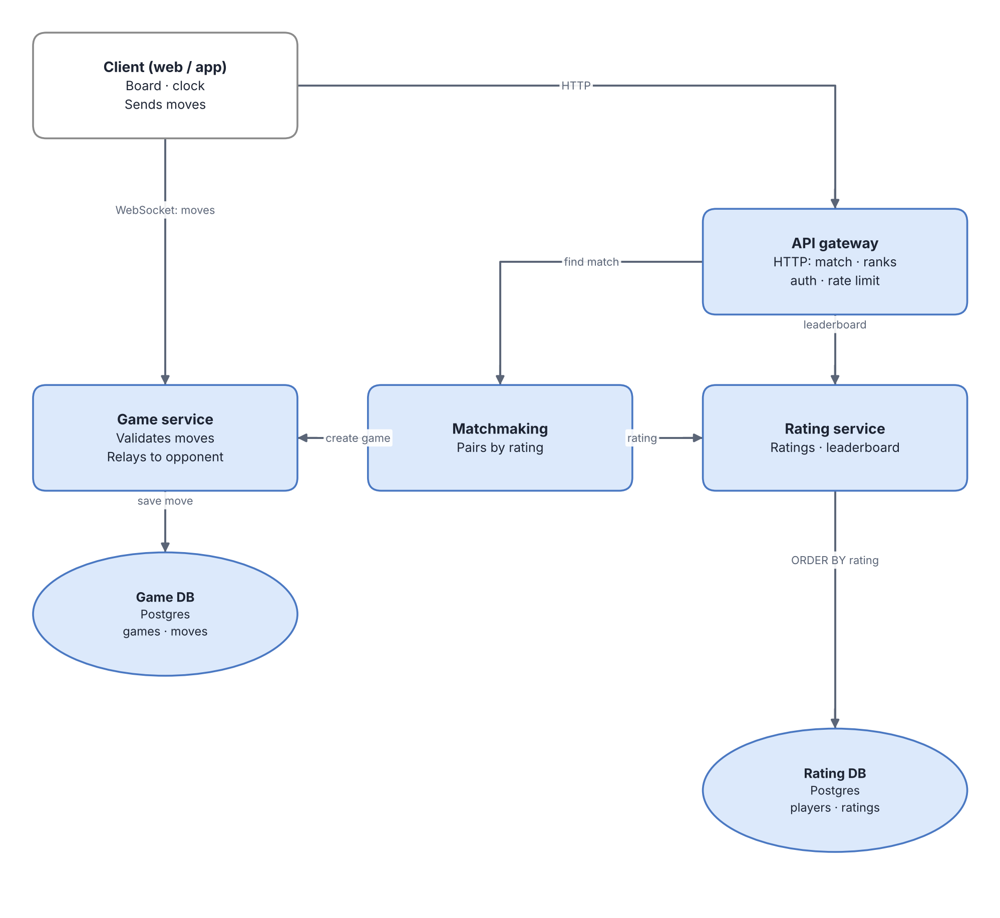
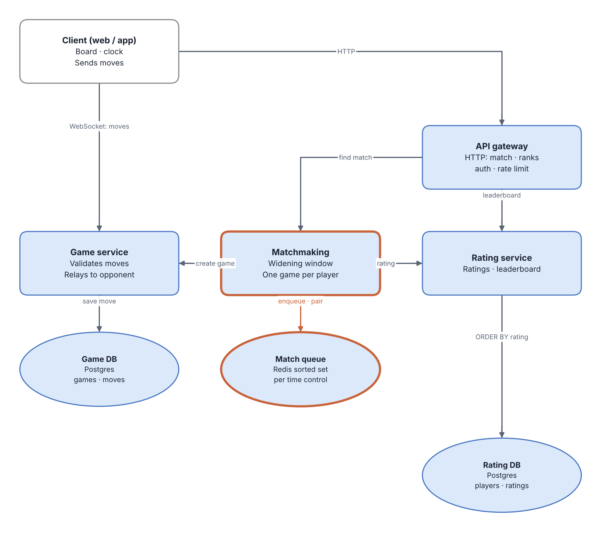
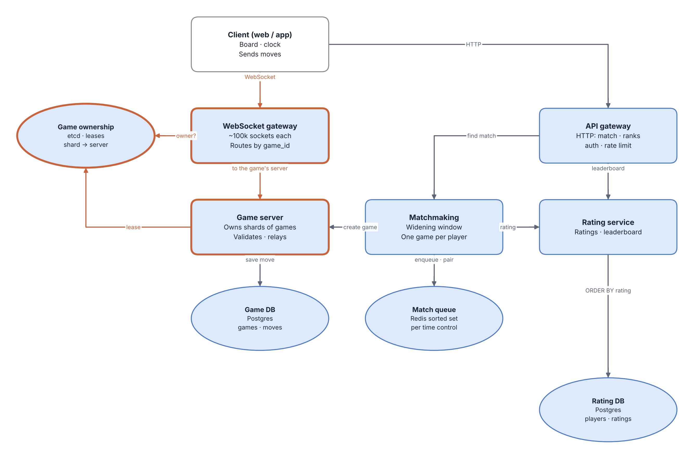
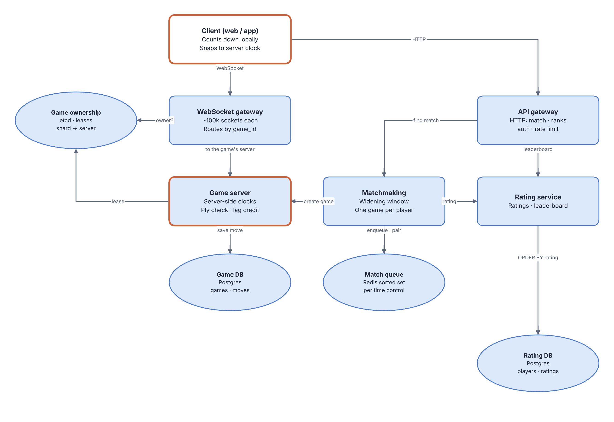
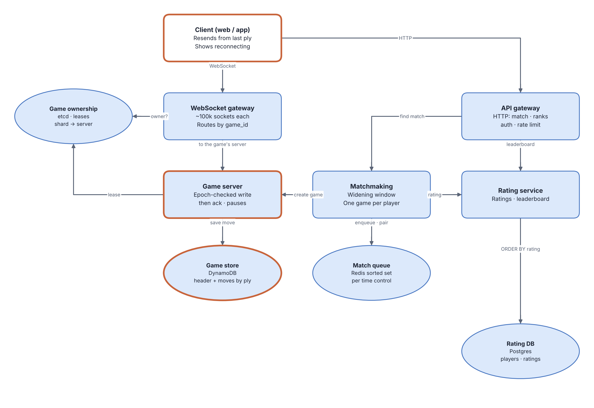
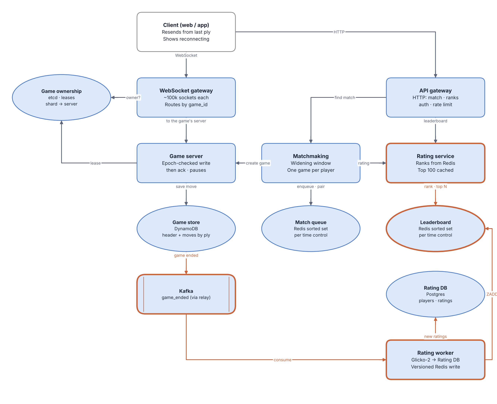

# Online Chess · system design, step by step

Whiteboard (Claude artifact): https://claude.ai/artifact/2XwH7NSzQJZGWCB8qW3Hkx · PDF: [online-chess.pdf](online-chess.pdf)

> Part 2 · Design: one server owns each game and its clock; everything else is eventually consistent

## Part 1 · Requirements, API and data model

### Functional requirements

Core requirements:

1. Players should be able to find an opponent through skill-based matchmaking and start a game
2. Players should be able to play a game in real time
3. Players should be able to view a global leaderboard and see their own rank, both updating shortly after games finish

Below the line (covered in the deep dives): clocks and time controls, reconnecting to a game

Out of scope: chat, spectating, tournaments, anti-cheat, game analysis, friends and challenges

### Non-functional requirements

- **Low latency:** a move reaches the opponent's board in < 200 ms end to end (p95, same region); players may have only seconds left
- **Consistency over availability for game state:** one server decides each game; if it can't be reached, the game pauses instead of letting two boards drift apart (a paused game can be recovered, a corrupted one can't)
- **Durability:** an acknowledged move and a finished game's result are never lost
- **Fresh leaderboard:** ranks update within a few seconds after a game ends; eventual consistency is fine
- **Scale:** 10M registered players; 500K concurrent games (1M connections) at peak; \~65k moves/s (a game ≈ 80 plies, i.e. half-moves, over \~10 min)

### API

**Core**

- POST /matchmaking {time_control} → ticket_id (join the queue; refused if you already have a ticket or a game)
- GET /matchmaking/{ticket_id} (long-poll) → game_id, color, game_token when matched
- WebSocket /games/{id}/live, game_token in the first message (play in real time):
  - client → server: join {last_ply} · move {ply, uci e.g. "e2e4"} · resign · offer_draw / answer_draw · claim_win · pong
  - server → client: ack {ply} · move {ply, uci, white_ms, black_ms} · moves since last_ply (on join) · game_over {result, reason} · ping
- GET /leaderboard?time_control=&cursor= → top players, next_cursor
- GET /leaderboard/me?time_control= → my rating, my rank, players around me

**Below the line**

- DELETE /matchmaking/{ticket_id} (cancel) · GET /games/{id} (moves, result)

Auth: user session for HTTP; the WebSocket uses the short-lived game_token

### Entities

**Core**

- **player**: player_id PK, username, region, created_at
- **rating**: (player_id, time_control) PK, rating, deviation (Glicko-2), games_played, updated_at
- **game**: game_id PK, white_id FK, black_id FK, time_control, status (active / finished / aborted), result, owner_epoch, started_at, ended_at (from DD4: a header item next to its moves)
- **move**: (game_id, ply) PK, uci, white_ms_left, black_ms_left, server_ts

**Used by the deep dives**

- **ticket** (Redis hash): ticket_id → player, time_control, rating, deviation, region, enqueued_at, status, game_id; plus one sorted set per time control: player → rating
- **player_active**: player_id → current ticket or game, so nobody is in two games
- **shard_owner** (etcd): shard (= hash(game_id) mod \~4k) → game server, epoch
- **leaderboard** (Redis): sorted set per time control + rating hash {rating, deviation, games_played}
- **processed_game**: game_id PK, so a game's rating update is applied once

## Part 2 · Design, step by step

Each step redraws the whole diagram. Blue = our services, white = external, circle = storage, orange outline or orange arrow = new or changed in that step.

### Step 0 · Baseline (high-level design)

#### Step 0: works, but has problems

**Core 1 · match:** client → API gateway → Matchmaking service, which pairs waiting players with close ratings (from Rating service) and creates the game on a Game service instance; both clients get game_id by long-poll

**Core 2 · play:** both clients open a WebSocket to the Game service. Each move is validated, saved to Game DB and sent to the opponent

**Core 3 · leaderboard:** Rating service runs ORDER BY rating on Rating DB. When a game ends, Game service asks Rating service to update both ratings (line not drawn; replaced in DD5)

**Why start here:** the shortest path that covers all three core requirements; make it clear first, then fix problems one at a time

**Problems:**

1. Matching scans all waiting players; two matchmakers can put one player in two games; a fixed rating gap means long waits
2. The two players can land on different Game service instances, so nothing holds the one true board; 1M connections
3. Who decides how much time is left? Lag makes slow connections lose time; moves can arrive twice or out of order
4. If a Game service instance crashes, nobody takes over its games, and Postgres has to absorb \~65k move writes/s
5. Ranking 10M players with ORDER BY and COUNT(*) on every view is slow

**Next:** each deep dive fixes one problem; new or changed components get an orange outline

### Step 1 · DD1 Skill-based matchmaking: add Redis match queue

#### DD1 · Skill-based matchmaking

**Problem:** pair players of similar skill quickly, never put one player in two games; \~800 games start per second at peak

**Added:** Match queue in Redis: one sorted set per time control (bullet, blitz, rapid), scored by rating; ticket details in a hash per ticket

- Join: refused if the player already has a ticket or a game (player_active, SET NX). Otherwise ZADD queue:{time_control} rating player_id, and the ticket hash stores region, deviation and enqueued_at
- Matchmaker workers (one per time control, or per rating band for big pools; a leader lease each) loop every \~100 ms: two ZRANGE BYSCORE … LIMIT 1 queries, just above and just below a player's rating, find the closest opponent; the pair must fit both players' windows
- The window widens with waiting time: ±50 at first, ±100 after 10 s, ±200 after 30 s; high-deviation (new) players start wider
- Both players are claimed atomically with a Lua script (ZREM both, only if both are still queued)
- Creating the game is idempotent, keyed by the two ticket ids. If it fails, both players are re-queued with their original enqueued_at. The final guard is a conditional write of player → game, so even after a Redis failover nobody ends up in two games
- Same-region opponents are preferred for latency; the rule relaxes after a few seconds
- The result (game_id + game_token) is written to each ticket hash and pushed via Redis pub/sub to the server holding that player's long-poll

**Rating system:** Glicko-2 (rating + deviation, as Lichess uses)

**When things fail:**

- A matched player never shows up → the game is aborted if no first move within \~20 s; the other player is re-queued with their original enqueued_at
- Redis primary lost → a replica takes over; clients re-send their ticket

### Step 2 · DD2 One server per game: add WebSocket gateway, etcd

#### DD2 · One authoritative server per game

**Problem:** both players' moves must go through one place that holds the board, and 1M connections can't sit on a few servers

**Added:** WebSocket gateway, Game ownership in etcd

- Each live game lives in memory on exactly one game server (one actor per game: board, clocks, move list). All moves are validated and ordered there
- Ownership is by shard, not by game: game_id hashes into \~4k shards, and etcd maps shard → server, epoch with one lease per server. \~100 game servers × \~5k games each, so a crash pauses \~1% of games
- Matchmaking creates the game on the server that owns its shard, using the shard map it caches from etcd (that read isn't drawn)
- Clients connect to any WebSocket gateway; it finds the owner in its cached shard map (kept fresh by an etcd watch) and forwards over a persistent gRPC stream. The game server pushes each move to both players
- Latency budget (same region): client → gateway \~30 ms, → game server \~2 ms, validate \~1 ms, → opponent \~30 ms ≈ 65 ms (≈ 85 ms with DD4's write), well under 200 ms
- Sizing: 1M connections at \~100k per gateway ≈ 10 gateways (20 with headroom)

**Why a separate gateway:** TLS and heartbeats for 1M sockets scale on their own, and a game server restart doesn't drop connections

**Why etcd:** strongly consistent leases with an epoch. A server that has lost its lease (GC pause, network split) may still think it owns its games for a moment, but the epoch check in the store rejects its writes (DD4)

**When things fail:**

- A game server dies → a controller moves its shards to the others; gateways see the change through their watch
- etcd unavailable → servers can't renew leases; after the TTL they stop accepting moves and games pause (consistency over availability)

### Step 3 · DD3 Fair clocks and move order

#### DD3 · Fair clocks and move order

**Problem:** with seconds left on the clock, who measures time decides games; lag and retries can delay, repeat or reorder moves

**Added:** server-authoritative clocks; a ply number on every move

- Each move carries its ply (move number). The server accepts it only if ply = next expected; a repeat of the last move is acked again; anything else is rejected and the client resyncs
- The server owns both clocks: when a move arrives, it charges the mover for the time since the opponent's move was sent, then starts the other clock
- Lag compensation: the server measures each player's network delay with pings and credits it back on each move (capped at \~0.5 s), so a slow connection isn't punished
- Every broadcast carries both remaining times; clients count down locally and snap to the server's numbers
- Running out of time is decided by a timer on the server, never by a client
- Premoves are queued on the client and sent the instant the opponent's move arrives

**Why server time:** client clocks drift and can be tampered with; one authority means one truth

**When things fail:** a delayed or duplicated message can't change the game, because the ply must match; a drifting client clock is corrected on every move

### Step 4 · DD4 Crashes and reconnects: add DynamoDB game store

#### DD4 · Crashes and reconnects: pause, don't diverge

**Problem:** a game server can crash mid-game and players' networks drop; the NFR says pause rather than let boards diverge

**Added:** Game store in DynamoDB, written before every ack; resume from the last ply

- Each game has a header item (game_id, ply 0) holding owner_epoch, players and status. A server that takes over a shard bumps the epoch of each game it loads
- Each move is one TransactWriteItems: check header epoch = mine, and put (game_id, ply) only if that ply doesn't exist. Only then is it acked and broadcast. Clocks are saved with each move
- Game server dies → its shards move (\~5 s); players see "reconnecting" and both clocks are paused. The new owner bumps the epoch, rebuilds each game from the store and resumes. The old server's writes now fail the epoch check
- A player's own network drops → their clock keeps running (normal chess rules); on reconnect the client sends join {last_ply} and gets the missing moves; after \~60 s away the opponent can claim the win
- Latency: the transaction adds \~10–20 ms (p95), so a move reaches the opponent in \~85 ms in-region. Cross-region pairs (matched after the region rule relaxes) are hosted near one player; the 200 ms p95 target is for same-region games
- Finished games are marked with their result; old games are archived to S3

**Why DynamoDB:** \~65k move writes/s is too much for one Postgres; DynamoDB is partitioned by game_id and its conditional writes give strict order and fencing

**Why pause:** a new owner that might be missing a move must not let play continue; a few seconds' pause is recoverable, a corrupted game isn't

**When things fail:** a slow write means no ack yet; the client shows the move as pending and retrying the same ply is safe

### Step 5 · DD5 Leaderboard: add Kafka, Rating worker, Redis

#### DD5 · Leaderboard that updates in seconds

**Problem:** ranking 10M players with ORDER BY and COUNT(*) on every view is too slow, and ratings must change seconds after a game

**Added:** Kafka (game_ended events), Rating worker, Leaderboard in Redis

- A small stream relay reads DynamoDB Streams and forwards only finished-game records to Kafka (the stream also carries every move)
- Rating worker computes Glicko-2 for both players and updates Rating DB in one transaction (locking both rows in player_id order) together with a processed_game row
- Then, for every event, even a replay already processed, it reads both players' ratings back from Rating DB and writes Redis with a version check (a Lua script applies it only if games_played is newer). A crash between the DB commit and Redis heals on redelivery, and out-of-order writes can't go backwards
- My rank: ZREVRANK in O(log n); top 100: ZREVRANGE, cached \~5 s; players around me: ZREVRANGE rank − 5 … rank + 5
- 10M players × \~100 bytes ≈ 1 GB per time control: one Redis primary with read replicas
- Rating service (and matchmaking through it) reads rating + deviation from the Redis rating hash; Rating DB stays the source of truth

**Why a Redis sorted set:** rank and range queries are built in and O(log n)

**When things fail:**

- Redis lost → rebuild from Rating DB (one scan, a few minutes); leaderboard briefly stale
- Rating worker down → events wait in Kafka and ranks catch up afterwards
