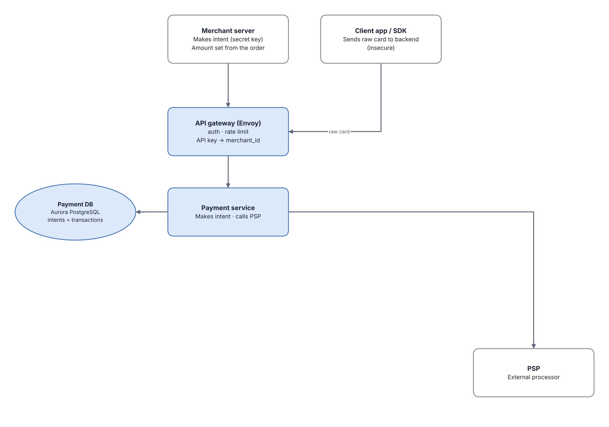
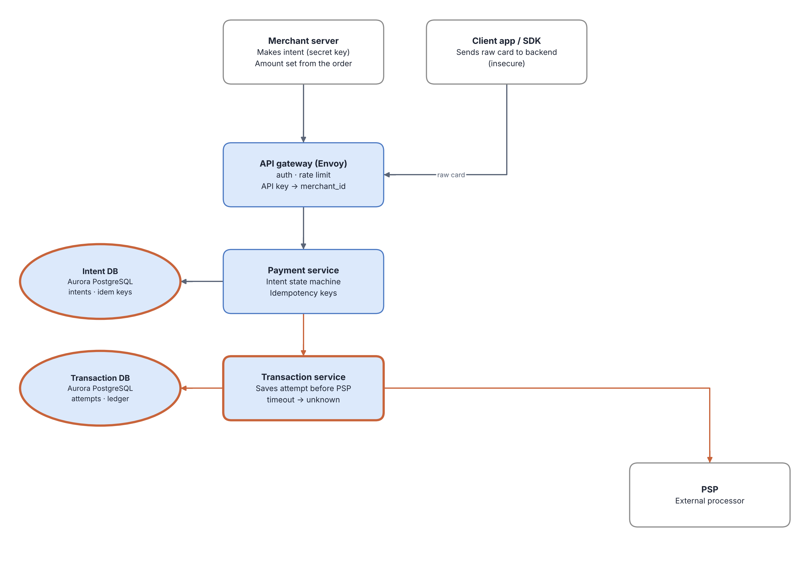
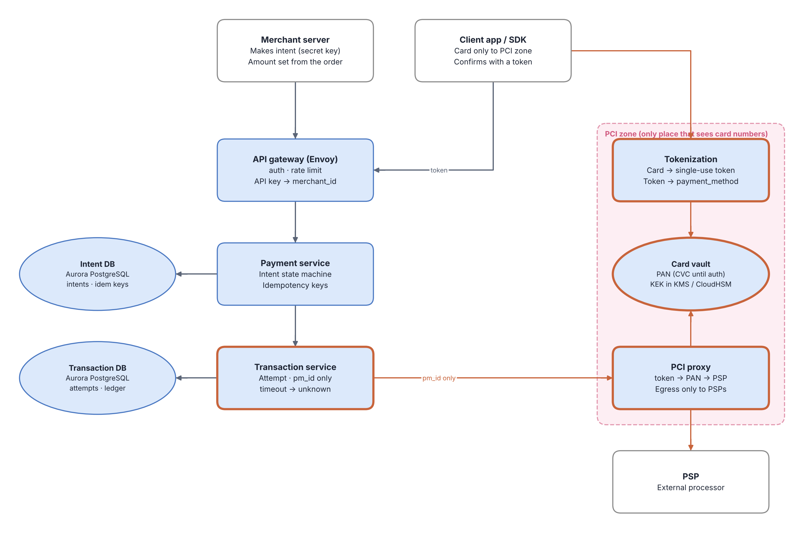
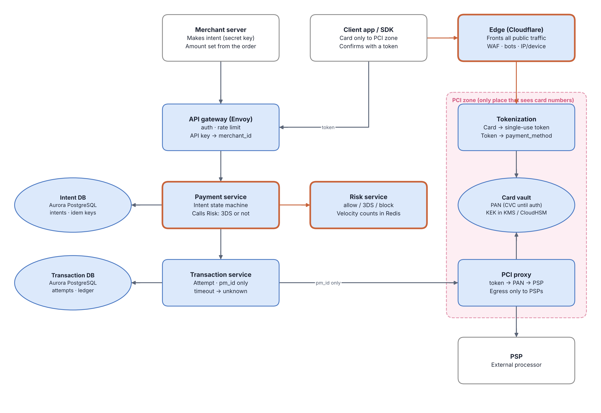
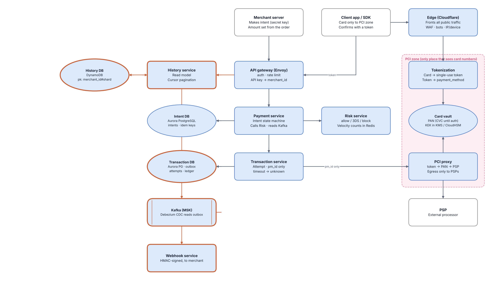
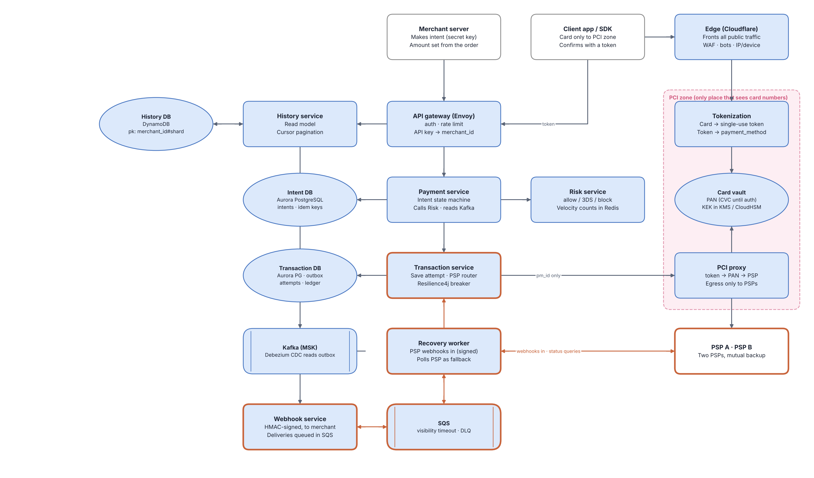
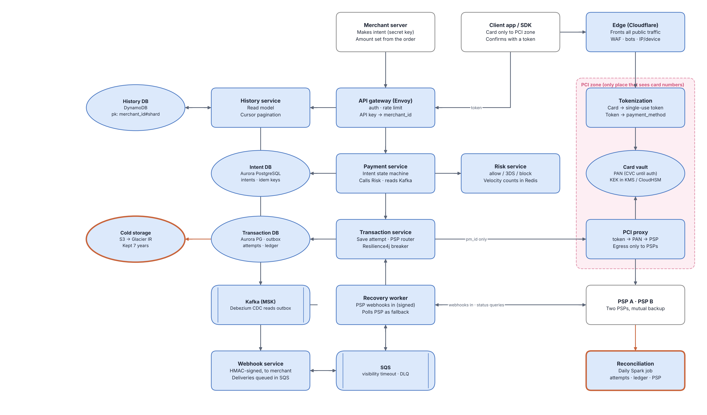
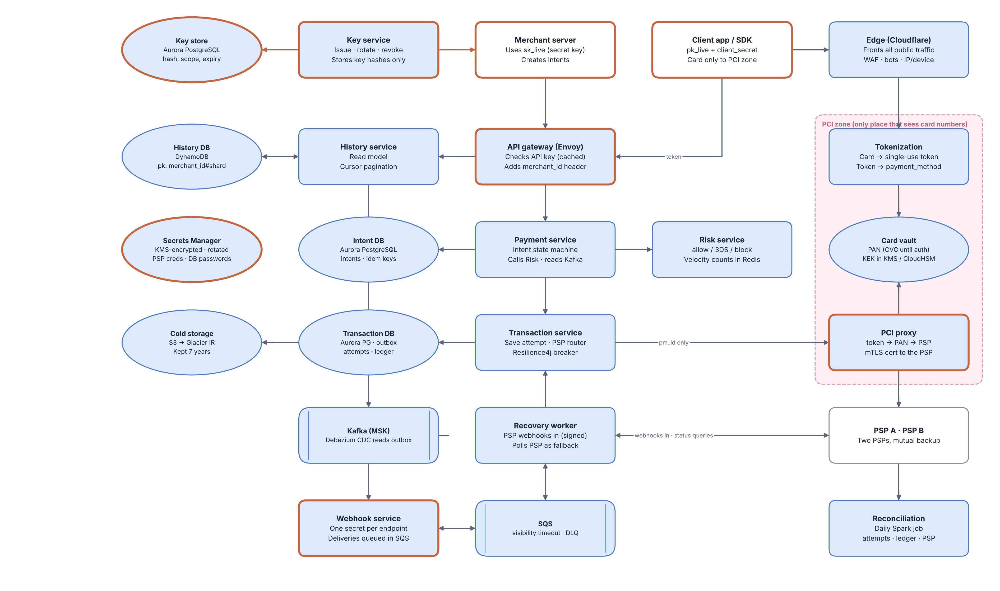

# Payment system · system design, step by step

Whiteboard (Claude artifact): https://claude.ai/artifact/PvhQkQdU4qGNcRxAGi3SbA · PDF: [payment.pdf](payment.pdf)

> Start simple; each deep dive adds components

## Part 1 · Requirements, API and data model

### Functional requirements

1. Merchant creates a payment intent
2. Customer pays it by card (3DS if needed)
3. Check a payment's status
4. List transaction history

Out of scope: refunds, disputes, payouts, saved cards

### Non-functional requirements

- Never charge twice, never lose a charge (strong consistency, idempotent APIs)
- Secure: PCI DSS, card data only in the PCI zone
- High availability for create and pay: 99.99% (≈ 4 min down per month)
- Low latency for history: a page loads in < 1 s (p99); a new payment can take a few seconds to show up in the list
- 10M payments/day ≈ 120 TPS, \~1.5k TPS at peak

### API

- POST /payment_intents {amount, currency} → id, client_secret
- POST /tokens {encrypted card} → token (PCI zone)
- POST /payment_intents/{id}/confirm {token} → status (+ next_action for 3DS)
- GET /payment_intents/{id} → status
- GET /transactions?cursor= → list, next_cursor

Keys: the merchant's server uses the secret key (sk_: full access, never in the browser) to create intents. The browser uses the publishable key (pk_: public, can only tokenize and confirm) plus that intent's client_secret. Create and confirm take an Idempotency-Key

### Entities

- **payment_intent**: intent_id PK, merchant_id FK, amount, currency, status, attempt_id, version
- **payment_attempt**: attempt_id PK (= PSP idempotency key and merchant reference), intent_id FK, pm_id FK, merchant_id, amount, currency, psp, psp_ref, status, version
- **idempotency_record**: (merchant_id, key) PK, request_hash, state, attempt_id, lease_id, response
- **ledger_entry**: entry_id PK, attempt_id FK, account, debit / credit, amount, currency
- **payment_method** (vault): pm_id PK, merchant_id FK, intent_id FK, encrypted PAN
- **webhook_delivery**: delivery_id PK, event_id, endpoint_id, next_attempt_at, status

## Part 2 · Design, step by step

Each step redraws the whole diagram. Blue = our services, white = external, pink = PCI zone, circle = storage, orange outline or orange arrow = new or changed in that step.

### Step 0 · Baseline (high-level design)

#### Step 0: works, but has problems

**Flow:** merchant creates an intent → client confirms with the raw card → Payment service calls the PSP → result saved in Payment DB

**Why start here:** get the main flow clear first, then fix problems one at a time

**Problems:**

1. Client retries or PSP timeouts → the same payment may be charged twice
2. Card numbers pass through the gateway and every service → all of them are in PCI scope
3. No fraud checks, no history or webhooks, no reconciliation

**Next:** each deep dive fixes one problem; new or changed components get an orange outline

### Step 1 · DD1 No double charge: add Transaction service

#### DD1 · No double charge

**Problem:** client retries or PSP timeouts → the same payment may be charged twice

**Added:** Transaction service + Transaction DB; Payment DB becomes Intent DB

- An intent is the merchant-facing order; an attempt is each real PSP call. One intent can have many attempts (e.g. a new card after a decline)
- States — intent: requires_payment_method → (requires_action) → processing → succeeded / failed; attempt: pending → (requires_action / unknown) → succeeded / failed
- Idempotency record: key = (merchant_id, Idempotency-Key), kept 24 h, with a hash of the request body
- The first request inserts it as `in_progress` with a lease (lease_id, 60 s, longer than the 20 s PSP timeout) and picks the attempt_id right away
- Confirm moves the intent requires_payment_method → processing with a compare-and-set that also records the attempt_id, so a second confirm, even with a new key, can't start another charge
- Same key again: done → stored response; in progress → 409; different body → 422
- Crash mid-request → the lease runs out and the retry takes over. It holds the same attempt_id, so it skips the CAS: a final attempt is stored and returned; a pending one returns `processing` and step 5 finishes it. Responses are written only `WHERE lease_id = mine`
- No retry ever comes (browser gone) → a sweeper finds `in_progress` records with an expired lease and has Transaction insert that attempt_id as `abandoned` IF NOT EXISTS, so the stalled request can no longer create it. Then it follows the attempt's real state or rolls the intent back
- Write the attempt (pending) before calling the PSP; attempt_id is the PSP idempotency key. At most one active attempt per intent (partial unique index)

**Why two services and DBs:** one Aurora cluster would handle \~1.5k TPS; the split is for blast radius and ownership — attempts and the ledger are the money path with strict change control and audits, intents are a fast-changing merchant API

**Why Aurora PostgreSQL:** ACID transactions; partial unique indexes (MySQL has none); storage spans 3 AZs, fast failover

**When things fail:**

- PSP timeout, or a crash after `pending` was written → leave the attempt `pending` / `unknown`; never retry with a new key (step 5)
- Primary DB down → 503 during failover; the client retries with the same Idempotency-Key

### Step 2 · DD2 Card security: add the PCI zone

#### DD2 · Card data security (PCI)

**Problem:** card numbers flow through the gateway, Payment and Transaction → all of them are in PCI scope

**Added:** Tokenization, Card vault and PCI proxy in an isolated PCI zone

- The card form is an iframe on the PCI zone's domain. It encrypts the card with the zone's public key, so no proxy or CDN in between can read the number
- Tokenization checks the pk_ key, binds the token to that merchant and returns a single-use token (15 min)
- At confirm, Payment exchanges the token for a payment_method bound to the intent (line not drawn); it's idempotent per (token, intent_id), so a retried confirm gets the same pm_id
- Retries and a failover to PSP B reuse that payment_method; a new card after a decline creates a new one
- Our services only pass token / pm_id; the PCI proxy swaps them for the card inside the zone and forwards it to the PSP (vault-and-forward)
- Envelope encryption: a DEK encrypts the card, the KEK lives in KMS / CloudHSM; rotation only re-wraps DEKs
- CVC: PCI DSS forbids keeping it after authorization, even encrypted. It's deleted when the authorization result is known, or after 15 min at most
- The card fingerprint (for fraud limits) is an HMAC of the PAN, computed inside the zone

**Why:** PCI scope shrinks to the zone, plus the Edge as a service provider (step 3); the zone gets its own AWS account + mTLS; the proxy can only call PSP domains

**When things fail:** Vault and proxy run in multiple AZs and health checks remove bad nodes; attempts not yet sent to the PSP are safe to retry

### Step 3 · DD3 Fraud: add Edge and Risk

#### DD3 · Fraud prevention

**Problem:** card testing — bots try stolen cards with many small charges; plus stolen-card fraud

**Added:** Edge (Cloudflare), Risk service

- Cloudflare fronts all public traffic: confirm, the merchant API and the card iframe (its lines to the gateway aren't drawn)
- It serves the iframe's JS, so it could change the code that encrypts the card. It is therefore in PCI scope as a service provider (its AOC), with CSP and script-change monitoring on the iframe (PCI DSS 6.4.3 / 11.6.1)
- Edge: WAF + bot detection, rate limits per IP and device. Limits per BIN and card fingerprint run inside Tokenization, the only place that can read the card
- Payment asks Risk for a score → allow / 3DS / block
- 3DS: the attempt is sent with 3DS requested; the PSP returns a challenge, attempt and intent become `requires_action`, and confirm returns next_action with a redirect_url. The result comes back by PSP webhook (step 5)
- 3DS expiry: after 15 min a sweep asks the PSP to cancel by attempt_id and marks the attempt failed only once the PSP confirms; if the PSP says it was authorized, take the success. A late success on a failed attempt is voided automatically, with an alert
- After 3DS succeeds, liability for fraud chargebacks shifts to the issuer (other dispute types don't)
- Watch decline rates per merchant and tighten limits automatically on spikes

**Why Cloudflare:** a global edge blocks bad traffic early and its bot detection is mature; Risk keeps velocity counters in Redis for millisecond reads and writes

**When things fail:** Risk times out → fall back to rules (3DS above a small amount, tighter velocity limits); never block payments entirely

### Step 4 · DD4 Events: add Kafka, History, Webhook

#### DD4 · Events: consistency, history, webhooks

**Problem:** intents and attempts live in two DBs with no distributed transaction; history queries and webhooks shouldn't load the payments DB

**Added:** Kafka + Debezium, History service + History DB, Webhook service

- Confirm stays synchronous: Payment calls Transaction, gets the result and updates the intent before replying, so a GET right after confirm sees the new status
- Transaction writes the state and an outbox row in one local transaction; Debezium reads the Postgres WAL and publishes to Kafka
- Kafka brings later results (an `unknown` resolved, a PSP webhook) back to Payment, and fans events out to History and Webhook. The Kafka → Payment line is left out of the diagram
- Events carry the attempt's version, and Payment ignores older ones. If Payment crashed after Transaction succeeded, the intent shows `processing` for a few seconds; a GET on a `processing` intent also asks Transaction for the latest attempt
- Partition by intent_id so each payment's events stay in order
- History: read model in DynamoDB with cursor pagination; single-payment status is still read from Payment
- Hot merchants: pk = merchant_id#shard, shard = hash(intent_id) % N. N is 1 for most merchants and grows with volume; a page reads the N shards in parallel and merges by created_at. A GSI on status serves filters
- Webhook: HMAC-SHA256 signature + timestamp, sent to the merchant (line not drawn)

**Why Kafka:** several consumer groups each read the same events, events can be replayed, and Debezium integrates natively; RabbitMQ deletes messages once consumed, so no replay

**Why DynamoDB:** queries by merchant + time, read-heavy, scales automatically

**When things fail:**

- Kafka down → events stay in the outbox table; Debezium resumes from its replication slot. Alert on slot lag: a stuck slot keeps WAL and can fill the disk
- Consumer crashes → re-read from the last committed offset, dedupe by event_id
- Poison message → after a few retries, move it to a retry topic / DLQ so the partition isn't blocked

### Step 5 · DD5 Async results & timeouts: add Recovery, SQS, 2nd PSP

#### DD5 · PSP webhooks, timeouts and recovery

**Problem:** after a PSP timeout the attempt is stuck in `unknown`; 3DS and other results arrive later; failed webhook deliveries need retries; there is only one PSP

**Added:** Recovery worker (PSP webhooks + polling), SQS (+ DLQ), a second PSP

- PSP webhooks (3DS results, late authorizations) come into Recovery worker: verify the PSP's signature, dedupe by PSP event_id, update the attempt through Transaction
- attempt_id is sent as both the PSP idempotency key and the merchant reference, because a timeout returns no psp_ref; lookups and settlement files match on it
- On timeout Transaction puts the attempt_id on SQS (line not drawn). Within 15 min Recovery has Transaction resend the identical request with the same key (CVC still kept): the PSP returns the original result or charges once
- After 15 min: no more resends and the CVC is deleted; status lookups only (no card data, so Recovery calls the PSP directly over mTLS)
- Still unclear → the attempt stays `unknown` and blocks new attempts (the merchant sees `processing`). It closes when the PSP confirms it never got the request, or reconciliation finds the result; a late authorization on a closed attempt is voided automatically
- A sweep every 5 min picks up attempts stuck in `pending` or `unknown` (3DS ones have their own expiry, step 3)
- Merchant webhooks: retries in the first hour via SQS with backoff; longer schedules (up to 3 days) are webhook_delivery rows (Intent DB) with next_attempt_at, since SQS delays cap at 15 min. Block private IPs (SSRF); events carry created_at + version because standard SQS doesn't keep order
- PSP router + Resilience4j: per-PSP timeouts and circuit breakers; fail over only requests that were definitely never sent; each attempt records its psp

**Why SQS:** visibility timeout — a taken message is invisible; if it isn't deleted in time it becomes visible again for another worker. Slow tasks extend it (ChangeMessageVisibility); after maxReceiveCount it moves to the DLQ. Fully managed

**When things fail:**

- Recovery worker crashes → the message becomes visible again for another worker
- Merchant endpoint keeps failing → DLQ + alert; replay by hand
- Never retry an `unknown` attempt on another PSP — it could charge twice

### Step 6 · DD6 Reconciliation & cold data: add Recon, S3

#### DD6 · Reconciliation and cold data

**Problem:** our books and the PSP's books may disagree; the payments DB keeps growing

**Added:** Reconciliation (Spark), Cold storage (S3)

- Ledger: double-entry and append-only; mistakes are fixed only with reversal entries
- Daily three-way reconciliation: attempts ↔ ledger ↔ PSP settlement files. Spark reads the nightly export of attempts and ledger in S3, never the live Aurora (that feed isn't drawn)
- Settlement files arrive T+1 to T+3 with fees, so match by attempt_id (our merchant reference) over a rolling 3–5 day window; what's still unmatched after the window goes to an exception queue for manual review
- After 18 months, transactions are exported to S3 as Parquet and deleted from Aurora only after verification
- Storage classes: S3 Standard-IA, then Glacier Instant Retrieval, which Athena can still query; kept 7 years for compliance, then deleted

**Why Spark and S3:** Spark joins large datasets in batch and scales out; S3 is cheap with 11 nines of durability

**When things fail:**

- Reconciliation job fails → rerun safely; it overwrites its date partition
- Archiving writes to S3 first, verifies, then deletes from the DB, so a failure halfway loses nothing

### Step 7 · DD7 Auth & keys: add Key service, Secrets Manager

#### DD7 · Authentication and keys

**Problem:** who is calling the API? What if a key leaks? How do our services, and we and the PSP, trust each other?

**Added:** Key service + Key store, Secrets Manager; the gateway checks keys; mTLS everywhere

- Two key types: secret key (`sk_live_…`) only on the merchant backend, full access; publishable key (`pk_live_…`) in the frontend, can only tokenize and confirm with a client_secret
- client_secret: one per intent, works only for that payment
- Restricted keys: narrower scopes (e.g. read-only access to transactions)
- Store only a hash of each key, like a password; keys have a readable prefix and are shown only once, at creation
- The gateway caches key hashes with their expires_at, fetched from Key service, which also pushes revocations (lines not drawn)
- Tokenization checks pk_ keys through the same cached lookup and revocation push, and enforces the merchant's allowed origins (lines not drawn)
- Rotation: the old key keeps working for a grace period the merchant picks (up to 7 days). Calls with it succeed with a warning header, and last_used_at shows which servers still use it. Idempotency keys belong to the merchant, not the API key, so a retry with the new key still dedupes
- Ownership: the gateway passes merchant_id and every service query filters by it, so one merchant can't read another's intent (IDOR)
- mTLS between services (Istio / SPIFFE identities) with identity-based authorization; mTLS client certs or request signing toward the PSP, private keys in an HSM
- Webhooks: a signing secret per endpoint, HMAC-SHA256(timestamp + body); the merchant verifies it and rejects old requests (replay protection). These secrets are KMS-encrypted in the DB, since there can be millions

**Why Secrets Manager:** PSP credentials and DB passwords stay out of code and config; KMS-encrypted, auto-rotated, every access audited (lines from services not drawn)

**Why store only hashes:** a stolen DB yields no usable keys; keys are high-entropy random strings, so SHA-256 is enough (no bcrypt needed)

**When things fail:**

- Key service down → the gateway keeps checking keys from its cache; new keys and revocations just take effect later
- Secrets Manager down → services keep the secrets they loaded and refresh every few minutes; during rotation the old and new DB passwords both work for a while, so a late refresh doesn't break connections
- Key leaked → GitHub secret scanning reports it; we revoke it at once (no grace period) and notify the merchant
