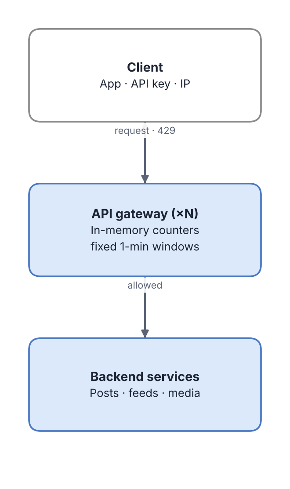
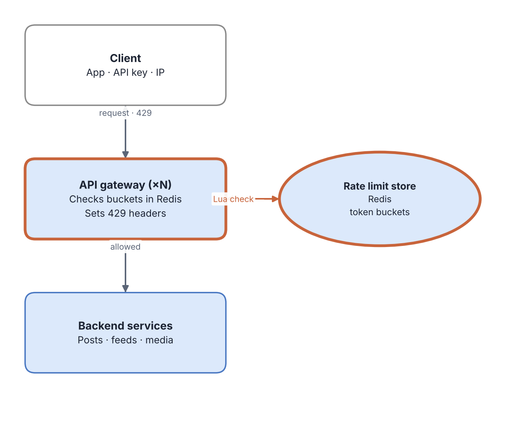
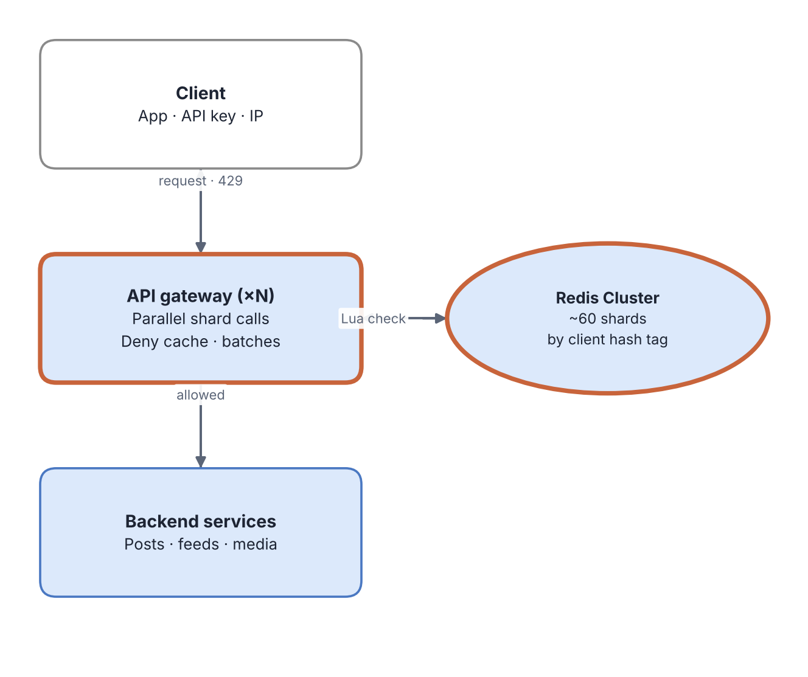
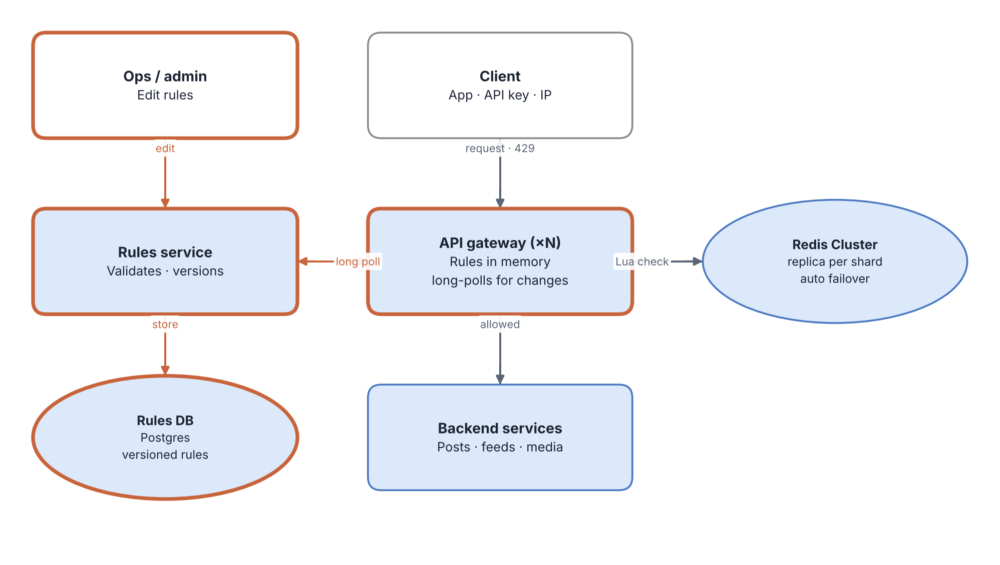

# Rate Limiter · system design, step by step

Whiteboard (Claude artifact): https://claude.ai/artifact/7QA1mrtexgPLAe8X65s832 · PDF: [rate-limiter.pdf](rate-limiter.pdf)

> Part 2 · Design: token buckets in a sharded Redis, checked at the API gateway

## Part 1 · Requirements, API and data model

### Functional requirements

Core requirements (server-side, per HTTP request, for a social media platform's API):

1. The system should identify clients by user ID, IP address, or API key to apply appropriate limits
2. The system should limit HTTP requests based on configurable rules (e.g., 100 API requests per minute per user)
3. When limits are exceeded, the system should reject requests with HTTP 429 and include helpful headers (rate limit remaining, reset time)

Out of scope: complex querying or analytics on rate limit data, long-term persistence of rate limiting data

### Non-functional requirements

- **Low latency:** the check adds < 10 ms per request (p99)
- **Availability over consistency:** a brief over-limit (a few extra requests) is fine; the limiter never takes the API down (only endpoints marked fail-closed, such as login, refuse while it's out)
- **Accurate across instances:** a limit holds across all gateway instances, not per instance
- **Scale:** 100M daily users; \~1M requests/s at peak

### API

**Core**

- check(request) → for each matching (rule, client key): allowed, remaining, reset_at; the gateway calls it on every request
- Responses carry X-RateLimit-Limit / Remaining / Reset for the most restrictive rule (Reset = when its bucket is full again); a rejected request is HTTP 429 with Retry-After (when one token is back)

**Below the line**

- PUT /rules/{id} {scope, limit, window, burst, fail_mode, overrides [{client key, limit}]} (ops only, DD4)

Auth: clients send an API key or a user token; the IP comes from our load balancer

### Entities

**Core**

- **rule**: rule_id PK, scope (client type: user / IP / API key; endpoint or all; tier), limit, window, burst, fail_mode (open / closed), overrides per client key (limit), version
- **client key**: built per rule from its client type: user:123, ip:1.2.3.4, key:abc. One request can match several rules (per user, per IP, per endpoint), each with its own counter

**Used by the deep dives**

- **bucket** (Redis): key = {client key}:rule_id, braces = Redis hash tag → tokens, last_refill; expires when idle

## Part 2 · Design, step by step

Each step redraws the whole diagram. Blue = our services, white = external, circle = storage, orange outline or orange arrow = new or changed in that step.

### Step 0 · Baseline (high-level design)

#### Step 0: works, but has problems

**Core 1 · identify:** client → API gateway, which finds the rules that match the request and builds each rule's client key: the user ID from the token, the API key, or the IP

**Core 2 · limit:** each gateway instance keeps in-memory counters per (rule, client key) in fixed 1-minute windows; every matching rule must allow, then the request goes to the backend services

**Core 3 · reject:** any rule over its limit → 429 with X-RateLimit-Remaining, X-RateLimit-Reset and Retry-After

**Why at the gateway:** it already sees and authenticates every request, so abuse stops before it reaches any service

**Problems:**

1. The load balancer spreads a client over N gateway instances, each counting alone: the real limit becomes N × 100
2. Fixed windows allow 2× the limit across a boundary (100 at 0:59, 100 more at 1:00)
3. Sharing the counters means one store taking \~1M+ checks/s: it needs sharding, and one hot client can overload a shard
4. That shared store becomes a single point of failure: requests either fail or go unchecked when it's down
5. Rules live in gateway config: changing a limit means a redeploy

**Next:** each deep dive fixes one problem; new or changed components get an orange outline

### Step 1 · DD1 One limit across all gateways: token buckets in Redis

#### DD1 · Accurate limits across all gateways

**Problem:** a limit must hold across all gateway instances, and bursts at window edges must be bounded

**Options:**

- Fixed window counter: simplest, but 2× bursts at the boundary
- Sliding window log (a timestamp per request): exact, but stores every request
- Sliding window counter (weighted current + previous window): close to exact, two numbers per client
- Token bucket (chosen): capacity = the rule's burst (e.g. 20), refilled at limit / window. A client gets at most burst at once and burst + limit in any window (120 for 100/min). Where "never more than 100 in any 60 s" is required, the sliding window log is used instead (the counter is only approximate)

**Added:** Redis, holding one bucket per (rule, client key)

- Keys are hash-tagged by client ({user:123}:r7), so all of one client's buckets sit on one shard and one Lua script checks them together: refill by elapsed time, take a token from each only if all allow. The script is atomic, so two gateways can't both take the last token
- A request with a user key and an IP key touches at most two shards, called in parallel; a token taken by one before the other says no isn't refunded (slightly strict, acceptable)
- Time comes from Redis (TIME) inside the script, so gateway clock skew doesn't matter
- Idle buckets expire (TTL = time to refill completely). \~300M active keys (users, IPs, API keys × rules) × \~200 B ≈ 60 GB

**Why Redis:** in memory, sub-millisecond, atomic scripts; a database round trip per request would break the 10 ms budget

**When things fail:** a slow Redis call → time out after \~5 ms and apply the rule's failure mode (DD3)

### Step 2 · DD2 1M requests/s: shard Redis, handle hot keys

#### DD2 · Scale to 1M requests/s

**Problem:** \~1M requests/s, each touching 1–2 shards → \~2M scripted calls/s; one Redis node handles \~50k scripted calls/s

**Changed:** Redis Cluster, sharded by client hash tag; gateways keep a local deny cache; hot keys take tokens in batches

- Keys spread over 16,384 hash slots on \~60 primaries (\~35k calls/s each, \~65% load, room for hot keys and failovers); adding shards moves slots, not data by hand
- Gateways keep pooled connections to every shard: one parallel call per shard, < 1 ms inside the region
- Abusive keys: after a 429, the gateway caches "blocked until Retry-After" for that (rule, client key) and rejects requests matching that rule locally, without calling Redis
- Busy legitimate keys (a partner API key, a large office behind one IP): the Lua reply flags a key as hot once its shard sees it above \~1k calls/s, so detection works however many gateways share the traffic. Gateways then batch per (rule, client key): each call takes up to b tokens, b = min(10, \~1 s of that rule's refill ÷ active gateways); rules where b < 2 (10 posts/min) stay one token per call. Unused batch tokens expire after \~1 s, so the cost is slight under-admission (at most N × b tokens parked on gateways), never more than the limit. A request skips Redis only when every matching rule has local batch tokens (or a deny-cache entry); otherwise one script takes b tokens for hot rules and 1 for the rest, all or nothing
- Regions: each region has its own gateways and Redis Cluster. Users are routed to a home region, so their buckets live in one place; API keys get a home region the same way (stored on the key record). IP limits are enforced per region: an IP is local to a region anyway, so the NFR's "across all gateways" means within its region for IPs

**Why Redis Cluster:** it routes keys to slots and rebalances itself; the client library knows the slot map

**When things fail:** one shard overloaded → only its keys slow down; the deny cache and token batches shed load first

### Step 3 · DD3 High availability: replicas, fail open or closed

#### DD3 · High availability

**Problem:** the limiter sits in front of every request; if Redis is down, the API must not go down with it

**Changed:** each shard gets a replica with automatic failover; each rule has a failure mode; the load balancer sends each client key to a preferred pair of gateways

- Each primary has a replica in another zone. Redis Cluster promotes it after its node timeout plus an election (\~10–20 s unless tuned); the circuit breaker and local limiter below cover that gap. Asynchronous replication may lose a few seconds of counts, which is fine
- Fail open (most rules): if Redis doesn't answer within \~5 ms, use a local in-memory bucket per gateway. For this, the L7 load balancer now hashes each request on its primary client key (user_id or API key from the token; the IP for anonymous traffic) to a preferred pair of gateways, spilling elsewhere only on overload. Rules on that key get limit / 2 locally (capacity and refill, no floor), so a client stays at about its limit however many gateways there are; rules on other keys (an IP rule for logged-in traffic) aren't enforced during the outage, since their traffic is spread over all gateways and a limit / N slice would reject almost everything; hot keys that spill can exceed their limit during an outage
- Fail closed (sensitive endpoints such as login and password reset): reject with 503, because a brute-force attack costs more than a short outage there
- A circuit breaker stops calling a dead shard for a few seconds, so timeouts don't pile up

**Why this split:** for a social API, staying up matters more than exact counts, except where abuse is expensive

**When things fail:** a whole region's Redis down → that region's gateways run on local buckets until it recovers

### Step 4 · DD4 Change rules without a redeploy

#### DD4 · Dynamic rules

**Problem:** limits change often (new endpoints, abuse responses, paid tiers); a redeploy per change is too slow

**Added:** Rules service and Rules DB; gateways keep the rules in memory

- Ops edit rules through the Rules service, which validates them and stores versioned rules in the Rules DB (Postgres)
- Each gateway holds a long poll to the Rules service with the rule-set version it has; the call returns as soon as a newer version exists, and gateways also re-fetch every \~30 s as a backup. New rules apply within seconds
- All matching rules apply, each with its own bucket: an endpoint rule (10 posts/min) stacks with the global per-user rule (100 requests/min)
- A changed rule keeps existing buckets: the new capacity and refill rate apply from the next check
- Tiers come from the API-key record or the user's token, cached for a few minutes, so an upgrade takes effect within that window

**Why push and cache:** rules are read on every request but change rarely; a lookup per request would add latency

**When things fail:** Rules service down → gateways keep the last rules they have; only changes wait
