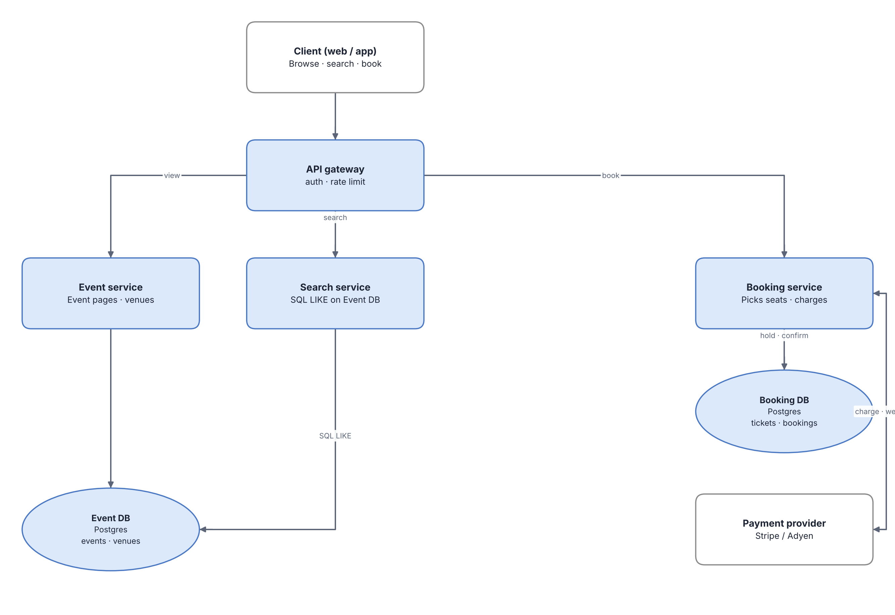
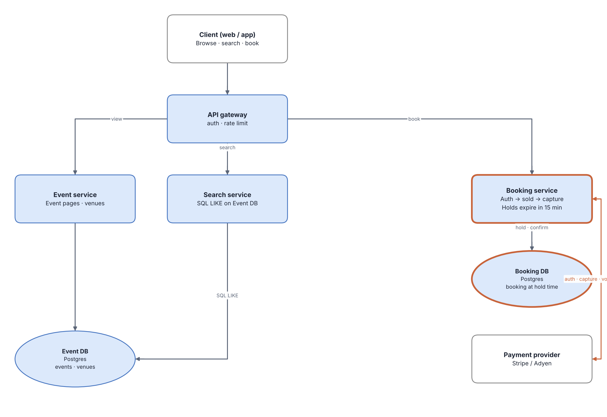
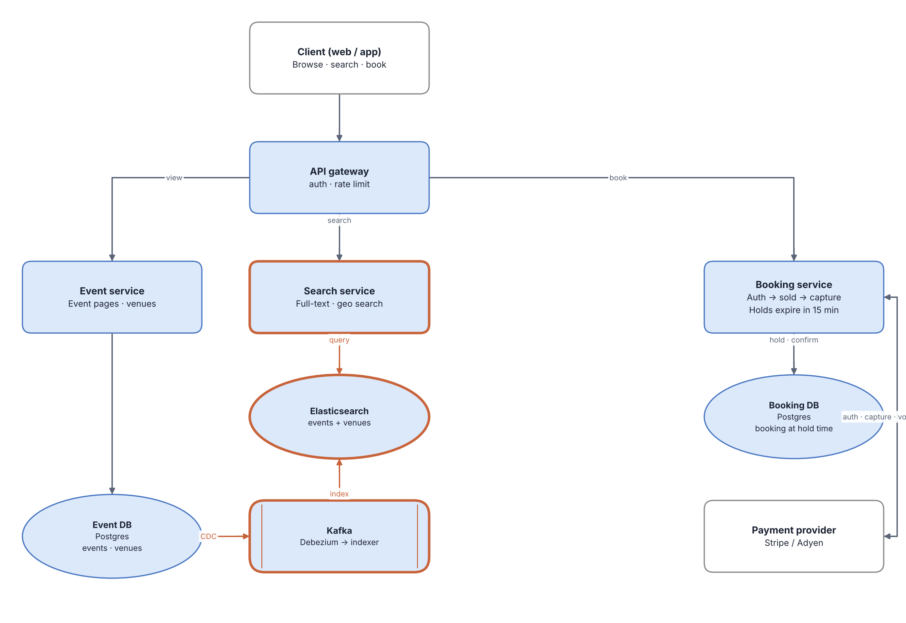
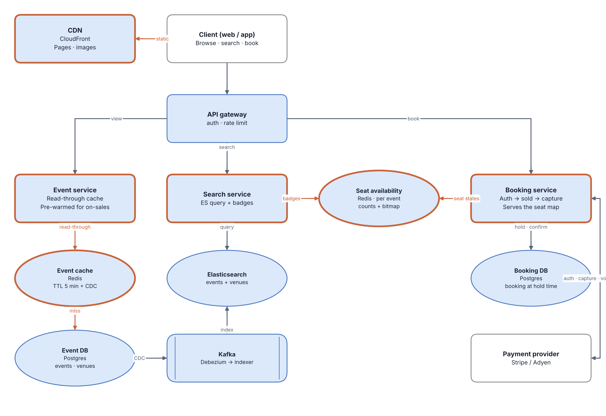
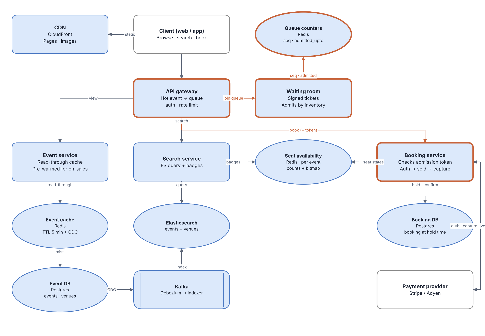
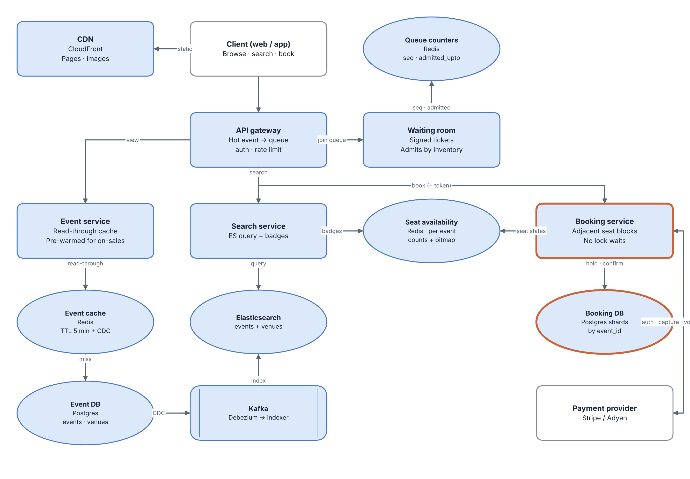

# Ticketmaster · system design, step by step

Whiteboard (Claude artifact): https://claude.ai/artifact/TXa4VNNU1AaDdFwq3RdtSq · PDF: [ticketmaster.pdf](ticketmaster.pdf)

> Part 2 · Design: browse and search favor availability; booking favors consistency

## Part 1 · Requirements, API and data model

### Functional requirements

Core requirements:

1. Users should be able to view events
2. Users should be able to search for events
3. Users should be able to book tickets to events

Below the line (covered in the deep dives): a waiting room for hot on-sales, picking seats on a seat map

Out of scope: resale and transfers, refunds, dynamic pricing, recommendations, venue tools

### Non-functional requirements

- **No double booking:** a seat is sold to at most one person (strong consistency for booking)
- **Low latency:** event pages and search < 300 ms (p95); a seat hold answers in < 1 s
- **Availability vs consistency:** browsing and search favor availability (seconds stale is fine); booking favors consistency
- **Bursts and fairness:** a hot on-sale brings \~10M users in minutes for \~50k seats; served in arrival order (random order for everyone who arrives before the sale opens), and the system stays up
- **Scale:** 100M daily users, reads:writes ≈ 100:1; \~100k live events; \~1k bookings/s normally. A hot on-sale sends 50k+ requests/s to the waiting room, but only \~2k holds/s reach booking

### API

**Core**

- GET /events/{id} → event, venue, performers, price tiers (view an event)
- GET /events/search?q=&city=&near=&from=&to=&category=&cursor= → events, next_cursor (search)
- GET /events/{id}/seats → seats left per section + seat map (available / held / sold)
- POST /bookings/hold {event_id, seat_ids or section + count} + Idempotency-Key → booking_id, seats, expires_at (15 min)
- POST /bookings/{booking_id}/confirm {payment_token} → status (confirmed / pending / failed)
- GET /bookings/{booking_id} → status, tickets (e.g. after a payment timeout)

**Below the line (waiting room)**

- POST /queue/{event_id} → signed queue ticket {seq} · GET /queue/{event_id}/status → admitted_upto (CDN-cached) · POST /queue/{event_id}/admit → admission token

Auth: user session; hold and confirm need a logged-in user (and, for hot events, an admission token)

### Entities

**Core**

- **event**: event_id PK, venue_id FK, performer_ids, name, category, start_time, on_sale_at, price_tiers, status
- **venue**: venue_id PK, name, city, geo, seat map (sections, rows, seats)
- **ticket**: (event_id, seat_id) PK, section, price_tier, status (available / held / sold), booking_id, hold_expires_at
- **booking**: (event_id, booking_id) PK, user_id FK, seat_ids, total, status (held / paying / confirmed / failed / expired), expires_at, idempotency_key UNIQUE, payment_id, payment_status (none / authorized / captured / voided)

**Used by the deep dives**

- **search doc** (Elasticsearch): event fields + venue city / geo + performer names + price range
- **seat availability** (Redis): per event, counts per section + 2 bits per seat (available / held / sold)
- **queue** (Redis, per event): next_seq, admitted_upto; queue ticket and admission token are signed JWTs {user_id, event_id, seq or max_seats, exp}

## Part 2 · Design, step by step

Each step redraws the whole diagram. Blue = our services, white = external, circle = storage, orange outline or orange arrow = new or changed in that step.

### Step 0 · Baseline (high-level design)

#### Step 0: works, but has problems

**Core 1 · view events:** client → API gateway → Event service reads the event, venue and price tiers from Event DB

**Core 2 · search:** Search service runs a SQL query (LIKE on names, filters on city and date) on Event DB

**Core 3 · book:** Booking service picks the seats, charges the card through the payment provider, then marks the seats sold in Booking DB

**Why start here:** the shortest path that covers all three core requirements; make it clear first, then fix problems one at a time

**Problems:**

1. Two users can pay for the same seat at the same time → double booking; or a seat stays locked for the whole payment
2. LIKE queries are slow and can't rank results, handle typos or search by distance
3. Every page view hits Event DB; one popular event's page can overload it
4. A big on-sale brings millions of users at once: everything times out and who gets tickets is random
5. Even with traffic under control, \~2k holds/s compete for the same seats of one event, and one database serves every event

**Next:** each deep dive fixes one problem; new or changed components get an orange outline

### Step 1 · DD1 No double booking: seat holds

#### DD1 · No double booking: hold, then confirm

**Problem:** booking takes minutes (choosing, paying). The same seat must never be sold twice, and a seat shouldn't stay blocked by someone who walked away

**Added:** two-phase booking (hold, then confirm), with a booking row created at hold time

- Hold: in one transaction, insert a booking (held, expires_at = now + 15 min by the DB clock, Idempotency-Key) and UPDATE the tickets to `held` only where they're `available` or their hold expired. Fewer rows than seats asked → roll back. Walking away just lets the hold expire
- Confirm: only the booking's own user can confirm. A booking already `confirmed` returns its result at once; otherwise it moves held|paying → `paying` (conditional) and its holds are extended past the payment provider's timeout (+ margin), so they can't expire mid-payment
- 1. Authorize the card (funds reserved, nothing captured), key booking_id:auth, so a retried confirm never authorizes twice; payment_status = authorized
- 2. One conditional write: tickets → `sold` and booking → `confirmed`, WHERE the tickets are held by, or already sold to, this booking AND the booking is `paying` or already `confirmed` (a retry passes, a failed booking can't). 3. Capture (key booking_id:capture) → payment_status = captured
- The write matches 0 rows or times out → a conditional write moves the booking paying → failed; only if it matched is the authorization voided (booking_id:void). If it didn't, re-read: capture only if the booking is `confirmed`; if it is already `failed`, whoever failed it voids.
- A reconciler captures confirmed bookings still `authorized`; for a stale `paying` one it first moves it to `failed` (conditional write), then voids; it also voids any failed or expired booking still `authorized`

**Why no lock during payment:** a lock held for minutes blocks everyone; a Redis lock could disagree with the DB after a failover. \~1k bookings/s is easy for Postgres

**When things fail:**

- Payment times out → booking stays `paying`; the webhook or a status lookup by idempotency key tells whether the authorization exists. If it does, continue at step 2 (its failure path voids); if not, mark the booking failed. The client polls GET /bookings/{id}
- Capture fails after the seats are sold → the reconciler retries it with the same key; still failing near the authorization's expiry → alert for manual handling, seats stay sold

### Step 2 · DD2 Fast search: add Elasticsearch, CDC

#### DD2 · Fast, relevant search

**Problem:** users search by artist, venue, city, date and "near me", with typos; LIKE on Postgres can't rank, can't do geo, and scans the table

**Added:** Elasticsearch, kept in sync by CDC (Debezium → Kafka → indexer)

- One search document per event: name, performers, venue, city, geo point, date, category and price range (from the event's price tiers)
- Queries use full-text relevance (BM25) with fuzzy matching, filters (date, category) and geo-distance sorting; facets come from aggregations
- Event DB changes flow through Debezium (reads the Postgres WAL) → Kafka → an indexer that updates Elasticsearch, usually within seconds
- Seat availability isn't indexed (it changes every second); from DD3 the Search service adds a "few left / sold out" badge to each result from Seat availability
- Popular queries ("concerts this weekend in Seattle") are cached for \~30 s

**Why Elasticsearch:** inverted index, relevance ranking, geo queries and aggregations in one engine; OpenSearch is the same idea

**Why CDC instead of writing to both:** no dual writes, so a crash can't leave DB and index disagreeing; Kafka lets the indexer replay

**When things fail:**

- Indexer behind → results a bit stale; fine for search
- Elasticsearch down → fall back to a rate-limited city + date filter on an Event DB read replica, without relevance

### Step 3 · DD3 Fast event pages: add CDN, caches

#### DD3 · Fast event pages and live seat maps

**Problem:** event pages are read \~100× more than anything is written; a hot event page gets millions of views, and its seat map changes every second during an on-sale

**Added:** CDN, Event cache (Redis), Seat availability store (Redis)

- The page shell, images and event details are served from the CDN with a short TTL and stale-while-revalidate
- Event service reads through a Redis cache (TTL \~5 min); changes from the CDC stream invalidate it; hot events are pre-warmed before the on-sale
- Request coalescing: on a cache miss only one request goes to the DB, the rest wait for it (no stampede)
- Seat availability lives in Redis per event: counts per section plus 2 bits per seat (available / held / sold). Booking service updates it on every hold, sale and expiry, and serves GET /events/{id}/seats from it, never from Booking DB
- For a hot event, the seat map is published as a snapshot every \~1 s to the CDN, so millions of viewers don't all hit one Redis key
- Search adds "few left / sold out" badges from the section counts
- The seat map can be a few seconds stale; every hold (DD1) is checked against the DB, so a stale map can't cause a double sale

**Why Redis:** sub-millisecond reads, bitmaps and counters built in, easy to rebuild from the DB

**When things fail:**

- Redis lost → rebuild the event's seat states from Booking DB (one query); show "checking availability" meanwhile
- CDN stale → harmless for details; price and availability are re-checked when holding

### Step 4 · DD4 Hot on-sales: add waiting room

#### DD4 · Hot on-sales: virtual waiting room

**Problem:** a big on-sale brings \~10M users for \~50k seats within minutes; letting them all hit booking melts the DB, and timeouts turn it into a lottery

**Added:** Waiting room service + Queue counters (Redis); signed queue tickets and admission tokens

- For a hot event (flagged ahead of time, or automatically when traffic spikes), users join the queue instead of booking: POST /queue gives a signed ticket with a sequence number (Redis INCR). Everyone who arrives before the sale opens gets a random number from that early range, so refreshing early gives no edge
- Position = my seq − admitted_upto. The waiting room only advances one counter, admitted_upto, and clients read it from the CDN every few seconds: no per-user reads, even with 10M people waiting
- Admission follows inventory: admitted shoppers still choosing are kept to about the seats not yet held ÷ \~2.5 seats per order, and never more than booking can take (\~2k holds/s). Holds that expire re-open admission
- When it's your turn you exchange the ticket for an admission token {user_id, event_id, max 4 seats, \~15 min}; Booking service checks it on hold, and the confirm is authorized by the hold itself
- Sold out is declared only when every seat is sold; until then, waiting users see "all seats are held, some may come back"
- Bots: CAPTCHA or verified-fan checks before joining, one ticket per account and device, per-IP limits at the gateway

**When things fail:**

- Redis primary lost → tickets are signed and carry their seq, so nobody loses their place; the counters are restored from the highest values seen
- Waiting room down → pause sales for that event rather than let the flood through

### Step 5 · DD5 Booking under on-sale load: shards, no lock waits

#### DD5 · Booking under on-sale load

**Problem:** behind the waiting room, \~2k holds/s still compete for the same seats of one event: lock waits, retries, and one database shared by every event

**Changed:** Booking DB sharded by event_id; seats picked without waiting on locks

- Tickets and bookings of an event live on the same shard (booking key (event_id, booking_id)), so hold and confirm stay one local transaction. Sharding isolates events: one hot on-sale doesn't slow the others
- \~2k holds/s on one event fits one Postgres primary when transactions are tiny: hold = one INSERT + one conditional UPDATE, sale = one conditional write (tickets + booking); the payment call happens outside any transaction
- Best available: users ask for "2 seats in section 102"; Booking service picks a block of adjacent free seats from the seat states in Redis and conditionally UPDATEs exactly those rows; if any is taken, it tries the next block. No request waits on another's lock
- Users who pick an exact seat on the map get an instant "taken" from the seat states if it's held — no retries against the DB
- GET /bookings/{id} goes straight to the right shard (booking_id encodes event_id); "my bookings" is a per-user index fed by CDC (line not drawn)

**Why shard by event_id:** every booking touches one event, so no cross-shard transactions are needed

**When things fail:**

- A shard is down → only its events stop selling; failover to a synchronous replica, so no hold is lost
- Hot shard overloaded → the waiting room lowers its admit rate automatically based on booking latency
