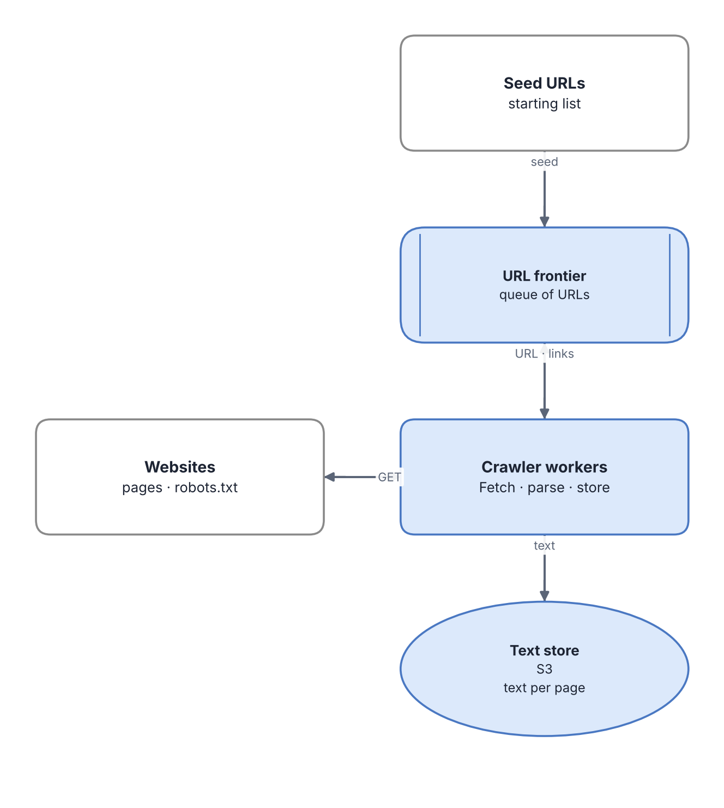
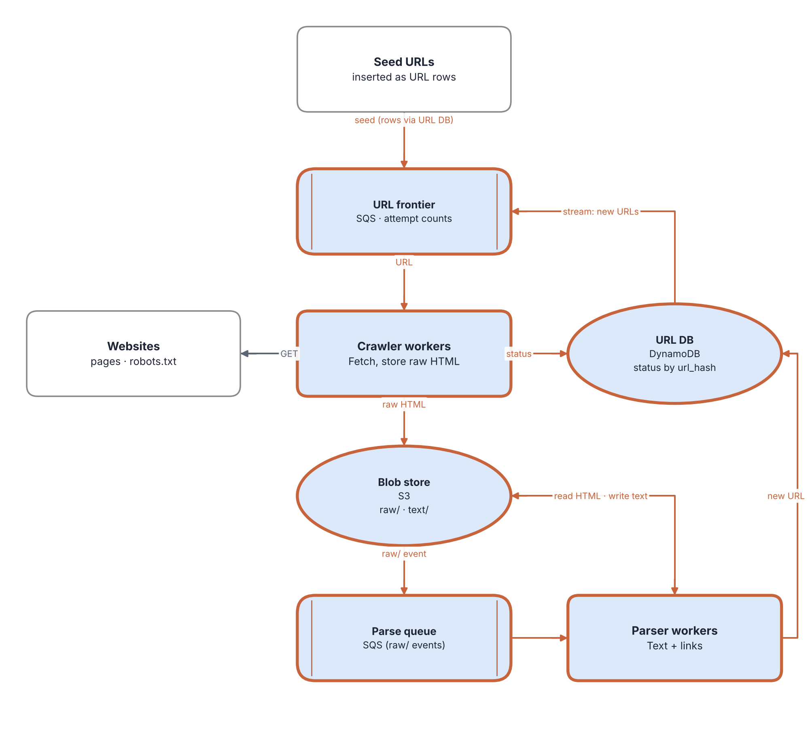
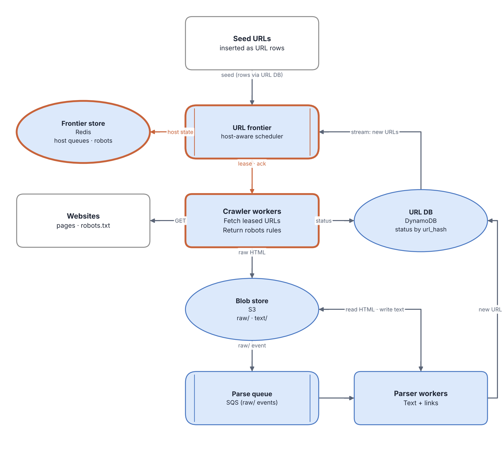
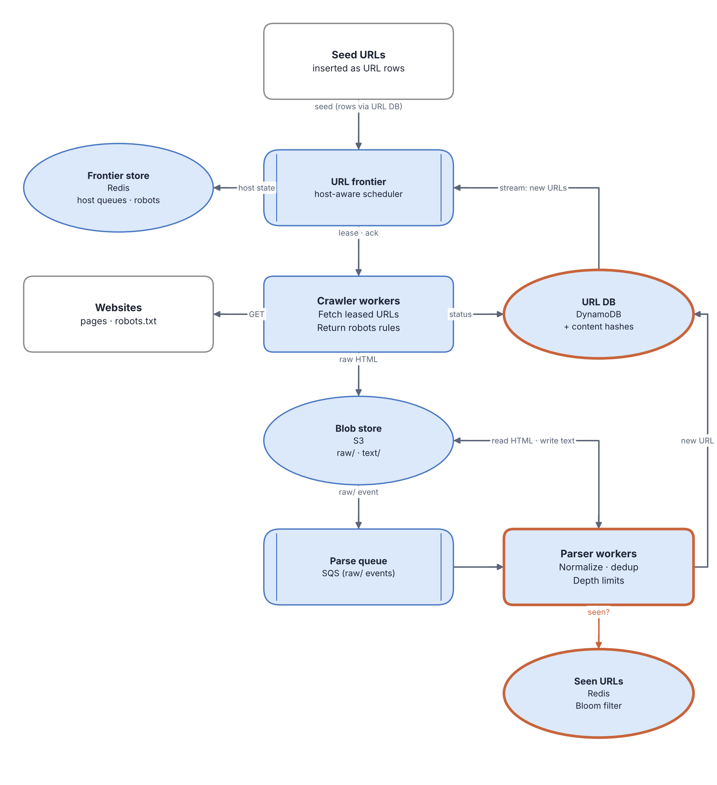
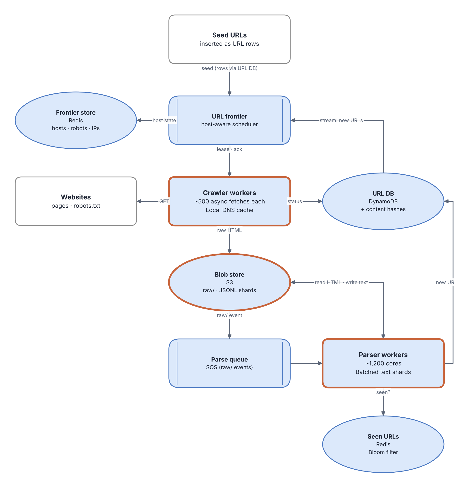

# Web Crawler · system design, step by step

Whiteboard (Claude artifact): https://claude.ai/artifact/FiLGZD7xJ5eLAmKRFkVa1P · PDF: [web-crawler.pdf](web-crawler.pdf)

> Part 2 · Design: a restartable fetch → parse loop with a host-aware frontier and the URL table as the source of truth

## Part 1 · Requirements, API and data model

### Functional requirements

Core requirements (goal: text to train an LLM):

1. Crawl the web starting from a given set of seed URLs
2. Extract text data from each web page and store the text for later processing

Out of scope: processing the text (e.g. training), non-text data (images, video), JavaScript-rendered pages, login-required pages

### Non-functional requirements

- **Fault tolerant:** a crashed worker or a failed fetch never loses progress; crawling resumes where it stopped
- **Polite:** obey robots.txt and never overload a site (about 1 request/s per host by default)
- **Scale:** 10B pages in under 5 days ≈ 23k pages/s; HTML only, \~100 KB a page ≈ 1 PB raw (\~2.3 GB/s); \~50B unique URLs discovered along the way
- **Efficient:** don't fetch the same URL twice or store the same text twice

### API

**Interfaces** (no user-facing API)

- Input: a list of seed URLs, inserted like any discovered URL
- Output: extracted text in S3, in large JSONL shards, with an index url_hash → (shard, offset) (DD4)
- Frontier message {url, depth, attempt}; parse event = the S3 event for raw/{url_hash}; the parser reads url and depth from the object's metadata

### Entities

**Core**

- **url**: url_hash PK, url, host, depth, status (queued / in_frontier / fetched / parsed / failed / skipped), frontier shard, updated_at, attempts, content_hash, text location
- **raw page**: S3 raw/{url_hash} (kept \~14 days by lifecycle)

**Used by the deep dives**

- **host** (Redis, DD2): URL queue, next_allowed, robots rules, crawl delay, pages crawled
- **seen URLs** (Bloom filter in Redis, DD3): normalized URL → probably seen
- **content** (DD3): content_hash PK → owner url_hash, status, text location (first writer wins)

## Part 2 · Design, step by step

Each step redraws the whole diagram. Blue = our services, white = external, circle = storage, orange outline or orange arrow = new or changed in that step.

### Step 0 · Baseline (high-level design)

#### Step 0: works, but has problems

**Core 1 · crawl:** seed URLs go into the URL frontier (a queue). Crawler workers take a URL, fetch the page and put every link they find back into the frontier

**Core 2 · extract:** the same worker strips the HTML down to text and stores it in S3

**Why start here:** the shortest loop that covers both core requirements; make it clear first, then fix problems one at a time

**Problems:**

1. One worker fetches, parses and stores: a crash mid-page loses the URL, a failed fetch is never retried, and slow parsing holds up network I/O
2. Nothing stops 1,000 workers from hitting one site at once, or crawling pages robots.txt forbids
3. The same URL is found millions of times, the same text appears under many URLs, and link loops (calendars, session ids) never end
4. 23k pages/s needs thousands of concurrent fetches, fast DNS, and enough distinct sites to keep busy politely

**Next:** each deep dive fixes one problem; new or changed components get an orange outline

### Step 1 · DD1 Never lose progress: URL table, queues, split fetch and parse

#### DD1 · Fault tolerance

**Problem:** at 23k pages/s some fetches always fail and some workers always crash; neither may lose a URL or the work already done

**Added:** URL DB as the source of truth, raw HTML in S3, a parse queue fed by S3 events, Parser workers

- Every URL, seeds included (bulk-inserted as rows), gets a row (status queued) before it's queued; new rows reach the frontier through the table's change stream (DynamoDB Streams), so a crash between "saved" and "queued" can't lose a URL
- Frontier is SQS: a crawler deletes the message only after the raw HTML is stored and the row says fetched; a crashed crawler's message reappears after the visibility timeout
- Crawler: fetch, store at raw/{url_hash} with url and depth as object metadata, mark the row fetched. Only raw/ writes emit the event that feeds the parse queue
- Parser: read the HTML, extract text and links, write the text, insert new URL rows (conditional put on url_hash: one row per URL); the row is marked parsed and the parse message deleted only once the text is durably in S3 (DD4: after its small text object is flushed)
- Failed fetch → delete the message and send it again with a delay (30 s, 2 min, 10 min) and attempt + 1 in its body; after \~5 attempts the row is marked failed. Re-sending, rather than stretching the visibility timeout, keeps in-flight messages under SQS's \~120k limit
- Every step is idempotent (keys are URL hashes); a sweeper finds stuck rows through an index keyed by (frontier shard, host) with status and updated_at, holding only unfinished rows (so writes spread over many partitions). Status updates are conditional and move forward (queued → in_frontier → fetched → parsed), except the sweeper's in_frontier → queued reset; adding a URL to the frontier (SQS here, host queues from DD2; from the stream or a refill) is a conditional queued → in_frontier update, and a full head leaves the row queued for a later refill; the sweeper resets in_frontier rows only after a timeout longer than retries plus queue wait, and fetched ones get a new parse message
- Fetching is I/O-bound and parsing CPU-bound, so the fleets scale separately, and a parser bug is fixed by re-parsing stored HTML (raw HTML is kept \~14 days)

**Why SQS over Kafka:** per-message retries and delays are built in; in Kafka a stuck message blocks its partition

**When things fail:** S3, SQS or DynamoDB briefly unavailable → workers back off and retry; nothing is acknowledged until it's stored

### Step 2 · DD2 Politeness: a host-aware frontier

#### DD2 · Politeness

**Problem:** obey robots.txt and never overload a site. With one shared queue, workers keep pulling URLs for sites that aren't ready yet and putting them back, and most links on a page point to the same site

**Changed:** the frontier becomes host-aware: a queue per host and a ready set ordered by next fetch time, kept in Redis

- The frontier is sharded by hash(host). Each shard keeps a short FIFO of URLs per host (a bounded head; the rest wait as queued rows in the URL DB and are refilled from that index by host) and a sorted set of hosts by next_allowed; a crawler asking for work gets a URL from a host whose time has come (a Lua script: ZRANGEBYSCORE score ≤ now, then ZREM), as a lease
- After each fetch, next_allowed = now + delay (default 1 s, or the site's crawl-delay; longer after 429 / 503 or slow answers). No crawler ever holds a URL it can't fetch yet
- Limits apply per hostname and per resolved IP: a next_allowed key per IP in one small shared Redis — a single global store, distinct from the sharded frontier — is checked at lease time, so thousands of subdomains on one server farm don't add up to a flood
- robots.txt: a new host's first URL is its robots.txt; the crawler returns the rules and the host's resolved IP with its ack (for the per-IP limit), they're cached in Redis (TTL \~1 day) and checked again at lease time, and disallowed URLs are marked skipped (a final status, so they leave the unfinished index) as they enter the host queue. 4xx → allow all; 5xx or timeout → treat as disallowed and retry later (RFC 9309)
- This Redis frontier replaces SQS. A lease not acked within a few minutes returns to its host queue; a failed fetch goes into a per-shard sorted set by retry time (30 s, 2 min, 10 min) and back into its host queue when due, with attempt + 1. The crawler identifies itself (User-Agent with a contact URL)

**Why a host-aware frontier:** politeness becomes the scheduling rule itself, instead of URLs bouncing in and out of a queue

**When things fail:** a Redis shard lost → its hosts pause until it's rebuilt from that shard's queued and in_frontier rows in the unfinished index; other shards keep crawling

### Step 3 · DD3 Skip duplicates and crawler traps

#### DD3 · Duplicates and traps

**Problem:** \~50 links per page means \~1M link checks/s; most point to pages already seen, and many sites repeat the same text under different URLs

**Changed:** Parser normalizes and checks links before saving them; text is deduplicated by hash; depth limits stop traps

- Normalize every link: lowercase the host, drop fragments, default ports and tracking parameters, sort query parameters; drop binary extensions (.jpg, .pdf, .zip)
- Seen check: a Bloom filter in Redis as a fast prefilter, sized for discovered URLs: \~50B at 0.1% false positives ≈ 90 GB, sharded; the \~0.1% of new URLs it wrongly skips is accepted (sized for 10B it would overfill and silently drop most new URLs). The conditional put on url_hash stays the truth: put the row (queued), then add to the Bloom filter
- Content dedup: first a conditional put on content_hash in a separate table, pending and owned by this url_hash (first writer wins); only the winner appends the text and then records its location. A re-parse by the owner resumes its own pending row. A duplicate that finds the row still pending must not mark itself parsed: it requeues its parse message with a short delay and re-checks until the row is done, then copies the location. A pending row stuck past a timeout (its owner's message exhausted) can be adopted by a duplicate, which becomes the new owner and writes the text itself. Near-duplicates (SimHash) are left to the training pipeline
- Traps: depth ≤ \~20 from the seed, a maximum URL length, a page cap per host (host state counts pages; URLs over it are marked skipped) and dropping links with repeating path segments

**Why a Bloom filter:** it answers \~1M checks/s from memory; only new URLs reach DynamoDB

**When things fail:** Bloom filter lost → rebuild it from the URL DB; meanwhile the conditional put still blocks duplicate rows

### Step 4 · DD4 Scale: 10B pages in 5 days

#### DD4 · Scale to 10B pages

**Problem:** 10B pages in 5 days = \~23k pages/s, sustained, while staying polite

**Changed:** async crawlers with local DNS; batched text output; the numbers that size each fleet

- At ≤ 1 request/s per host, 23k pages/s needs ≥ 23k hosts in flight at once. The web has hundreds of millions of hosts, so the 5-day goal relies on breadth; very large sites get a page cap per crawl (or a faster rate by agreement)
- Crawlers are I/O-bound: \~500 async fetches each, \~1 s per fetch → \~500 pages/s, so \~50 machines (\~100 with headroom). Only text/html is kept and bodies stop at \~2 MB, so \~100 KB average and \~2.3 GB/s (\~20 Gbps) hold
- DNS: a local caching resolver (e.g. Unbound) on each crawler, with negative caching; cloud VPC resolvers cap packets per network interface
- Parsers are CPU-bound: \~50 ms a page → \~1,200 cores, autoscaled on parse-queue depth
- Output: each parser flushes a small text object every \~2 s and only then marks those rows parsed and deletes their parse messages: 23k/s × \~2 s ≈ 50k in flight, spread over several parse queues by key prefix, well under SQS's \~120k per queue; a compaction job merges them into \~1 GB JSONL shards with an index url_hash → (shard, offset), easy for training to read; raw HTML expires after \~14 days (S3 lifecycle)
- URL DB: \~50B discovered rows × \~300 B ≈ 15 TB, keyed by url_hash (uniform); \~50B inserts over 5 days ≈ 115k writes/s plus status updates. Frontier shards by host hash hold only per-host heads, a few GB each

**Why separate fleets:** fetching and parsing saturate different resources, so each is sized and autoscaled on its own

**When things fail:** a slow site ties up only its own fetches (timeouts \~10–30 s); per-host limits keep any one site's share small
