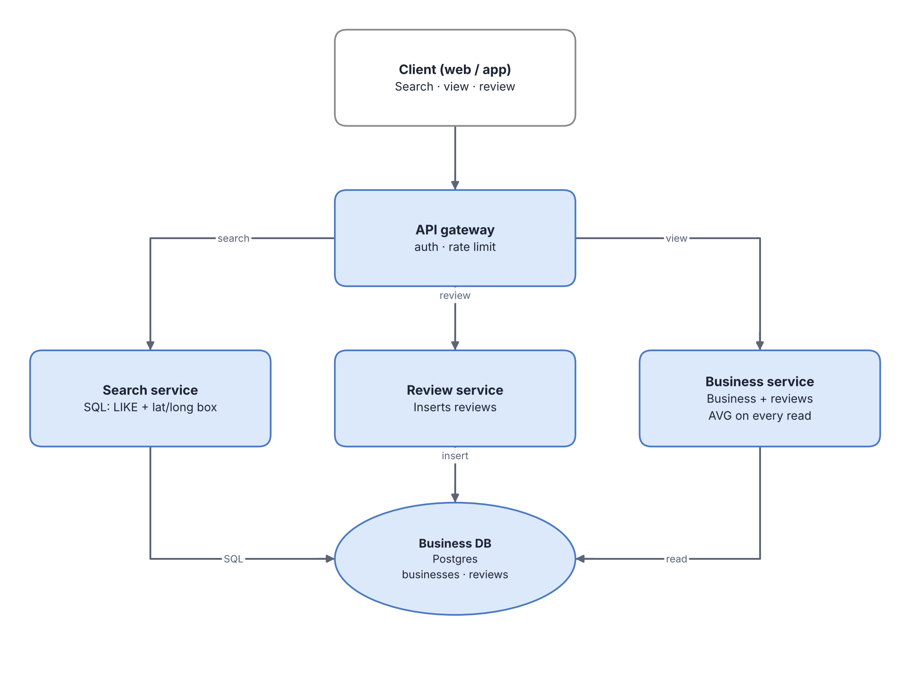
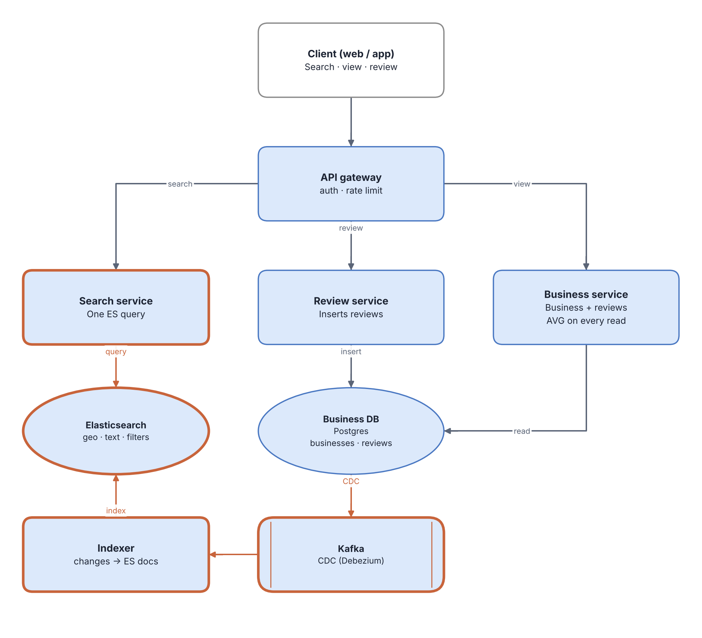
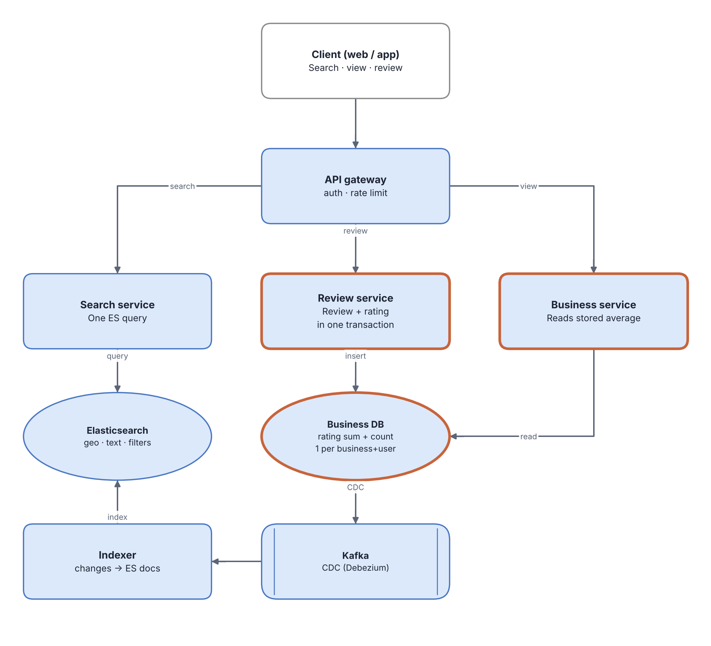
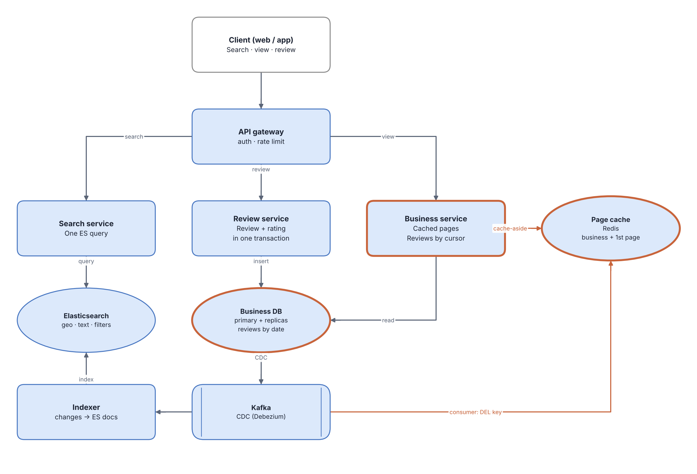
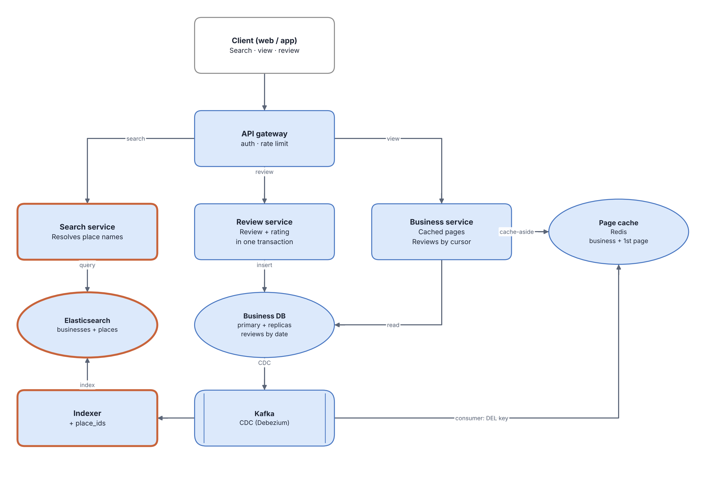

# Yelp · system design, step by step

Whiteboard (Claude artifact): https://claude.ai/artifact/NkDw7TktPLDhWVxTKPpK3c · PDF: [yelp.pdf](yelp.pdf)

> Search in Elasticsearch; review and rating in one Postgres transaction

## Part 1 · Requirements, API and data model

### Functional requirements

Core requirements:

1. Users should be able to search for businesses by name, location (lat/long) and category
2. Users should be able to view businesses (and their reviews)
3. Users should be able to leave reviews on businesses (mandatory 1–5 star rating and optional text)

Covered in the deep dives: one review per user per business, search by place names

Out of scope: admin tools to add or edit businesses, map view, recommendations

### Non-functional requirements

- **Low latency:** search < 500 ms, business page < 200 ms (p95)
- **Availability over consistency:** search and pages may lag a few seconds; a new review shows in search ranking within a minute
- **One review per user per business:** enforced, not best-effort
- **Scale:** 100M daily users, 10M businesses, \~1B reviews; \~500M searches/day (\~6k/s average, \~20k/s peak); \~1M new reviews/day (\~12/s)

### API

**Core**

- GET /businesses/search?q=&category=&lat=&long=&radius=&location=&cursor= → businesses (name, avg rating, distance), next_cursor; location = a place name (DD4); lat/long are still sent when known
- GET /businesses/{id} → details, avg_rating, review_count
- GET /businesses/{id}/reviews?cursor= → reviews, newest first
- POST /businesses/{id}/reviews {rating 1–5, text?} → review_id (409 if you already reviewed it)

**Below the line**

- PUT / DELETE /reviews/{id} (edit or remove your review)

Auth: search and view are public; writing a review needs a logged-in user

### Entities

**Core**

- **business**: business_id PK, name, category, location (lat, long), address
- **review**: review_id PK, business_id FK, user_id FK, rating (CHECK 1–5), text, created_at
- **user**: user_id PK, name

**Used by the deep dives**

- **business** + rating_sum, review_count; **review** + UNIQUE (business_id, user_id) (DD2)
- **search doc** (Elasticsearch): name, category, geo_point, avg rating, review_count, place_ids
- **place** (Elasticsearch): place_id, name, type (city / neighborhood), boundary polygon

## Part 2 · Design, step by step

Each step redraws the whole diagram. Blue = our services, white = external, circle = storage, orange outline or orange arrow = new or changed in that step.

### Step 0 · Baseline (high-level design)

#### Step 0: works, but has problems

**Core 1 · search:** Search service runs SQL on Business DB: name LIKE '%q%', category = ?, and lat/long inside a box around the user

**Core 2 · view:** Business service reads the business and its reviews; the average rating is AVG(rating) over its reviews

**Core 3 · review:** Review service inserts the review

**Why start here:** the shortest path that covers all three core requirements; make it clear first, then fix problems one at a time

**Problems:**

1. LIKE '%q%' and a lat/long box can't use indexes well: every search scans millions of rows, with no relevance ranking or typo tolerance
2. AVG over thousands of reviews on every page view is wasted work, and two quick submits create two reviews from one user
3. Popular business pages are read millions of times, and some have tens of thousands of reviews
4. People search "pizza" near "Mission District", a named area, not a lat/long and radius

**Next:** each deep dive fixes one problem; new or changed components get an orange outline

### Step 1 · DD1 Search: add Elasticsearch, CDC

#### DD1 · Search by text, location and category

**Problem:** \~20k searches/s at peak, combining text, distance and category; LIKE plus a lat/long box scans the table

**Added:** Elasticsearch, kept in sync by CDC (Debezium → Kafka → Indexer)

- One document per business: name, category, geo_point, average rating, review_count
- One query does it all: full-text match on name and category words (name boosted, typo-tolerant), a category filter, a geo_distance filter (e.g. 5 km), sorted by a mix of relevance, distance and a smoothed rating (a Bayesian average, so one 5★ review doesn't beat 500 reviews at 4.5★)
- The geo filter uses a spatial index on geo_point (BKD tree), so only nearby businesses are examined
- Paging: the cursor holds the last hit's sort values (search_after, ties broken by business_id); results stop at \~100
- Business DB changes flow Postgres → Debezium → Kafka → Indexer within seconds, including new averages (DD2)
- Alternative at this size: 10M businesses fit in one Postgres with PostGIS (GiST index) plus full-text search (GIN), served from read replicas. Fewer moving parts, weaker relevance and typo tolerance

**Why Elasticsearch:** text relevance, geo and filters in one index; reads scale by adding replicas

**When things fail:**

- Indexer behind → results a few seconds stale
- An ES node or zone lost → replica shards in other zones keep serving. The whole cluster down → search fails fast with a clear error; business pages and reviews keep working (they don't use ES)
- Kafka or Debezium down → Postgres keeps WAL for the replication slot: alert on slot lag, cap it (max_slot_wal_keep_size), re-snapshot if the slot is dropped

### Step 2 · DD2 Reviews: stored rating, one per user

#### DD2 · Reviews: rating kept up to date, one per user

**Problem:** AVG over every review on each view is too slow, and a user must never end up with two reviews of one business (double clicks, two devices)

**Changed:** the business row keeps rating_sum and review_count; reviews get a unique constraint

- In one transaction: insert the review and UPDATE business SET rating_sum = rating_sum + r, review_count = review_count + 1; average = sum / count
- Contention is low: \~12 reviews/s overall, a few a minute even for popular businesses, and the row lock lasts milliseconds
- Editing a review adjusts the sum by (new − old); deleting subtracts
- UNIQUE (business_id, user_id): a second insert fails → 409 "you already reviewed this; edit it instead". A check-then-insert in code alone would race; the database makes it safe
- Retries are safe: a retried POST hits the same constraint; if the stored review has the same rating and text, it's returned instead of a 409
- If reviews are ever sharded, shard by business_id so both the constraint and the rating update stay on one shard

**Why one transaction:** count, sum and review can never disagree

**When things fail:** the transaction fails → neither the review nor the rating changes; the client retries

### Step 3 · DD3 Fast business pages: cache, cursors

#### DD3 · Fast business pages

**Problem:** popular businesses are viewed millions of times, and some have tens of thousands of reviews

**Added:** Redis cache for business pages; cursor pagination for reviews; read replicas

- Business service caches the details + first page of reviews in Redis (TTL \~5 min); a miss is rebuilt from a read replica
- Invalidation rides CDC: a small consumer on Kafka deletes the page key when a review or business change arrives, and again \~5 s later, so a page refilled from a lagging replica is fixed within seconds. A crash after commit can't lose the delete
- The author sees their own review at once, from the POST response
- Reviews come newest first, paged by a cursor (created_at, review_id) on an index (business_id, created_at DESC, review_id DESC), never OFFSET
- Page reads go to read replicas; the primary only takes writes
- Photos and static files come from a CDN (not drawn)

**Why cache:** a business page is the same for everyone, so most views become one Redis read

**When things fail:**

- Redis down → reads go to replicas: slower, still correct
- The invalidation consumer behind → a page is at most one TTL (\~5 min) stale

### Step 4 · DD4 Search by place names

#### DD4 · Search by place names

**Problem:** people search near "Mission District, SF", a named area with a real boundary, not a lat/long and a radius

**Added:** a places index in Elasticsearch; the Indexer tags businesses with place ids

- A places index holds cities and neighborhoods with their boundary polygons, from a public dataset, updated rarely
- The Indexer stores the ids of the places that contain each business (city, neighborhood), recomputed only when its location changes, not on every rating update. A search by place becomes a term filter on place_ids
- The user types the place in a separate "Near" box (as on Yelp), sent as location=; Search service resolves it in the places index, then filters by that place_id instead of a radius. Distance is measured from the user's lat/long if sent, else from the place's center
- No place matches → fall back to lat/long + radius if sent; an ambiguous name ("Mission") → offer the top matches

**Why precompute place ids:** each polygon check happens once per business move instead of on every search

**When things fail:** the places dataset changes → the Indexer re-tags businesses inside the old or new polygons (re-tagging all 10M is also only a short batch job)
